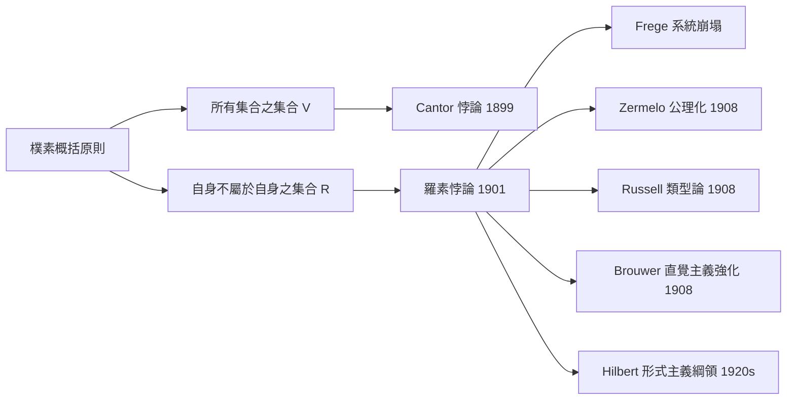

# 3.1 羅素悖論1901

## 本章導言

1901 年 6 月，30 歲的 Bertrand Russell 在檢視 Cantor 的對角線論證時，發現同一結構可以摧毀 Frege 的系統，也可以摧毀樸素集合論本身。他在自傳中描述了那個早晨：「我努力想找出這個矛盾中的錯誤，但每天都失敗……直到 1901 年春末，我不得不承認我的深淵。」這個悖論不是 Cantor 式悖論（如最大基數悖論）的邊緣怪例，而是**從集合論最核心的公理直接推導出的矛盾**。它使 1900 年 Hilbert 演講時的樂觀氣氛徹底粉碎，並直接催生了 ZFC、類型論、直覺主義與形式主義——本書其後七章的主題。

### 悖論的誕生：從 Cantor 到 Frege 的一步

Russell 的推理路徑：他 1900 年在巴黎數學家大會聽 Peano 講座後轉向數理邏輯，讀 Frege 時問自己：Cantor 定理（ $|S| < |\mathcal{P}(S)|$ ）取 $S$ 為「所有事物的集合」 $V$ 會如何？ $V$ 應是最大的集合，但其冪集 $\mathcal{P}(V)$ 應更大——矛盾（Cantor 悖論，1899 由 Burali-Forti 類似版本預示）。Russell 追蹤此矛盾到最簡形式：

> **樸素概括原則**：任意性質 $\phi(x)$ 定義集合 $A = \{x : \phi(x)\}$ 。

取 $\phi(x) = (x \notin x)$ ，得集合

$$
R = \{x : x \notin x\}.
$$

問： $R \in R$ ？

- 若 $R \in R$ ，由 $R$ 的定義， $R \notin R$ 。矛盾。
- 若 $R \notin R$ ，由 $R$ 的定義， $R \in R$ 。矛盾。

故 $R \in R \iff R \notin R$ ——**純邏輯矛盾**，不含任何分析、幾何或超窮數的成分。Russell 在 1902 年 6 月 16 日的信中告訴 Frege，並精準指出這打擊 Frege 的基本律 (V)。Frege 的回覆堪稱科學史上的風度典範，但他的系統再也沒有恢復。

### 悖論的殺傷範圍：不止一個系統

羅素悖論的可怕之處在於它**同時**命中多個當時的基礎方案：

| 系統 | 被擊中的公理或原則 | 症狀 |
|------|------|------|
| Frege 邏輯主義 | 基本律 (V)（無約束外延） | 全系統崩塌 |
| 樸素集合論 | 無約束概括 $\{x : \phi(x)\}$ | 矛盾 |
| Frege「所有概念的邏輯」 | 概念可作用於任何對象（無型別） | 矛盾 |
| 樸素語義「所有性質的謂詞」 | 無約束謂詞抽象 | 矛盾 |

而**數學的日常部分**（算術、分析、幾何的具體定理）未受直接影響——矛盾都藏在「太大」的集合或概念中。這種「日常安全、基礎崩塌」的格局，使整個數學界陷入奇特狀態：**一方面繼續做數學，一方面不確定自己在做什麼**。Hilbert 1908 年寫道：「必須承認，在這些悖論面前，目前數學的狀況是**不可忍受的**。」

### 謊言者悖論的親戚關係

羅素悖論有一個古老的親戚：**Epimenides（克里特人說「所有克里特人都是騙子」）**，精煉形式為「這句話是假的」。兩者的共同結構是**自我指涉**（self-reference）。Russell 深刻地意識到這一點，並提出**惡性循環原則**（vicious circle principle）：

> 「凡涉及全部的集合者，不可為該集合之一員。」

但他隨即發現，此原則若嚴格執行，會禁止**實數定義為實數集的下確界**這類標準數學操作（Poincaré 曾以此為樂）。這是 Russell 的類型論（1908）採用**分層**而非全面禁止自我指涉的原因：把對象分成層次 $0, 1, 2, \dots$ ，每個性質只談論「更低一層」的對象，自我指涉在型別系統中**語法上不可能**。

### 一個具體例子

**例題 3.1.1（理髮師悖論與其失效）**：Russell 自己給出通俗版本：「村中理髮師宣布：他為且僅為**所有不自己刮鬍的村民**刮鬍。問他是否給自己刮鬍？」——分析此悖論，並說明它**為何不是**羅素悖論的嚴格等價物。

**解**：設理髮師 $B$ ，村民 $x$ 刮鬍關係 $S(B, x)$ 。 $B$ 的宣言：

$$
\forall x\,(S(B,x) \leftrightarrow (x \ne B \wedge \neg S(x,x)))\ \wedge\ \neg S(B,B).
$$

問 $S(B, B)$ ？若 $S(B,B)$ 則（由宣言） $B \ne B \wedge \neg S(B,B)$ ，矛盾；若 $\neg S(B,B)$ 則由宣言（取 $x = B$ ，此時「 $B$ 是不自己刮鬍的村民」成立）得 $S(B,B)$ ，矛盾。

**但**：理髮師悖論的「解」是平凡的——**這樣的理髮師不存在**（宣言自相矛盾，如同 $\phi \wedge \neg\phi$ ）。羅素悖論之所以深刻，是因為它涉及的不是某人的**宣言**，而是**存在性的集合**：樸素概括原則**保證** $R$ 存在，而 $R$ 的存在導致矛盾。所以修補方式不能是「否認 $R$ 存在」這麼簡單——必須**修改概括原則本身**，使 $R$ 連被定義都不可能。理髮師是修辭， $R$ 是**基礎公理的故障報告**。

**例題 3.1.2（分層如何滅火）**：在簡單類型論中，對象分層 $\text{type}_0$ （個體）、 $\text{type}_1$ （個體的集合）、 $\text{type}_2$ （type 1 對象的集合），以此類推。「 $x \in y$ 」僅在 $\operatorname{type}(y) = \operatorname{type}(x) + 1$ 時語法合法。證明 $R = \{x : x \notin x\}$ **不可寫出**。

**解**： $x \in x$ 要求 $\operatorname{type}(x) = \operatorname{type}(x) + 1$ ，語法即非法。因此「 $x \notin x$ 」不是合式公式，概括原則無法作用於它， $R$ 不存在——悖論被語法排除，而非被定理否定。**分層的方法論：不是「證明悖論假」，而是「使悖論的表達成為不可能」**。此思想將在 9.3 節的類型論、10.2 節的同倫類型論中反覆升級。

### ZERMELO 的搶先與隱匿

一個有趣的歷史轉折：Zermelo 在 1904 年用選擇公理證明良序原理時，已被 E. Schmidt 提醒注意類似悖論，他在 1908 年的公理化論文中獨立給出（與 Russell 同年）自己的公理系統以避開悖論——但他**從未正式引用 Russell**，只在註腳中說「Russell 的悖論與我無關，我的理論建立在不同的基礎上」。優先權與路線之爭的微妙，與 Cantor–Tartaglia 的舊劇本如出一轍。

### 歷史啟示

- **對角線結構是邏輯系統的普遍脆弱點**：Cantor 用它證定理，Russell 用它造矛盾，Gödel 用它證不完備——**同一招式，建設或破壞，取決於取反的對象**。
- **矛盾的「位置」決定反應**：若矛盾出現在分析邊緣，可局部修補；出現在概括原則，則必須重造地基。羅素悖論正中要害。
- **基礎的修補方式有多種，且彼此不相容**：分層（類型論）、限制（ZFC）、重造（直覺主義）、後設（形式主義）——1908 年的四個方案，成為本書第 3 到 10 章的地圖。

## 與其他章節及領域的關聯

- **1.3 節**：Frege 的 (V) 是被擊中的原點。
- **2.1 節**：Cantor 對角線法是羅素悖論的技術祖先。
- **4.1 節**：Zermelo 分離公理是對概括原則的「切小」修補。
- **9.3、10.2 節**：類型論從 Russell 1908 一路演化到 Martin-Löf 1972 與 HoTT。
- **6.1 節**：Gödel 的不可判定命題 $G$ （「 $G$ 不可證」）是羅素悖論的「去矛盾化」：把 $R \in R \iff R \notin R$ 換成 $G \leftrightarrow \neg\operatorname{Prov}(G)$ ，矛盾變成不可判定。
- **7.3 節**：停機問題的程序版本： $\text{halt}(p)$ 檢驗「 $p$ 對 $p$ 停機嗎」——**自我指涉從集合遷移到程式**。
- **計算機科學**：Quine（自我列印程式）、病毒的自我複製、資料庫的自反查詢限制——羅素悖論的工程後裔無處不在。

## 練習

1. 寫出 Burali-Forti 悖論（所有序數之集 $O$ ； $\Omega$ 為其序型，則 $\Omega \in O$ 且 $\Omega > O$ 中一切序數，矛盾），並比較其與羅素悖論的技術差異。
2. 在簡單類型論中，證明「所有 type-1 集合的集合」 $V_1 = \{y : \operatorname{type}(y) = 1\}$ 是 type-2 對象，且 $V_1 \notin V_1$ 不產生矛盾。
3. 分析 Quine 程式（可列印自身原始碼的程式）為何不構成邏輯矛盾，而羅素悖論構成。
4. 用理髮師悖論的正式化（例題 3.1.1），證明「滿足宣言的理髮師不存在」是一階邏輯的定理。
5. 思考題：羅素悖論是否「證明了」數學基礎必須分層？或只是證明了**這一種**概括原則不行？舉出一個非分層的修補方案。

## 進階研讀：三個深化場景

**場景一：Russell 的《數學原理》與其困境**。Russell 與 Whitehead 的 Principia Mathematica（1910–1913）以類型論重建數學，三巨冊、千餘頁才證出 $1+1=2$ （附註「此命題由 *54.43 得」）。類型論的冗長使其在數學家中不受歡迎，ZFC 佔了上風——但類型論的邏輯結構在計算機時代復活（9.3、10.2 節），**證明助手的內核幾乎全是類型論**。

**場景二：悖論的年代學與「誰先發現」**。Zermelo 1904 良序證明發表前，已於 1900–02 私下告知 Hilbert 圈子類似悖論；Russell 1901 發現並 1902 告知 Frege；Hilbert 1904 海德堡演講首次公開討論。今日標準歸功 Russell，因其**公開且系統化**——科學史的優先權屬於「發表者」而非「發現者」，此例是教科書。

**場景三：Tarski 的語言分層**。Tarski 1933 以羅素悖論的語義版（謊言者）證明：**自然語言無法定義自身的真謂詞**；形式語言的「真」須在**後設語言**中定義（5.1 節）。羅素悖論因此分岔為兩支：集合論的（ZFC 的起點）與語義的（Tarski 真值理論的起點）——**同一結構，兩個學科**。

### 名詞速查表

- **樸素概括原則**：任意性質定義集合，羅素悖論的靶心。
- **羅素集 $R$ **： $\{x : x \notin x\}$ ， $R \in R \iff R \notin R$ 。
- **惡性循環原則**：不可用全體定義屬於全體的成員。
- **簡單類型論**：對象分層， $x \in y$ 僅在相鄰層合法。
- **理髮師悖論**：羅素悖論的通俗版，但缺乏存在性保證。
- **Tarski 不可定義性**：形式語言不能定義自身的真謂詞。

### 年表速查

- 1897：Burali-Forti 最大序數悖論。
- 1899：Cantor 致 Dedekind 信，最大基數悖論。
- 1901：Russell 發現羅素悖論。
- 1902：Russell 致 Frege 信。
- 1904：Zermelo 良序定理。
- 1908：Zermelo 公理系統；Russell 類型論論文。
- 1910–13：Principia Mathematica。
- 1933：Tarski 真值不可定義性。

### 深化問答三則

**問：為什麼理髮師悖論「淺」而羅素悖論「深」？**
答：理髮師悖論矛盾來自**一個特定個體的矛盾宣言**，解法是否認其存在。羅素悖論矛盾來自**公理系統（概括原則）的存在性保證**，不能以否認對象了事。深度差異在於：前者是局部矛盾，後者是**公理的矛盾**——公理矛盾意味著系統本身不自洽，這是無法局部修補的。

**問：羅素悖論是否「反對」了 Frege 的整個邏輯主義？**
答：只反對了其中「外延無約束」的一步。Hume 原則（1.3 節）不涉及自我指涉，今日已被證明相對一致（新弗雷格主義）。**崩塌的是 Frege 的實現策略，不是他的哲學目標**——這是「綱領 vs 系統」的典型分野，也預示了 Hilbert 綱領的命運（6.3 節）。

**問：日常數學為何從未觸碰羅素悖論？**
答：因為日常數學的集合都「小」且「具體」（有限集、 $\mathbb{R}$ 、函數空間），且「 $x \in x$ 」在這些對象上從不出現。悖論只藏在「所有集合」「所有性質」這類**全稱總體**中。ZFC 的精確功能正是：**保住日常數學的所有集合，同時禁止產生悖論的全稱總體**——下一章的主題。

（本節完）
