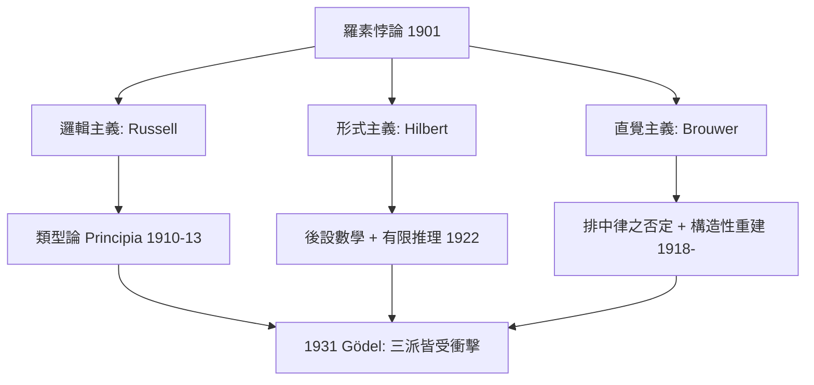

# 3.2 三個學派邏輯主義形式主義直覺主義

## 本章導言

羅素悖論之後，數學基礎不再是一個問題，而是**三個互相競爭的綱領**。到 1930 年代，格局成形：**邏輯主義**（Frege–Russell：數學可還原為邏輯）、**形式主義**（Hilbert：數學是形式系統的符號遊戲，其可靠性由後設數學證明）、**直覺主義**（Brouwer：數學是心智構造，邏輯從屬於構造）。三派在 1920–1930 年代的公開論戰（Hilbert vs Brouwer 為最烈）是數學史上最深刻的基礎辯論。本節把三派的動機、技術與命運並列，因為**所有當代基礎問題的術語，都是這場辯論的遺產**。

### 三派的起點與核心主張

**邏輯主義**：數學概念可由邏輯概念定義，數學真理是邏輯真理。Frege 打底、Russell 以類型論完成《數學原理》。技術特徵：**分層**（type theory）滅悖論；目標：把 Peano 算術、分析還原為純邏輯公理。

**形式主義**：數學是**符號操作的形式系統**；「真」不是系統外的本體，而是系統內的可推導性。一致性、完備性、獨立性是系統的性質，由**有限方法**（finitary methods：具體符號的有限組合操作）在後設層證明。Hilbert 1922 演講正式提出：**用有限方法證明無窮數學的一致性**——保住 Cantor 天堂的策略。

**直覺主義**：數學是**心智的自由構造活動**，語言與邏輯是構造的紀錄而非構造本身。命題「真」意味著**有構造證明**。推論：排中律 $P \vee \neg P$ 在無窮總體上不普遍有效（「有一個 $n$ 使 $P(n)$ 或沒有」——你必須實際找到或證明不存在，不能靠二值預設）。Brouwer 1908 論文〈論邏輯原理的不可靠〉正式發難。

### 技術分歧：排中律的命運

三派對同一條邏輯規則的態度，最能顯示分歧：

| 原則 | 邏輯主義 | 形式主義 | 直覺主義 |
|------|------|------|------|
| 排中律 $P \vee \neg P$ | 接受 | 接受（系統內） | **拒斥**（無窮域上） |
| 雙重否定消除 | 接受 | 接受 | 拒斥（ $\neg\neg P \not\Rightarrow P$ ） |
| 選擇公理 | 分歧 | 接受 | 拒斥（非構造） |
| 實無窮 | 接受 | 接受 | 拒斥（只有潛無窮） |
| 非構造存在證明 | 有效 | 有效 | **無效** |

直覺主義的經典例：**「存在無理數 $a, b$ 使 $a^b$ 是有理數」**。經典證明：考慮 $\sqrt2^{\sqrt2}$ 。若它有理，取 $a=b=\sqrt2$ ；若它無理，取 $a = \sqrt2^{\sqrt2}, b = \sqrt2$ ，則 $a^b = \sqrt2^2 = 2$ 。**此證明用了排中律，且完全沒告訴你 $a, b$ 是誰**。Brouwer 說：這不算證明了存在。構造性證明： $a = \sqrt2, b = \log_2 9$ ，則 $a^b = 3$ （因 $2^{\log_2 9} = 9$ ， $\sqrt2^{\log_2 9} = 3$ ）。——**構造性版本是更強的定理**，這是直覺主義的技術吸引力：它區分了「存在」的強弱。

### HILBERT vs BROUWER：一場毀滅性的私人戰爭

1920 年代，Hilbert（Göttingen）與 Brouwer（Amsterdam）的論戰升級到個人層面。Brouwer 在 Mathematische Annalen 的編輯職務上推遲 Hilbert 學派稿件；Hilbert 1928 年強行將 Brouwer 逐出編委會（Brouwer 從此淡出數學前沿，1942 年辭去阿姆斯特丹職位）。論戰的技術核心：

- **Hilbert**：直覺主義若成立，須放棄半個分析學（如 Bolzano–Weierstrass），「這是對科學的閹割」。
- **Brouwer**：形式主義「在技術上正確、在哲學上空洞」，形式系統只是**無生氣的遺骸**，真正的數學在構造直覺中。

諷刺的是，論戰的**副產品**是二十世紀最有成果的三個數學領域：證明論（Hilbert 綱領）、直覺主義邏輯與拓撲學（Brouwer 的不動點定理、維數理論）、以及遞迴論（為「有限方法」精確化而生）。**爭論本身是生產性的，即使沒有一方獲勝。**

### 一個具體例子

**例題 3.2.1**：考慮命題「存在無理數 $a, b$ 使 $a^b \in \mathbb{Q}$ 」。分別給出經典證明與構造性證明，並解釋直覺主義者對二者的不同態度；再證明在直覺主義邏輯中，命題 $\neg\neg(P \vee \neg P)$ 一般不可推出 $P \vee \neg P$ 。

**解**：**經典證明**： $\sqrt2^{\sqrt2}$ 要麼有理要麼無理（排中律）。有理則 $a = b = \sqrt2$ ；無理則 $a = \sqrt2^{\sqrt2}, b = \sqrt2$ ， $a^b = \sqrt2^{2} = 2 \in \mathbb{Q}$ 。證畢，但**未給出具體的 $a, b$ **。

**構造性證明**：取 $a = \sqrt2$ 、 $b = 2\log_2 3$ 。則 $a^b = 2^{\log_2 3} = 3 \in \mathbb{Q}$ ，且 $\sqrt2$ 無理（經典可證；直覺主義下也有構造性證明）、 $2\log_2 3$ 無理（因為若 $2\log_2 3 = p/q$ ，則 $2^p = 3^{2q}$ ，偶冪等於奇冪，矛盾——這個論證是構造性的）。給出了具體的 $a, b$ 。

直覺主義的態度：經典證明**不構成**「存在」的證明，因為它以 $\neg(\forall a,b: a^b \notin \mathbb{Q})$ 的雙重否定形式存在，需雙重否定消除才能變成存在式。構造性證明則完全合格。

**雙重否定的不可消除**：取命題 $P$ = 「存在無理數 $a,b$ 使 $a^b$ 有理」。我們證明了 $\neg\neg P$ （經典證明即為 $\neg\neg P$ 的證明：假設不存在，則 $\sqrt2^{\sqrt2}$ 的兩種情形都矛盾）。但 $P$ 的構造性證明需要具體的 $a,b$ ——經典論證不提供。在 Kripke 語義或拓撲語義（9.1 節）下可構造模型使 $\neg\neg P$ 為真而 $P$ 為假，故 $\neg\neg P \to P$ **不是直覺主義定理**。 $\blacksquare$

### 三派的命運：Gödel 的一擊三傷

1931 年 Gödel 不完備定理（6.1 節）同時打擊三派：

- **邏輯主義**：若全部數學可還原為一個形式系統，該系統必不完備——「還原為單一邏輯系統」的夢想受限。
- **形式主義**：Hilbert 綱領的原版（以有限方法證明算術一致性）被證明**不可能**（Gödel 第二定理：系統不能證自身一致）。
- **直覺主義**：Gödel–Gentzen 1933 翻譯顯示經典算術與直覺主義算術**在翻譯下等價**——直覺主義沒有更「安全」的一致性。

但三派都**部分倖存**：邏輯主義轉為新弗雷格主義（1.3 節）；形式主義蛻變為證明論與逆數學（6.3 節）；直覺主義演化為建構數學與類型論（第 9 章）。**基礎的辯論沒有輸家，只有轉型。**

### 歷史啟示

- **基礎爭論的實質是「證明的價值」之爭**：非構造存在證明「有效但空」還是「有效且有力」？此問題在今日以「證明即程式」（9.2 節）的形式重生。
- **技術分歧可以精確化**：排中律、雙重否定、選擇公理——三派的分歧不是玄學，而是一張精確的邏輯原則清單，各自可獨立接受或拒絕。
- **論戰的勝利者是邏輯學本身**：為了辯論，各方被迫發明精確工具（形式系統、直覺邏輯、遞迴函數）——這些工具的價值超越了任何一派的勝負。

## 與其他章節及領域的關聯

- **1.3 節**：邏輯主義的起點 Frege。
- **3.1 節**：三派共同的觸發事件羅素悖論。
- **3.3、6.3 節**：Hilbert 綱領的細節與命運。
- **4.1 節**：ZFC 是形式主義的「對象層」標準載體。
- **6.1–6.3 節**：不完備定理對三派的衝擊。
- **7.1–7.2 節**：「有限方法」的精確化即 Turing 機與遞迴函數。
- **9.1–9.3 節**：直覺主義的完整發展與其計算實現。
- **計算機科學**：直覺主義邏輯是類型程式語言（Haskell、Agda）的邏輯；形式主義的「符號操作」觀點是編譯器與證明檢查器的哲學。

## 練習

1. 用 Kripke 模型（三個世界 $w_0 \le w_1$ ， $P$ 在 $w_1$ 為真）驗證 $\neg\neg P \to P$ 不有效。
2. 給出「存在無理數 $a, b$ 使 $a^b$ 有理」的第二個構造性例子（提示： $a = e, b = \ln 4$ ）。
3. 證明在直覺主義邏輯中 $\neg P \vee P$ 與 $\neg\neg P \to P$ 等價（皆為排中律的等價形式）。
4. 對照表：ZFC、Principia 類型論、Heyting 算術三者對排中律的立場，並說明各自如何避開羅素悖論。
5. 思考題：若「證明即程式」（9.2 節）為真，非構造證明相當於「無程式的說明」——這是否意味着經典數學的部分內容「不可計算實現」？舉例。

## 進階研讀：三個深化場景

**場景一：Hilbert–Brouwer 決裂的文獻**。1928 年 Hilbert 以主編身份將 Brouwer 逐出 Mathematische Annalen 編委會，Einstein 同時辭職抗議（「這不過是青蛙與老鼠的戰爭，我不願參與」）。愛因斯坦的厭倦 vs 兩位主角的執著，是基礎辯論的社會學切片：**基礎爭論總是高於也低於純數學**。

**場景二：Gödel–Gentzen 雙重否定翻譯**。1933 年兩人獨立發現：經典算術的每個定理 $A$ 可翻譯為 $A^N$ （把 $\vee, \exists$ 定義為 $\neg\neg$ 的組合），且 $A^N$ 在直覺主義算術中可證當且僅當 $A$ 在經典算術中可證。**經典數學「沒有比直覺主義更強」，只是不同**——直覺主義的「安全」優勢消失，但計算內容優勢保留（9.2 節）。

**場景三：三派與計算機的三次相遇**。邏輯主義的類型論 → 編譯器類型系統；形式主義的形式系統 → 證明檢查器（Coq、Lean）與自動推理；直覺主義的構造 → 函數式程式與構造性算法。**1900 年代的基礎辯論，在 1970 年代後全部變成了軟體工程**——這是本書第 9、10 章的主軸。

### 名詞速查表

- **邏輯主義**：數學可還原為邏輯（Frege–Russell）。
- **形式主義**：數學為形式系統，可靠性由後設數學證明（Hilbert）。
- **直覺主義**：數學為心智構造，證明即構造（Brouwer）。
- **排中律**： $P \vee \neg P$ ，三派分歧的試金石。
- **有限方法（finitary）**：Hilbert 後設數學允許的推理：具體符號的有限操作。
- **雙重否定翻譯**：經典與直覺主義算術的等價翻譯（Gödel–Gentzen）。
- **Kripke 語義**：直覺主義邏輯的可能世界語義。

### 年表速查

- 1908：Brouwer〈論邏輯原理的不可靠〉；Zermelo 公理；Russell 類型論。
- 1910–13：Principia Mathematica。
- 1918：Brouwer《集合論的構造》；Weyl《連續統》。
- 1922：Hilbert 綱領首次完整表述。
- 1928：Brouwer 被逐出 Annalen。
- 1930：Hilbert–Ackermann《理論邏輯基礎》；Gödel 完備性定理。
- 1931：Gödel 不完備定理。
- 1933：Gödel–Gentzen 雙重否定翻譯。

### 深化問答三則

**問：為什麼排中律成為戰場的中心？**
答：因為它是「真值二值性」的最小斷面：接受它等於承認每個命題**在事實上**已有真值（即使無人知道）；拒斥它等於把「真」綁定到「可證」。所有其他分歧（選擇公理、實無窮、非構造存在）都是這個基本分歧的放大。**排中律是基礎分歧的「最小公倍分歧」**。

**問：形式主義說數學是「符號遊戲」，這不是把數學貶低了嗎？**
答：Hilbert 本人否認：「形式主義不否認數學的內容，只是說**內容的可靠性由形式的可檢驗性保證**。」他的类比：物理學家用量尺檢驗理論，數學家用有限符號檢查證明。「遊戲」是工程隱喻而非貶義——今日的證明助手（Lean）正是這個隱喻的實現。

**問：三派有「對」的嗎？**
答：技術上，各有其適用域：ZFC 為日常數學服務、直覺主義為計算內容服務、形式主義為後設研究服務。哲學上，問題仍開放：**數學的必然性來自形式、構造還是邏輯**？10.3 節將論證：這個問題的價值不在答案，而在它持續迫使數學反思自身。

（本節完）
