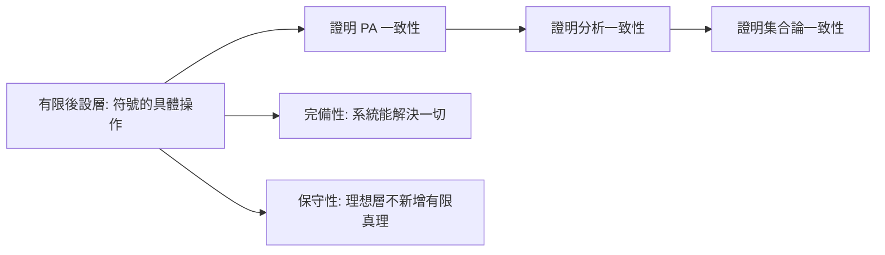

# 3.3 HILBERT的綱領與公理化狂熱

## 本章導言

David Hilbert（1862–1943）是二十世紀前三分之一數學的絕對中心：他不只做數學，還**規劃**數學。1899 年《幾何基礎》確立公理方法的現代形式；1900 年巴黎演講提出 23 個問題規劃了整個世紀；1920 年代的**Hilbert 綱領**試圖以有限方法一勞永逸地證明數學的一致性。這是公理化方法的最高野心，也是它在 1931 年遭遇的最大失敗。本節講清綱領的內容、其公理化狂熱的社會背景，以及它為何「失敗卻孕育了整個邏輯學」。

### 巴黎演講（1900）：數學的議程設定

Hilbert 1900 年 8 月 8 日在巴黎國際數學家大會的演講提出 23 個問題。前三個直指基礎：

1. **連續統假設**（2.2 節）。
2. **算術公理的一致性**：「研究算術公理的一致性……公理應該相互獨立……這是數學最基本、最值得追求的目標之一。」
3. 兩個等底等高的四面體體積相等（Dehn 1900 解決，答案：否）。

第 2 問題是 Hilbert 綱領的種子。注意其措辭：不是「證明數學為真」，而是「**證明公理的一致性**」——把本體論問題轉為**相對一致性**與**絕對一致性**問題。Hilbert 對第 2 問題的早期方案是分析的（實數理論的一致性），要到 1920 年代才蛻變為純形式系統的方案。

### 公理化狂熱：方法的擴張

1899 到 1920 年代，公理化方法從幾何擴張到全數學，形成學術風潮：

| 領域 | 公理化者 | 年代 |
|------|------|------|
| 幾何 | Hilbert | 1899 |
| 自然數 | Dedekind / Peano | 1888 / 1889 |
| 實數 | Hilbert | 1900 |
| 集合論 | Zermelo | 1908 |
| 群論 | Huntington / Moore | 1902 |
| 邏輯 | Frege / Russell / Hilbert–Ackermann | 1879–1928 |
| 機率 | Kolmogorov | 1933 |

公理化的方法論承諾（Hilbert 1917 Zürich 演講〈公理化思想〉）有三：(1) **列舉**——窮盡系統的全部公理；(2) **獨立性**——每條公理不可由其餘推出（用模型法，1.1 節）；(3) **一致性**——系統不產生矛盾。加上後來的**完備性**（系統能證明或反駁每個可表述命題），這就是**後設數學**的研究議程：**以數學方法研究數學系統本身**。

### HILBERT 綱領：兩層架構

綱領（1922 漢堡演講正式成形）的架構分兩層：

- **對象層**：全部數學的形式系統 $T$ （一階算術 PA、分析、集合論），允許理想元素（實無窮、超窮集合、排中律）。
- **後設層**：以**有限方法**（finitary：具體符號的有限組合、可預見的操作、初等歸納）在後設層證明：(1) $T$ 的一致性；(2) $T$ 的完備性；(3) 理想命題的**保守性**（加入實無窮不會證出新的有限命題）。

關鍵洞察是 Hilbert 的**理想元素論證**：數學引入理想元素（負數、虛數、點在無窮遠、實無窮）的歷史一再證明，只要理想層**不產生矛盾**，它就是合法的強化工具——「在理想科學中，我們得到解放的果實；在有限科學中，我們保有確定性的錨。」綱領的技術路線圖：

### 有限方法的模糊與 GENTZEN 的回聲

綱領的最大技術難點：「有限方法」從未精確定義。Hilbert 與 Bernays 的《數學基礎》（1934, 1939）使用的工具包括初等歸納與具體組合——大致相當於 **PRA（初等遞迴算術）**。這個模糊性正是 Gödel 1931 結果的突破口（6.1 節）：**無論把「有限」畫在哪裡，只要它夠強以表達自身一致性，就夠強以不可證明它**。

部分復活：Gentzen 1936 以**超越有限但很弱**的歸納（直到 $\varepsilon_0$ 的超窮歸納）證明 PA 一致——一致性證明需要**比系統本身更強的原則**，這成為證明論的核心模式（逆數學，6.3 節）。**綱領死了，綱領的技術全活了。**

### 一個具體例子

**例題 3.3.1**：以 Hilbert 風格證明一個微型形式系統的一致性：系統 $K$ 的語言僅含命題變元與 $\neg, \to$ ，公理為

$$
K1:\ A \to (B \to A), \qquad K2:\ (A \to (B \to C)) \to ((A \to B) \to (A \to C)),
$$

推理規則為 modus ponens。證明 $K$ 一致（即不存在 $A$ 使 $K \vdash A$ 且 $K \vdash \neg A$ ）。

**解**：這是後設數學方法的微型示範。定義**後設層性質**：稱公式 $A$ 為「**正公式**」，若其出現的否定號 $\neg$ 全部套在變元上（如 $\neg p \to q$ 是正的， $\neg\neg p$ 不是）。歸納證明：

**引理**： $K$ 的每條定理都是正公式。

- 公理 $K1, K2$ 皆正（它們不含 $\neg$ 或只含變元上的 $\neg$ ）。
- Modus ponens 保持正性：由 $A \to B$ 與 $A$ 得 $B$ ，兩前提皆正則結論 $B$ 正（因 $A \to B$ 的正性要求 $B$ 正）。

現在： $\neg A$ 形如 $\neg(A)$ 。若 $K \vdash A$ 且 $K \vdash \neg A$ ，則 $A$ 與 $\neg A$ 皆正。 $A$ 正且 $\neg A$ 正意味 $A$ 的最外層是 $\neg$ 且其中所有 $\neg$ 都在變元上，即 $A = \neg p$ （ $p$ 為變元）。此時 $K \vdash \neg p$ 且 $K \vdash p$ 。對**公式長度**做歸納可證： $p$ 不是 $K$ 的定理（取賦值 $v(p) =$ 真，則兩條公理在 $\{\top, \bot\}$ 賦值下皆為重言式、MP 保持真值，故一切定理為重言式，而 $p$ 非重言式）；同理由 $v(p) =$ 假得 $\neg p$ 非定理。故 $K$ 中不存在 $A$ 與 $\neg A$ 同時可證， $K$ 一致。 $\blacksquare$

**此例的方法論要點**：一致性證明完全在**後設層**進行（談論公式的形狀、對長度歸納、構造賦值），不使用系統內的無窮概念。Hilbert 綱領就是想把此模式放大到 PA 與分析——Gödel 證明此放大有不可逾越的上限。

### HILBERT 的口號與其時代

Hilbert 的口號是數學基礎史上最著名的戰鬥宣言（1926〈論無窮〉）：

> 「**無人能把我們從 Cantor 為我們創造的天堂中驅逐出去。**」

以及 1930 年 Königsberg 演講的結尾——「**Wir müssen wissen, wir werden wissen**（我們必須知道，我們將會知道）」——講稿刻於其墓碑。諷刺的是，演講前一天，Gödel 在同城的會議上首次宣布了不完備定理。**口號與反證同城相遇**——歷史的戲劇性無出其右。

### 歷史啟示

- **綱領的正確部分比錯誤部分更有影響**：「以數學方法研究數學」成為證明論、模型論、遞迴論的總綱。
- **理想元素論證是數學哲學的重要資產**：它為「為何可以使用虛數、實無窮、選擇公理」提供了**一致性條件下的合法性**論證——這是 Frege、Brouwer 之外第三種護數學的方式。
- **精確化自己的綱領，等於暴露其上限**：Hilbert 對「有限方法」的每一寸精確化，都讓 Gödel 的對角線更接近目標。**自我嚴格化是雙刃劍**。

## 與其他章節及領域的關聯

- **3.1、3.2 節**：綱領的動機是悖論與學派之爭。
- **4.1 節**：ZFC 是「對象層」的標準形式系統。
- **5.2 節**：Gödel 完備性定理（1930）是綱領的**勝利**時刻——完備性對一階邏輯成立。
- **6.1–6.3 節**：不完備性是綱領的失敗與轉型。
- **7.1–7.2 節**：「有限方法」的精確化即 Turing 機——**綱領的模糊概念逼出了可計算性理論**。
- **計算機科學**：形式驗證（Lean、Coq）是 Hilbert 式「符號操作保證可靠性」的當代實現；「一致性證明需要更強系統」的教訓直接影響形式化驗證的基礎選擇。
- **物理學**：Hilbert 的公理化也波及物理（Hilbert 第六問題：物理的公理化），量子力學的 Hilbert 空間表述（von Neumann 1932）是副產品。

## 練習

1. 在例題 3.3.1 的系統 $K$ 中證明演繹定理： $K \cup \{A\} \vdash B \Rightarrow K \vdash A \to B$ 。
2. 以賦值法（真值表）證明 $K$ 不證 $p$ ，並說明這是**相對**一致性還是**絕對**一致性證明。
3. 解釋 Hilbert 的「保守性」要求：為什麼「理想層不證出新的有限命題」對綱領至關重要？
4. 比較 Hilbert 對幾何（1899，用實數模型證一致性）與對算術（1920s，要求後設層證明）的一致性策略，指出兩者不能互換的原因。
5. 思考題：Hilbert 口號「我們必須知道，我們將會知道」在不完備定理後如何重寫才不為假？嘗試給出你的版本。

## 進階研讀：三個深化場景

**場景一：Hilbert 與 Brouwer 的最後較量**。1930 年 Hilbert 退休演講（Königsberg）仍宣稱綱領可成；Gödel 的發言被 Hilbert 派淡化了。Bernays 1934–39 的《數學基礎》第二卷誠實處理了不完備定理的後果——**學派內部的誠實修正，比外部攻擊更深刻地改變了綱領**。

**場景二：Hilbert 的 24 個問題**。1990 年代在 Hilbert 手稿中發現第 24 問題的草稿：「建立證明論，使證明可以比較簡短與簡單。」這是最早的**證明複雜性**（proof complexity）問題——綱領的遺產仍在生長。

**場景三：Hilbert 空間的意外收穫**。Hilbert 研究積分方程時定義的 $\ell^2$ 空間，經 von Neumann 1932 公理化為量子力學的語言。**公理化狂熱的單一成果（量子力學的數學架構）的影響力已超越整個基礎辯論**——基礎研究的外溢效應難以預測。

### 名詞速查表

- **Hilbert 綱領**：以有限方法證明形式數學的一致性、完備性、保守性。
- **後設數學**：以數學方法研究數學系統的學科。
- **有限方法（finitary）**：具體符號的有限操作，大致相當於 PRA。
- **理想元素**：超窮集合、實無窮等擴充工具。
- **保守性**：擴充系統不證出原系統的新定理（關於有限命題）。
- **PRA**：初等遞迴算術，有限方法的候選形式化。
- **逆數學（reverse mathematics）**：確定定理需要何種公理的證明論分支（6.3 節）。

### 年表速查

- 1899：Hilbert《幾何基礎》。
- 1900：巴黎演講，第 2 問題。
- 1917：Zürich〈公理化思想〉。
- 1922：漢堡演講，綱領成形。
- 1926：〈論無窮〉，「Cantor 天堂」。
- 1928：Hilbert–Ackermann《理論邏輯基礎》。
- 1930：Königsberg 演講；Gödel 完備性與不完備性的宣布。
- 1934/39：Bernays《數學基礎》兩卷。
- 1936：Gentzen 的 PA 一致性證明。

### 深化問答三則

**問：Hilbert 綱領「失敗」的精確含義是什麼？**
答：原版（以**有限**方法證明包含無窮的系統的一致性）不可能——Gödel 第二定理的推論。但若放寬「有限」為「可反思接受的原則」（如 Gentzen 的 $\varepsilon_0$ 歸納、或大基數公理），一致性證明部分可行。**綱領的死訊與復活取決於「可接受推理」的邊界畫在哪**——這是至今活躍的問題。

**問：公理化狂熱的「狂熱」是否是貶義？**
答：帶有一點。Weyl 1918 評 Hilbert 思想為「把一切化為公理的急性病」，但其正面意義是：公理化迫使概念**精確到可以獨立研究**。Hilbert 自己的平衡話語：公理化不等於僵化，而是**為直覺建立檢查站**。

**問：為何一階邏輯的完備性（5.2 節）沒有救活綱領？**
答：完備性定理說：一階語義的邏輯真理都可形式證明。但綱領要求的是**算術真理**（含 $\mathbb{N}$ 的標準模型）的完備性——而 Gödel 不完備定理恰好說明：**含算術的理論在一階層次上不可能完備**。完備性（1930）與不完備性（1931）由同一人一年內證明，分別是綱領的最後勝利與終結判決。

（本節完）
