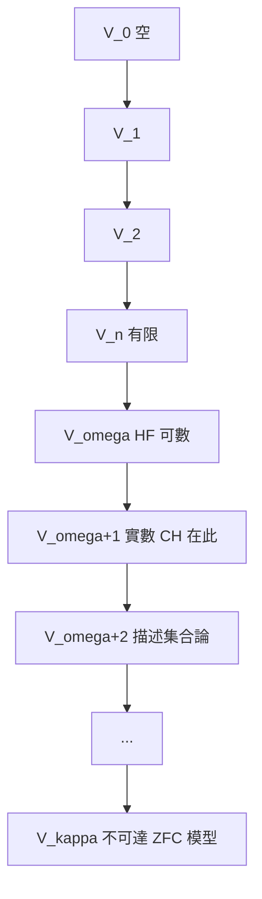

# 4.3 序數與基數的累積層級

## 本章導言

ZFC 完成後，集合宇宙的**內部結構**需要一張地圖。von Neumann 疊代概念與 Zermelo 1930 的分層宇宙給出了標準答案：**累積層級**（cumulative hierarchy）

$$
V_0 = \varnothing,\quad V_{\alpha+1} = \mathcal{P}(V_\alpha),\quad V_\lambda = \bigcup_{\alpha < \lambda} V_\alpha,\quad V = \bigcup_{\alpha \in \mathrm{Ord}} V_\alpha.
$$

每個集合都在某個層 $V_\alpha$ 上出現；宇宙 $V$ 是沿序數「逐層堆疊」的塔。這張圖像是 ZFC 的隱含宇宙觀，也是獨立性研究（第 8 章）的幾何語言。本節講序數—基數的完整理論、 $V$ 的塔結構，與「集合論宇宙看起來像什麼」的當代爭論之入口。

### 序數算術：三種運算，三種直覺

序數有加、乘、冪三種運算，全部由超窮遞迴定義：

- **加法**： $\alpha + 0 = \alpha$ ； $\alpha + (\beta + 1) = (\alpha + \beta) + 1$ ； $\alpha + \lambda = \sup_{\beta < \lambda}(\alpha + \beta)$ 。
- **乘法**： $\alpha \cdot 0 = 0$ ； $\alpha(\beta+1) = \alpha\beta + \alpha$ ； $\alpha \lambda = \sup_{\beta<\lambda} \alpha\beta$ 。
- **冪**： $\alpha^0 = 1$ ； $\alpha^{\beta+1} = \alpha^\beta \cdot \alpha$ ； $\alpha^\lambda = \sup_{\beta<\lambda}\alpha^\beta$ 。

關鍵現象——**非交換性與吸收**：

$$
1 + \omega = \omega \ne \omega + 1, \qquad 2 \cdot \omega = \omega, \qquad \omega \cdot 2 > \omega.
$$

（ $1 + \omega$ ：在 $\omega$ 的開頭加一點，仍是 $\omega$ ； $\omega + 1$ ：在尾端加一點，序型變大。左端加法被「無窮長隊」吸收。）序數算術是**排隊算術**，基數算術是**數量算術**（2.2 節）：同一對象的兩種度量，前者敏感、後者遲鈍。

### 基數的序數實現

每個序數 $\alpha$ 有基數 $|\alpha|$ ；每個基數選一個代表序數（**初始序數**：不大於任何同基數序數者），記 $\omega_\alpha$ （基數 $\aleph_\alpha$ ）。由 AC，每個集合可良序化，故**每個集合的基數是某個 $\aleph_\alpha$ **——無窮基數排成良序序列

$$
\aleph_0 < \aleph_1 < \aleph_2 < \cdots < \aleph_\omega < \aleph_{\omega+1} < \cdots
$$

（下標也是序數！）Cantor 定理保證 $2^{\aleph_\alpha} > \aleph_\alpha$ ，故冪運算在 $\aleph$ 序列之「上」再開一層。**連續統假設（CH）問： $2^{\aleph_0}$ 在 $\aleph$ 序列的哪一格？**——2.2 節的問題在層級語言下獲得精確位置。

### 累積層級 $V$ ：宇宙的地形

von Neumann–Zermelo 層級的構造：

| 層 | 內容 | 基數 |
|------|------|------|
| $V_0 = \varnothing$ | 空 | $0$ |
| $V_1 = \{\varnothing\}$ | 零 | $1$ |
| $V_2$ | 0, 1 | $2$ |
| $V_n$ | 有限集合 | 有限 |
| $V_\omega$ | 所有有限遺傳集合（HF） | $\aleph_0$ |
| $V_{\omega+1}$ | $\mathcal{P}(V_\omega)$ ：實數在此！ | $2^{\aleph_0}$ |
| $V_{\omega+2}$ | $\mathbb{R}$ 的子集（描述集合論的舞台） | $2^{2^{\aleph_0}}$ |
| $V_{\omega_1}$ | 所有可數層的併 | 大 |
| $V_\kappa$ （ $\kappa$ 不可達） | ZFC 的模型 | 極大 |

**要點**：實數住在 $V_{\omega+1}$ ——分析的整個世界在塔的極低處。更高的層（不可達基數以上的 $V_\kappa$ ）是集合論自己的鏡子。**基礎（正則）公理 + 替換公理**共同保證： $V$ 窮盡一切集合，即 ZFC 的每個模型「相信」宇宙就是這座塔。

### 一個具體例子

**例題 4.3.1**：證明每個集合 $x$ 屬於某個 $V_\alpha$ （即 $V = \bigcup_\alpha V_\alpha$ 真的窮盡宇宙），並確定 $x = \{\{\varnothing\}\}$ 所在的最小層。

**解**：對集合 $x$ 的**傳遞閉包** $\operatorname{trcl}(x)$ （最小的包含 $x$ 且傳遞的集合，由替換與併集構造）做**良基歸納**：定義秩函數

$$
\operatorname{rank}(x) = \sup\{\operatorname{rank}(y) + 1 : y \in x\}.
$$

由基礎公理， $\in$ 是良基的，歸納合法。斷言： $\operatorname{rank}(x) \subseteq V_{\operatorname{rank}(x)}$ 且 $x \in V_{\operatorname{rank}(x)+1}$ 。對 $y \in x$ ： $\operatorname{rank}(y) < \operatorname{rank}(x)$ ，由歸納 $y \in V_{\operatorname{rank}(x)}$ ，故 $x \subseteq V_{\operatorname{rank}(x)}$ ，即 $x \in \mathcal{P}(V_{\operatorname{rank}(x)}) = V_{\operatorname{rank}(x)+1}$ 。

計算例子： $\operatorname{rank}(\varnothing) = 0$ ； $\operatorname{rank}(\{\varnothing\}) = 1$ ； $\operatorname{rank}(\{\{\varnothing\}\}) = \operatorname{rank}(\{\varnothing\}) + 1 = 2$ ，且 $\{\{\varnothing\}\} \in V_3$ 。**秩**把每個集合放到塔的確切高度——集合論因此有了「座標系」。 $\blacksquare$

**例題 4.3.2**：證明序數 $\omega + \omega$ 的基數是 $\aleph_0$ （不可數序數與小基數的分離）。

**解**： $\omega \cdot 2 = \{\omega + n : n \in \omega\} \cup \omega$ ，是兩個可數集之併，可數。但作為序型， $\omega \cdot 2$ 有一個**極限點** $\omega$ （其前段是整個 $\omega$ ），故 $\omega \cdot 2 \not\cong \omega$ （ $\omega$ 中沒有元素的前段是無窮的——每個 $n$ 的前段有限）。**基數相同、序數不同**： $\aleph_0$ 有「不可數多個」不同的序數代表。序數理論的豐富性恰恰在於**良序的形狀**比「多少」更細。 $\blacksquare$

### 宇宙觀的分裂： $V$ 是唯一的嗎？

累積層級給出宇宙圖像，但**這座塔是否「只有一座」**，是當代集合論的核心爭論（第 8、10 章的伏筆）：

- **一元論（宇宙觀，Gödel、Woodin 傾向）**： $V$ 是唯一的，CH 有客觀真值，只是 ZFC 太弱以判定。
- **多元論（Skolem 傳統，Hamkins）**：不同模型（不同的塔）同樣合法，CH 在不同宇宙中真值不同。

Zermelo 1930 年的原文已含兩種傾向：他主張 $V_{\kappa}$ （不可達層）是「數學的模型」，而塔本身開放無頂——**絕對無限（Cantor 的神學概念）對應塔的開放性，數學模型對應單層**。二十一世紀的辯論，正是這個 1930 年圖像的技術化。

### 歷史啟示

- **地圖的價值**：累積層級不證明新定理，卻使**所有**集合論定理有了統一的幾何形象——概念框架的統一力不可低估。
- **兩種度量的分離（序數 vs 基數）**是無窮理論的精華：**「多長」與「多少」在無窮處脫鉤**，正如「連續」與「可微」在實分析處脫鉤（1.2 節）。
- **分析的住址**：實數在 $V_{\omega+1}$ ——第 2 章的無窮階層、第 8 章的獨立性，全都發生在塔的「二樓」。**集合論的大部分深度集中在極低層**，這是基礎研究最驚人的尺度反差。

## 與其他章節及領域的關聯

- **2.1–2.2 節**：Cantor 的序數、基數思想在此形式化。
- **4.1–4.2 節**：ZFC 公理是塔的建造規範。
- **5.3 節**：Skolem 悖論在塔內的表現（可數模型「看小」自己的塔）。
- **6.1 節**：Gödel 不完備性與可反思性： $V_\kappa$ （ $\kappa$ 不可達）是 ZFC 的模型，但 ZFC 不能證明不可達基數存在（否則證自身一致）。
- **8.2–8.3 節**：可構造宇宙 $L$ 與力迫擴張，都是塔內的「子塔」與「換塔」操作。
- **10.1 節**：範疇論的「Grothendieck 宇宙」直接借用不可達基數與 $V_\kappa$ 。
- **計算機科學**：Herbrand 宇宙與項重寫的「分層語義」、形式化驗證中的「階段分層」，都是累積層級思想的工程版。

## 練習

1. 計算 $\operatorname{rank}(\omega)$ 、 $\operatorname{rank}(\{\omega\})$ 、 $\operatorname{rank}(\mathbb{Q} \text{ 的一個實現})$ 。
2. 證明：對序數 $\alpha$ ， $\operatorname{rank}(\alpha) = \alpha$ （序數住在自己的層）。
3. 計算序數 $\omega \cdot 2 + \omega$ 的 Cantor 範式（ $\omega^{\beta_1} c_1 + \cdots + \omega^{\beta_k} c_k$ ），並證明 $\omega^2 \cdot 3 + \omega \cdot 7 + 5$ 的算術。
4. 證明： $|V_{\omega+n}|$ 對 $n$ 的增長是 $2$ 的 $n$ 層叠代冪（tetration）；由此說明 $V_\omega$ 與 $V_{\omega+1}$ 之間的基數躍遷。
5. 思考題：若你是數學一元論者，CH 應該「有答案」；若你是多元論者，兩種答案皆合法。這兩種立場對**教學**有何不同後果？

## 進階研讀：三個深化場景

**場景一：不可達基數與 ZFC 的鏡子**。不可達基數 $\kappa$ （正則、強極限）使 $V_\kappa \models \mathrm{ZFC}$ 。ZFC 不能證明「不可達基數存在」（否則證自身一致，違反 Gödel 第二定理）。**塔的每一個「自我相似的樓層」都是一個完整宇宙**——這是集合論與幾何學（自相似）的意外共鳴。

**場景二：Cantor 範式與序數的「坐標系」**。每個序數有唯一分解 $\omega^{\beta_1} c_1 + \cdots + \omega^{\beta_k} c_k$ （Cantor 範式，1897）。這使序數算術成為**可計算的符號操作**，並是 Goodstein 定理（PA 不可證、真）的證明核心（6.1 節的自然模型）——**序數算術直接進入不完備性的具體範例**。

**場景三：Scott 拓撲與域理論**。資訊系統的域理論（Scott 1970s）以「部分序 + 極限」建模計算，其**分層逼近**結構（ $\bot$ 到極限）是 $V_\alpha$ 塔的計算版：**集合論宇宙觀對程式語言語義的直接輸出**。

### 名詞速查表

- **累積層級 $V_\alpha$ **： $V_0 = \varnothing$ ， $V_{\alpha+1} = \mathcal{P}(V_\alpha)$ ，極限取併。
- **秩（rank）**： $\operatorname{rank}(x) = \sup\{\operatorname{rank}(y)+1 : y \in x\}$ 。
- **初始序數**：基數的序數代表， $\omega_\alpha$ 。
- **Cantor 範式**：序數的 $\omega$ -冪基底分解。
- **不可達基數**：正則且強極限的不可數基數。
- **傳遞閉包**：最小的傳遞超集。

### 年表速查

- 1897：Cantor 範式。
- 1923：von Neumann 序數。
- 1930：Zermelo 分層宇宙（ $V_\kappa$ 模型思想）。
- 1930s：Mirimanoff、von Neumann 的正則公理傳統。
- 1939：Gödel 可構造宇宙 $L \subseteq V$ （8.2 節）。
- 1963：Cohen 力迫法在塔內操作（8.3 節）。
- 1960s：Grothendieck 宇宙（10.1 節）。

### 深化問答三則

**問：為什麼實數在 $V_{\omega+1}$ 而不是更高的層？**
答：實數是自然數的子集（特徵函數、Dedekind 分割皆可編碼為 $V_\omega$ 的子集），而 $V_\omega$ 的子集全體正是 $V_{\omega+1} = \mathcal{P}(V_\omega)$ 。**一次冪集運算就跨越了有限到連續統**——這就是為何 CH 是「二樓問題」，也是為何它如此難：塔的上層無法替二樓做決定。

**問：序數與基數的分離有實用意義嗎？**
答：有。計算複雜性中的**良序停止時間**（如 Ackermann 函數的 $\omega^\omega$ 界、Goodstein 的 $\varepsilon_0$ 界）用序數度量「過程多長」；資料結構的元素個數用基數。**複雜性理論實質上是「序數思維」的日常化**。

**問：累積層級是不是「唯一正確」的宇宙圖像？**
答：ZFC 內它是標準圖像（正則公理+替換保證 $V$ 窮盡）。但一階 ZFC 有多個模型（5.3 節），每個模型「以為」自己的塔是全部。**塔的圖像是 ZFC 的自我描述，不是哲學裁決**——10.3 節將回到「圖像 vs 真理」的問題。

（本節完）
