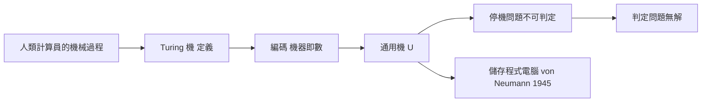

# 7.1 TURING機1936

## 本章導言

1936 年，24 歲的 Alan Turing 在倫敦數學會會刊發表〈論可計算數及其在判定問題上的應用〉。論文的表面目標是解決 Hilbert 的判定問題（Entscheidungsproblem：是否存在算法判定任意一階語句的有效性）；其方法卻發明了**通用計算機的數學模型**——Turing 機。這一年還有 Church 的 λ 演算答案（7.2 節），兩者獨立收斂到同一個「可計算」概念。Turing 機是邏輯學家對「機械操作」的形式化，卻成為數位電腦的設計藍圖——**本書中「理論逼出技術」的最直接案例**。

### 問題：什麼是「機械的」方法

Hilbert 1928 版判定問題要求「機械的過程」。但「機械的」一詞在 1935 年之前沒有數學定義——它是日常詞。要證明判定問題**無解**，必須先精確定義「一切可能的機械過程」的範圍：**定義不夠廣，無解證明就只是「這種方法不行」；定義夠廣，才是「任何方法都不行」。**

Turing 的路：分析**人類計算員**在做什麼。計算員：紙上有符號、眼睛看一處、依當前狀態與所見符號決定動作（改寫、移動、換狀態）。抽象化為**圖靈機**：

- **紙帶**：無限的方格序列，每格至多一符號。
- **讀寫頭**：指向一格。
- **有限狀態控制**：有限多狀態 + 轉移函數 $\delta(q, a) = (q', a', L/R/S)$ 。
- **停機**：進入特殊狀態。

**關鍵論證（Turing 的分析）**：人類計算員的任何機械過程可被此模型模擬——因為人一次只能注意有限多符號、狀態有限、動作局部。這是**哲學論證**（後來成為 Church–Turing 論題的一部分），但它使「可計算」第一次有了**候選形式定義**。

### 通用機：程式即資料

Turing 機的致命發明是**通用機** $U$ ：把任何機器 $M$ 的轉移表編碼為數（或串） $\ulcorner M \urcorner$ ，則存在固定機器 $U$ 使

$$
U(\ulcorner M\urcorner, x) = M(x).
$$

**單一台機器執行所有機器**——這是「軟體」概念的誕生：程式（機器的描述）與資料同為帶上符號。Turing 在 1936 論文中明確討論了此設計的工程可行性，並在二戰後參與 ACE、曼徹斯特機的設計。**von Neumann 架構（儲存程式計算機）的理論原型就是通用 Turing 機**。

### 停機問題：對角線法的機器版

**停機問題**：不存在算法 $H$ ，對任意 $(\ulcorner M \urcorner, x)$ 判定 $M(x)$ 是否停機。

**證明**（對角線）：反設 $H$ 可計算。構造機 $D$ ：輸入 $y$ ，模擬 $H(y, y)$ ；若「停」則**無窮迴圈**，若「不停」則**停機**。問 $D(\ulcorner D \urcorner)$ ？

- 若 $D(D)$ 停機，則 $H(D, D)$ 判「停」，故 $D(D)$ 無窮迴圈。矛盾。
- 若 $D(D)$ 不停機，則 $H(D, D)$ 判「不停」，故 $D(D)$ 停機。矛盾。

故 $H$ 不可計算。 $\blacksquare$

**與 6.2 節對角線引理的同構**：「在第 $x$ 個處對付第 $x$ 個，取反」。Cantor 取反成員關係、Gödel 取反可證性、Turing 取反停機性。**三次登場，三種命運：定理、不可判定語句、不可計算函數**——對角線結構是邏輯學的萬用工具。

由停機問題，判定問題立刻得解：若一階有效性可判定，則可判定「機器 $M$ 是否在輸入 $x$ 上停機」（把機器編碼為一階語句，有效性等價停機）——矛盾。**Hilbert 的判定問題無解。**

### 一個具體例子

**例題 7.1.1**：構造一台 Turing 機 $M_{\mathrm{succ}}$ 計算後繼函數：輸入為一進制數 $1^{n}$ （ $n$ 個連續的 1），輸出 $1^{n+1}$ 。

**解**：帶字母表 $\{1, \sqcup\}$ （ $\sqcup$ 為空白）。機器：狀態 $q_0$ （向右掃描）、 $q_1$ （寫入）。

| 狀態 | 讀 | 寫 | 移動 | 新狀態 |
|------|----|----|------|--------|
| $q_0$ | $1$ | $1$ | R | $q_0$ |
| $q_0$ | $\sqcup$ | $1$ | R | $q_1$ |
| $q_1$ | $\sqcup$ | $\sqcup$ | S | 停機 |

執行： $q_0$ 掃過全部 $n$ 個 $1$ ；遇空白寫入 $1$ ；停機。輸出恰為 $1^{n+1}$ 。 $\blacksquare$

**例題 7.1.2**：證明「判定一台 Turing 機在空白輸入上是否停機」不可計算（停機問題的空白輸入特例——用歸約）。

**解**：反設 $H_\varepsilon(\ulcorner M \urcorner)$ 可判定空白輸入停機。對一般 $(\ulcorner M \urcorner, x)$ ，構造機 $M_x$ ：**把 $x$ 編碼寫入其轉移表**（作為初始化動作：先在帶上打印 $x$ ，再模擬 $M$ ）。則 $M(x)$ 停機 $\iff M_x(\varepsilon)$ 停機。故 $H_\varepsilon$ 可判定一般停機——矛盾。**特例不可判定 ⟹ 一般不可判定**，反向歸約（把一般問題塞進特例）是可計算性理論的標準武器（7.3 節展開）。 $\blacksquare$

### TURING 的哲學：直覺、發明與「可計算」的穩定性

Turing 1936 論文第 9 節是**哲學論證**：為何此定義抓住了一切機械過程。他 1939 年〈數學推理系統中的序數邏輯〉進一步區分**直覺**（intuition）與**發明**（ingenuity），並討論機器能否代替數學直覺（與 10.3 節 Lucas–Penrose 爭論相連）。Gandy 1980 把 Turing 的分析公理化為「Gandy 機器」原理（有限性、局部性），證明任何滿足此原理的過程可被 Turing 機模擬——**論題的可證明部分與不可證明部分被分離**。

Church 的版本（λ 演算、遞迴函數）與 Turing 的版本**外延等價**：可計算函數的集合相同。Turing 論文的附錄證明了這一點——**兩條獨立的思路收斂於同一概念，是「論題為真」的最強經驗證據**。

### 歷史啟示

- **判定問題的否定答案需要先發明「算法」**：要證明某物不存在，先精確定義它的全體——與證明第五公設獨立需先有「公理系統」的概念（1.1 節）同一模式。
- **通用性是意外之財**：為解決邏輯問題發明的模型，成為工業技術的藍圖。**基礎研究的外溢不可預測，但在此案例中直接而劇烈**。
- **對角線法完成第四個登場**：集合（定理）、悖論（排除）、可證性（不可判定）、停機（不可計算）——**邏輯學的四件套至此齊備**。

## 與其他章節及領域的關聯

- **3.3、6.3 節**：「有限方法」的精確化——Turing 機是它的最終形式。
- **6.1–6.2 節**：編碼與對角線的機器版。
- **7.2–7.3 節**：遞迴函數的等價與不可判定性的展開。
- **8.3 節**：Cohen 的力迫法使用可計算性概念（名字、條件的枚舉）。
- **9.2 節**：構造性證明的「計算內容」由 Turing 可計算性刻畫。
- **計算機科學**：一切理論電腦科學的公理：複雜性類（P、NP）以 Turing 機定義；可計算性層次（遞迴可枚舉、圖靈度）是對角線法的後代；現代電腦是通用機的物理實現。
- **物理**：物理 Church–Turing 論題（物理過程可被計算模擬）連接量子計算（Deutsch 1985 的量子 Turing 機）。

## 練習

1. 構造一台 Turing 機判定輸入 $1^n$ 是否 $n$ 為偶數（接受則停於接受態，否則停於拒絕態）。
2. 證明：兩帶 Turing 機與單帶機計算相同的函數類（模擬 + 複雜度平方開根）。
3. 用停機問題證明：「機器 $M$ 是否**對所有**輸入停機」不可計算（歸約）。
4. 寫出把 $(\ulcorner M\urcorner, x)$ 編碼為一階語句 $\phi_{M,x}$ 使「 $\phi_{M,x}$ 有效 $\iff M(x)$ 停機」的構造思想。
5. 思考題：Turing 的「人類計算員分析」是經驗論證還是先驗論證？若未來出現突破 Turing 模型的物理計算（量子、超電腦），Church–Turing 論題的哪部分受威脅？

## 進階研讀：三個深化場景

**場景一：Church 與 Turing 的競爭與互相引用**。Church 1936 年 4 月先發表 λ 演算解；Turing 的論文 1936 年 11 月刊出，附錄證明兩者等價。Church 的定義先於 Turing，但**「機械過程」的分析以 Turing 的最說服人**——Gödel 自己說：只有看到 Turing 的分析，他才接受「可計算」有客觀定義。**命名權（Church–Turing 論題）的分配反映了貢獻的多維性**。

**場景二：Turing 的二戰與 Bombe**。Turing 1939–42 在 Bletchley Park 設計 Bombe 破解 Enigma——**把 1936 年的理論模型（有限狀態 + 搜索）直接工程化**。戰後他提出 ACE 報告（1945，儲存程式設計）與〈計算機器與智能〉（1950，圖靈測試）。**1936 年論文的每一個概念都在十年內變成工程或認知科學**。

**場景三：Chaitin 的 Ω 與演算法隨機性**。Chaitin 1960s 定義 $\Omega$ = 通用機停機機率的實數： $\Omega = \sum_{M \text{ 停機}} 2^{-|M|}$ 。 $\Omega$ 的二進位展開是**不可計算且演算法隨機**的——它的任何有限前綴都不可壓縮，且知道前 $n$ 位即可解 $n$ 位內所有停機問題。**停機問題凝結成一個實數**——數論、資訊論、可計算性的交匯點（2.1 節場景二對角線的資訊論版在此完成）。

### 名詞速查表

- **Turing 機**：紙帶、讀寫頭、有限狀態、轉移函數。
- **通用機 $U$ **： $U(\ulcorner M\urcorner, x) = M(x)$ ，程式即資料。
- **停機問題**：判定任意 $(M, x)$ 是否停機；不可計算。
- **歸約**：以已知的不可判定問題證新的。
- **Church–Turing 論題**：機械可計算 = Turing 可計算（經驗論題）。
- **Gandy 原理**：有限性 + 局部性 ⟹ Turing 可模擬。

### 年表速查

- 1935：Turing 開始可計算數研究（劍橋）。
- 1936：Church λ 演算解（4 月）；Turing 論文（11 月）；Post 獨立提出相似模型。
- 1937：Turing 論文附錄證明與 λ 演算等價。
- 1939：Turing〈序數邏輯〉；戰爭服務開始。
- 1945：ACE 報告。
- 1948：von Neumann 自複製自動機。
- 1950：〈計算機器與智能〉。
- 1965：Chaitin／Kolmogorov 演算法資訊理論。

### 深化問答三則

**問：Turing 機為何用「無限紙帶」？這不現實嗎？**
答：無限帶是**潛無窮**（可以一直寫下去）而非實無窮的數學便利：任何有限計算只用有限帶。它把「記憶體不夠」從問題定義中排除，使「可計算性」成為**純邏輯**概念；資源限制由複雜性理論（空間、時間層次）另冊處理。**可計算性與複雜性的分工正是「無限帶」的功能**。

**問：停機問題的證明為何如此短？**
答：因為它站在兩個巨人的肩上：對角線法（Cantor–Gödel）與編碼（程式即數）。整個證明只需「假設 $H$ 存在 → 構造 $D$ → 自相矛盾」。**強大的定理常常是短證明的**——它們把難度轉移到了概念的發明（此處是通用機）而非證明的技巧。

**問：Church–Turing 論題是定理嗎？**
答：不是，它是**定義的辯護**（「機械可計算」本無形式定義，論題主張 Turing 定義抓住了它）。可證的部分：Gandy 原理下的物理模擬性；不可證的部分：「一切機械過程」的全稱。**論題的地位類似物理定律**——由大量獨立收斂（λ 演算、遞迴函數、Post 系統、通用機）支撐的經驗概括。

（本節完）
