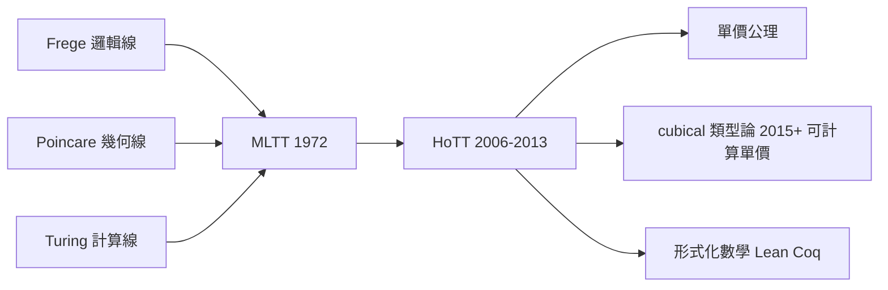

# 10.2 同倫類型論HOTT與UNIVALENT公理2006

## 本章導言

2006 年，Voevodsky（Fields 獎得主，代數幾何學家）與 Awodey、Warren 等人發現：Martin-Löf 類型論（9.3 節）的恆等類型 $\operatorname{Id}_A(a,b)$ 可以詮釋為**拓撲空間中 $a, b$ 之間的路徑空間**——類型論突然獲得同倫論的語義。2009 年 Voevodsky 提出**單價公理**（univalence axiom）：**同構的類型相等**——範疇論的「箭頭優先」原則（10.1 節）被做成**公理**，且不破壞計算性。這是二十一世紀數學基礎最大的新事件：一個同時是**邏輯、幾何、程式**的基礎。

### 恆等類型的同倫詮釋

MLTT 的 $\operatorname{Id}_A(a, b)$ 是「 $a = b$ 的證明」的類型（9.3 節）。**HoTT 的詮釋**：

| 類型論 | 同倫論 |
|------|------|
| 類型 $A$ | 空間 $X$ （或 $\infty$ -群胚） |
| 項 $a : A$ | 點 $x \in X$ |
| $\operatorname{Id}_A(a, b)$ | 路徑空間 $P(a, b)$ |
| $\operatorname{Id}_{\operatorname{Id}}(p, q)$ | 路徑的同倫（二維路徑） |
| $n$ -重叠代 | $n$ 維同倫 |

**層級結構**：每個類型有**同倫維數**—— $\mathbf{0}$ -類型（集，路徑唯一）、 $\mathbf{1}$ -類型（群胚，路徑可不同但二維路徑唯一）、……**「集合」只是同倫層級的最底層**——Cantor 的集合宇宙（第 2 章）在 HoTT 中是 $n = 0$ 的特例。**基礎的層次從「集合論 vs 邏輯」擴展為「同倫維數的譜系」**。

### 單價公理：同構即相等

**單價公理**：對類型 $A, B : U$ ，映射

$$
(A =_{U} B) \to (A \simeq B)
$$

是**等價**（即 $A = B$ 與 $A \simeq B$ 的證明空間同構）。

**內容**：兩個類型**相等當且僅當它們等價**——「等價」是範疇論意義（存在互逆映射，10.1 節）。這把 Frege 的外延原則（1.3 節基本律 V 的精神）以**不產生悖論**的方式恢復：外延性不再導致自指（型別系統守衛），卻獲得「數學結構的同構即同一」的強公理。

**三大後果**：

1. **函數外延性**： $\forall x.\ f(x) = g(x) \Rightarrow f = g$ 可證（經典集合論中為真，MLTT 中原本不可證）。
2. **傳輸原理**：沿等價 $A \simeq B$ 把性質從 $A$ 「搬」到 $B$ ——**數學實踐中的「WLOG 換表示」被公理化**。
3. **宇宙是 $\infty$ -群胚**： $U$ 的「點」是類型、「路徑」是等價、「二維路徑」是等價的同倫——**範疇論的全體結構成為類型論的內部幾何**。

### 一個具體例子

**例題 10.2.1**：在 HoTT 中構造 $2 + 2 = 4$ （ $\mathbb{N}$ 的加法），並說明其「計算內容」與 6.3 節逆數學框架下該定理的地位。

**解**： $\mathbb{N}$ 為歸納類型（ $0, S$ ）， $+$ 由歸納定義： $m + 0 \equiv m$ ； $m + S(n) \equiv S(m + n)$ 。

$$
2 + 2 \equiv 2 + S(1) \equiv S(2 + 1) \equiv S(S(2 + 0)) \equiv S(S(2)) \equiv 4.
$$

**計算內容**：歸約序列是**可執行**的——證明 $2+2=4$ 的項 $\operatorname{refl}(4)$ 的型別檢查過程**就是**這個計算。**與 6.3 節對照**：逆數學顯示 $2+2=4$ 屬最弱系統（ $RCA_0$ 之下）；HoTT 中它不僅可證，而且**證明即計算**——基礎的演進使「最平凡的定理」獲得「最直接的執行」。 $\blacksquare$

**例題 10.2.2**：用單價公理證明「 $n$ -維向量空間的全體結構是 $n$ -類型」的一個具體特例：證明「所有 2 元素集的等價」的空間 $K$ 恰有**一個**連通分支且其基本群為 $\mathbb{Z}/2$ （即 $K \simeq B\mathbb{Z}/2$ ，一個 $\mathbf{1}$ -類型）。

**解**： $U$ 中「2 元素類型」的全體 $\Sigma X:U.\ \operatorname{isContr-ish}(X)$ 的連通分支：由單價公理，兩個 2 元素集等價 ⟺ 相等，故**所有 2 元素集在同一分支**（任兩個之間有等價 = 路徑）。

基本群： $\pi_1$ = 「 $X = X$ （自等價）」的同倫類 = 2 元素集的**自同構群** $= \mathbb{Z}/2$ （恆等與交換）。二維以上： $X = X$ 的證明空間（等價的空間）是離散的（自同構群是集合），故無更高維路徑—— $K$ 是 $\mathbf{1}$ -類型， $K \simeq B\mathbb{Z}/2$ 。 $\blacksquare$

**要點**：**「對象的分類空間」在 HoTT 中是內部可談的**——經典數學中「模空間」是高階構造，HoTT 中它是宇宙 $U$ 的子空間，**幾何被內建進邏輯**。這正是 HoTT 對模空間、上同調理論的「基礎性」承諾：**結構的分類不是外掛而是基礎的一部分**。

### HoTT 作為基礎：統一三條線

HoTT 是本書三條基礎線的交點：

- **邏輯線**（Frege → Hilbert → Gödel）：形式系統與元定理——MLTT 的判斷與規則是它的語法。
- **幾何線**（Poincaré → Grothendieck → ∞-群胚）：空間與層次—— $\operatorname{Id}$ 的同倫詮釋是它的語義。
- **計算線**（Turing → Curry–Howard → Coq/Lean）：證明即程式——HoTT 在形式驗證中**可計算**（單價性以 cubical 類型論實現計算，2015–）。

### 哲學迴響：結構主義的形式化

單價公理的哲學意義：**「數學對象是結構，結構的位置由其互動決定」**——Benacerraf 1965 的經典難題（「3 是哪個集合？」——von Neumann 或 Zermelo 實現皆可）在 HoTT 中**消解**：不同的實現之間有等價（= 路徑），而路徑的存在使它們**在同一連通分支**——「哪個實現」的問題被「實現空間的幾何」吸收。

**這是二十世紀數學哲學「結構主義」的第一個形式基礎**——此前結構主義只是哲學口號（Shapiro、Resnik），HoTT 把它變成推理規則。**哲學問題的「形式化消解」**是基礎研究的最高榮譽形式——如羅素悖論被分層消解（3.1 節）、CH 被力迫法精確化（8.3 節）。

### 歷史啟示

- **基礎突破來自跨領域遷徙**：Voevodsky 是代數幾何學家（motivic 同倫論），把 $\infty$ -群胚的眼光帶進類型論——**基礎的下一步常由「外行人」推開**（與 Cohen 相同模式，8.3 節）。
- **公理的「可計算性」是 2010 年代的新標準**：單價公理最初不可計算（公理而非規則），cubical 類型論（2015，Huber、Coquand、Mörtberg）使之成為**歸約規則**——「公理也必須會算」成為新基礎的入場券。
- **Voevodsky 的悲劇與遺產**：他 2010 年代漸離數學主流（與其精神健康問題交織），2024 年去世。他的 Univalent Foundations 計劃（IAS 2012–13 特別年）已長為數百人的社群。**一個人的直覺開啟一代人的框架**——與 Cantor、Gödel 的個人史遙相呼應。

## 與其他章節及領域的關聯

- **3.1 節**：羅素悖論的類型防禦在 HoTT 中成為同倫層級。
- **9.3 節**：MLTT 是 HoTT 的語法基座。
- **10.1 節**：範疇論的「箭頭優先」在單價性中成為公理。
- **2.2、8.2–8.3 節**：HoTT 中 CH 的獨立性可以**內部**證明（層模型的內建）——宇宙論被類型論吸收。
- **6.3 節**：HoTT 的「計算內容」繼承構造數學傳統。
- **計算機科學**：cubical Agda、UniMath 庫；HoTT 是形式化數學的「結構敏感」路線（對比 set-level 的 Mizar）。
- **物理**：規範場論的叢結構、量子場的路徑積分與 HoTT 的「空間 = 類型」觀念有結構親緣（研究前沿）。

## 練習

1. 寫出 $\operatorname{Id}$ 類型的 J-規則（路徑歸納），並用它證明對稱性 $p : \operatorname{Id}(a,b) \to \operatorname{Id}(b,a)$ 。
2. 證明： $\mathbb{N}$ 是 $\mathbf{0}$ -類型（用 $\mathbb{N}$ -歸納 + J-規則）。
3. 用單價公理證明： $A \simeq B$ 且 $B \simeq C \Rightarrow A = C$ 的傳遞版本。
4. 計算 $\pi_1(\mathcal{S}^2)$ 在 HoTT 中的陳述（圓 $S^1$ 是 higher inductive type： $\operatorname{base}, \operatorname{loop}$ ），驗證 $\pi_1(S^1) = \mathbb{Z}$ 的 HoTT 證明思想。
5. 思考題：單價公理「同構即相等」會使「相等」變強（更多東西相等）。這對「數學對象的個體性」有何影響？與 Benacerraf 問題的消解對照。

## 進階研讀：三個深化場景

**場景一：IAS 特別年（2012–13）與《HoTT 書》**。Voevodsky 在高等研究院組織 Univalent Foundations 年，產出《Homotopy Type Theory》教科書（2013，網上開放）——**基礎框架的誕生以「集體寫作」完成**（對比 Principia 的雙人寫作與 Hilbert 學派的多卷本）。

**場景二：cubical 類型論與可計算單價**。CCHM（Cohen–Coquand–Huber–Mörtberg）2015 用立方體語義（de Morgan 代數賦值）使單價性**可歸約**——公理降為規則。**2010 年代基礎研究的加速**：從發現（2006）到公理（2009）到實現（2015）到生態（cubical Agda 2018）僅十二年。

**場景三：HoTT 的數學收穫**：形式化的層論（Riehl–Shulman 的 simplicial 類型論）、凝聚數學（Clausen–Scholze 的 analytification 有 HoTT 式解讀）、Galois 理論的 ∞-群胚化。**基礎不僅是地基，也是新數學的生成器**——10.3 節的「鏡子」論題在此有正面案例。

### 名詞速查表

- **HoTT**：以同倫論詮釋類型論的基礎。
- **恆等類型 = 路徑空間**： $\operatorname{Id}(a,b) = P(a,b)$ 。
- **單價公理**： $(A = B) \simeq (A \simeq B)$ 。
- ** $\infty$ -群胚**：有任意維同倫的「廣義群」。
- **n-類型**： $n$ 維以上路徑唯一的類型；集合 = 0-類型。
- **higher inductive type**：以生成元與關係定義的空間（ $S^1$ 等）。
- **cubical 類型論**：單價性可計算的 MLTT 擴張。

### 年表速查

- 1965：Benacerraf 結構主義難題。
- 1998：Hofmann–Streicher 的群胚模型（HoTT 語義先聲）。
- 2006：Awodey–Warren、Voevodsky 的同倫詮釋。
- 2009：Voevodsky 單價公理。
- 2012–13：IAS 特別年、《HoTT 書》。
- 2015：cubical 類型論。
- 2018：cubical Agda。
- 2020s：形式化數學的 HoTT 生態。

### 深化問答三則

**問：HoTT「替代」集合論了嗎？**
答：在**結構數學**（代數、幾何、拓撲的高層部分）是強競爭者；在**集合論自身的問題**（大基數、力迫）仍是「被建模者」。正確的描述：**基礎空間從「唯一地基」變成「多層景觀」，HoTT 是景觀的新樓層**——它使「集合」成為 $0$ -類型的特例，如同複數使實數成為特例（1.1 節的擴張模式）。

**問：單價公理的「計算成本」是什麼？**
答：cubical 實現中，等價的傳輸（transport）需要沿路徑的**重寫計算**，成本與結構複雜度相關。形式驗證實踐中，這使「表示選擇」更靈活（WLOG 換結構不需重新證明）。**成本轉移到了編譯器，收益給了數學家**——與類型系統的一般 trade-off 相同。

**問：HoTT 對「數學是什麼」的最終回答？**
答：**數學是 $\infty$ -群胚的構造理論**——命題是 $(-1)$ -類型、集合是 $0$ -類型、空間與範疇是更高類型，邏輯是層級的底層。這不是唯一答案，而是**迄今最統一的形式答案**：邏輯、集合、幾何、計算在層級中共存。10.3 節將以此作為「基礎即鏡子」的最終見證。

（本節完）
