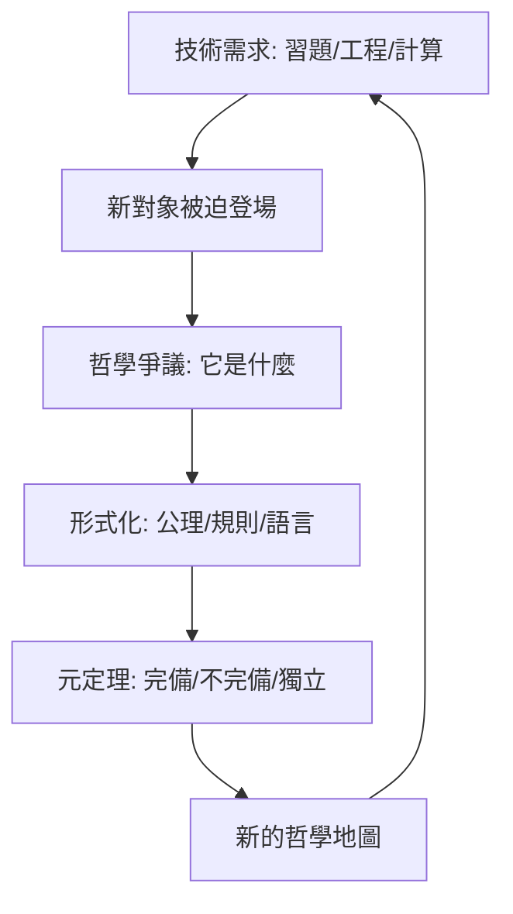

# 10.3 迴顧基礎不是地基而是鏡子

## 本章導言

本書走了三千年：Euclid 的公設（1.1）、分析的算術化（1.2）、Frege 的邏輯（1.3）、Cantor 的無窮（2 章）、危機與三學派（3 章）、ZFC（4 章）、一階邏輯與不完備（5–6 章）、可計算性（7 章）、獨立性（8 章）、構造與類型（9 章）、範疇與 HoTT（10 章）。回望時，最深刻的教訓不是「地基終於打好了」——它沒有，也許永遠不會——而是：**數學基礎不是支撐數學的地基，而是數學認識自身的鏡子**。本節以三條主線收束全書，並給出對「基礎的未來」的判斷。

### 主線一：每一次危機都生產了新的數學

回顧「危機 → 產物」的鏈條：

| 危機 | 直接產物 | 更深的產物 |
|------|------|------|
| 無理數（希臘） | Eudoxus 比例論 | 實數的構造（1.2 節） |
| casus irreducibilis | 複數 | 代數、分析的語言 |
| 第五公設 | 非歐幾何 | 公理方法、模型論（1.1、5 章） |
| 連續性怪物 | 嚴格分析 | 集合論、拓撲（1.2、2 章） |
| 羅素悖論 | ZFC、類型論 | 三學派、整個數理邏輯（3–4 章） |
| 不完備性 | 證明論、遞迴論 | 可計算性、電腦（6–7 章） |
| CH 獨立性 | 力迫法 | 宇宙論、多元主義（8 章） |
| 非構造性爭議 | 直覺主義、類型論 | 形式驗證、函數式程式（9 章） |
| Benacerraf 難題 | HoTT | 結構主義的形式化（10.2 節） |

**模式**：基礎研究的「失敗」（悖論、不可能性、獨立性）總是**更精確的問題陳述**，而精確的問題總會長出新的數學學科。Hilbert 綱領的死亡（6.3 節）是範式案例：**「不可能性定理是更精確的可能性定理」**。

### 主線二：技術與哲學的互驅

本書反覆出現的動力結構：

典型案例：Cantor 的三角級數習題（技術）→ 超窮數（對象）→ 神學與有限主義的攻防（哲學）→ ZFC（形式化）→ Gödel–Cohen（元定理）→ 宇宙多元論（新哲學）→ 內模型計劃（新技術）。**哲學從不終結基礎研究，它把技術成果重新提問**；技術也從不終結哲學，它把哲學爭議變成可測量的對象（如 6.3 節逆數學測量「公理需求」）。

**「基礎即鏡子」的準確含義**：基礎研究不告訴數學「你的根基是什麼」，而是**反映**數學「你此刻如何理解自己」。每次鏡子升級（從 Euclid 的公設鏡到 HoTT 的同倫鏡），數學的自我形象就改變一次——而數學本身繼續運轉。

### 主線三：多元共存與互操作

2010 年代後的基礎格局不再是競爭而是**生態**：

- **ZFC + 大基數**：集合論學派的宇宙學（8 章），日常數學的預設語言。
- **MLTT / HoTT**：形式驗證與構造數學的工作系統（9.3、10.2 節），Lean 數學庫（含費馬大定理形式化，2024）是其規模證明。
- **範疇論 / topos**：跨領域的語義介面（10.1 節）。
- **計算複雜性**：Hilbert 第 24 問題的後代，基礎與效率的橋（6.3、7.3 節）。

**互操作的實例**：HoTT 的模型在 ∞-topos 中（範疇論語義）；Lean 的核是類型論但日常用語接近集合論；集合論學家在 HoTT 中重構力迫。**基礎的「正確選擇」問題正在消失，取而代之的是「翻譯層」的工程**——如同程式語言的生態：沒有「最好的語言」，只有合適的場景與可靠的互譯。

### 一個具體例子：三次「基礎的基礎」

**例題 10.3.1**：比較三個時代對「 $1 + 1 = 2$ 」的基礎處理，量化其「信任成本」的變遷。

**解**：

**（a）Frege–Russell（1901–1913）**：《數學原理》以類型邏輯從定義出發證 $1 + 1 = 2$ ，歷經數百頁（命題 \*54.43，附註「以上命題有用」的著名玩笑）。**信任成本**：整個類型論系統 + 概念文字的掌握。

**（b）ZFC（1908–）**： $1 + 1 = 2$ 是 $\omega$ 的 von Neumann 定義與後繼的推論，PA 公理幾行內完成；日常數學家**直接使用而不內證**——基礎下沉為「公共設施」。**信任成本**：接受 ZFC 一致（Gödel 第二定理說此信任不可內部擔保，6.1 節）。

**（c）Lean / HoTT（2013–）**：`theorem one_plus_one : 1 + 1 = 2 := rfl`——**按定義歸約**，證明項是計算本身，kernel 機械檢查。**信任成本**：信任一個數千行的 kernel（其正確性由「de Bruijn 準則」部分緩解：它拒絕一切非構造的證明，包括自己歷史版本的錯誤）。

**變遷的意義**：信任從「哲學承諾」（Frege 的一生）轉移到「工程最小核」（Lean 的 kernel）——**Hilbert 的「有限方法保證可靠性」理想，以軟體形式實現**（6.3 節的預言成真）。基礎沒有「完成」，但它的**操作模式**完成了轉型：從學派的教義到可執行的核。 $\blacksquare$

### 基礎的未來：三個開放前沿

1. **CH 與宇宙選擇**（2.2、8.3 節）：一元論（Woodin 的終極 $L$ 、 $\Omega$ -邏輯）與多元論（Hamkins）的爭論未決。**預測**：不會有「裁決」，但會有更精確的「宇宙學不變數」（如 HOD 假設、絕對性譜系）。
2. **證明與機器的共生**（6.3、9.2、10.2 節）：AI 輔助的形式化（AlphaProof 2024 銀牌級 IMO）使「證明的計算內容」成為數學產出的標配。**基礎問題從「數學可信嗎」轉為「機器可信數學嗎」**——信任的層級化（kernel、社群複核、實驗重現）是新的認識論。
3. **物理與計算的邊界**（7.2 節場景三）：物理 Church–Turing 論題、量子計算的複雜性優勢、凝聚數學與 ∞-結構——**「數學基礎」與「物理基礎」正在交匯**：時間、隨機性、資訊是否「可計算地」構成世界。

### 對讀者的最後建議

- **不要問「哪個基礎是真的」**，要問「**這個基礎使哪些問題可問、哪些定理可證、哪些程式可跑**」。基礎是工具箱，不是信仰。
- **重視「不可能性定理」的生產力**：Gödel、Cohen、Turing 的「不可能」各開一個學科。遇到「不可能」時，先問它精確化了什麼。
- **歷史不重複但押韻**：casus irreducibilis 逼出複數、三角級數逼出集合論、判定問題逼出電腦——**下次「技術故障」出現時，注意它可能在逼出什麼**。

### 歷史啟示（全書總結）

- **基礎的歷史是數學自我意識的歷史**：每個時代有其「鏡子」——公理（希臘）、數（十九世紀）、集合（Cantor）、形式系統（Hilbert）、演算法（Turing）、宇宙（Cohen）、構造（Brouwer–Martin-Löf）、同倫（Voevodsky）。**鏡子會舊，照鏡的習慣不會**。
- **最深的基礎問題都是「反映」問題**：羅素悖論（集合反映自身）、謊言者（語言反映自身）、停機（程式反映自身）、CH（宇宙反映自身）——**對角線結構是「自我認識」的數學形式**，而本書的全部技術（分層、翻譯、力迫、類型）都是**給自我認識裝護欄**的工程。
- **數學的必然性至今未被「證明」也未被「取消」**：Frege 的夢（邏輯必然）、Hilbert 的夢（形式必然）、Brouwer 的夢（構造必然）各自留下遺產而無一全勝。**基礎研究的成熟恰恰在於承認這一點而繼續工作**——如同 Cantor 繼續算、Gödel 繼續證、Voevodsky 繼續建庫。

## 與其他章節及領域的關聯（終章總結）

- **1.1 節**：公理方法的兩千年從「唯一真理」走到「可選宇宙」——本節的第一主線。
- **3.2 節**：三學派無一全勝而全部轉型——多元共生的先例。
- **6.3 節**：綱領「終結與重生」的模式是全書的範式。
- **7 章**：可計算性把基礎變成工程——今天的數學實踐已離不開它。
- **8–10 章**：宇宙論、構造論、同倫論——三個現代的「鏡子」。
- **計算機科學**：形式驗證、AI 數學、密碼學——基礎的技術外溢在本世紀加速。
- **哲學**：結構主義獲得形式化，柏拉圖主義獲得宇宙學，構造主義獲得語言——**每個哲學立場都拿到了工具**，這是二十一世紀基礎研究的獨特狀態。

## 練習（終章綜合）

1. 撰寫「基礎危機年表」：從公元前 5 世紀無理數危機到 2015 cubical 類型論，標注每次危機的「直接誘因—形式化回應—元定理—哲學餘波」四欄。
2. 對照分析：Cohen 的力迫法與 Voevodsky 的單價公理，兩者都以「等價類的操作」為核心。寫出兩者的結構對照表（條件—泛型 vs 路徑—傳輸）。
3. 選一個「日常定理」（如隱函數定理），追蹤它在（a）ZFC（b）直覺主義（c）逆數學（d）HoTT 中的地位與證明需求，撰寫「一個定理的四種基礎生涯」。
4. 辯論題：「形式驗證使數學基礎問題過時了。」正反方各陳三論據，並引用本書至少三章的具體史實。
5. 終極思考題：若你給 2100 年的數學家寫一封信，預測「基礎的下一面鏡子」是什麼（量子邏輯？計算宇宙論？後人類數學？），並說明它將反映什麼樣的數學自我形象。

## 進階研讀：三個深化場景（收束）

**場景一：三份宣言並讀**。Hilbert 1926〈論無窮〉（「無人能驅逐我們」）、Brouwer 1928 柏林講座（「數學是構造」）、Voevodsky 2014 IAS 演講（「單價基礎」）——**三份文本各自宣稱「最終基礎」，各自部分成真**。並讀的收穫：基礎宣言的價值在**開啟問題**而非**終結問題**。

**場景二：基礎與教育的反饋**。Kline《數學基礎的失落》（1980）宣稱基礎危機摧毀了數學的確定性敘事；但同期（1970–2010）數學形式化的教育工具（Coq 教材、ProofWiki、Lean 數學庫）反而使「如何證明」的教學更透明。**「確定性敘事」的失落與「可檢驗性工具」的增進並行**——鏡子的兩面。

**場景三：本書作為鏡子**。這本書把數學基礎寫成「技術與理論互驅的歷史」——這本身就是一種基礎觀（歷史主義的、後設數學的、工程的）。讀者可以此為鏡：**你讀完後，你的數學自我形象變了嗎？** 若變了——本書的任務完成；若沒變——建議重讀 3.2 節與 9.1 節，再決定是否變。

### 名詞速查表（全書收束）

- **對角線結構**：自我指涉的數學形式，貫穿 2–8 章。
- **相對一致性**：不可能性時代的嚴格化模式（8.2 節起）。
- **互操作**：基礎生態的現實形態（10 章）。
- **計算內容**：證明的可執行面（9.2 節）。
- **宇宙層級**：從 $V_\alpha$ 到 $U_n$ 到 ∞-群胚（4.3、9.3、10.2 節）。
- **de Bruijn 準則**：形式驗證的信任工程（本節例題）。

### 年表速查（三千年精選）

- 約前500：無理數危機；前300：Euclid。
- 1545：Cardano 複數幽靈。
- 1637：Descartes；1687：Newton。
- 1821：Cauchy；1872：Weierstrass／Dedekind／Cantor。
- 1879：Frege；1900：Hilbert 巴黎。
- 1901：羅素悖論；1908：Zermelo／Heyting 前夜／類型論。
- 1931：Gödel；1936：Turing／Church。
- 1938：Gödel $L$ ；1963：Cohen。
- 1967：Bishop；1972：Martin-Löf。
- 1982：有效 topos；2006：HoTT；2009：單價；2015：cubical。
- 2024：費馬大定理 Lean 形式化完成。

### 深化問答三則（終章）

**問：本書的標題應該是「數學基礎」還是「數學的自我認識」？**
答：兩者是一體。技術上本書講的是公理、邏輯、集合、計算、類型（「基礎」）；敘事上講的是數學如何一次次面對自己的邊界（「自我認識」）。**「基礎」是工程名詞，「鏡子」是認識論名詞**——本書的立場是：兩者必須同時成立，缺一則基礎研究墮為純技術或純玄學。

**問：如果只能記住本書一件事，記什麼？**
答：**「不可能性是更精確的可能性」**。Gödel 說「完備不可能」→ 開啟證明論；Cohen 說「唯一宇宙不可能」→ 開啟宇宙學；Turing 說「全判定不可能」→ 開啟計算理論。數學基礎的歷史就是**把「不能」翻譯成「關於能的精確地圖」**的歷史。

**問：基礎研究「結束」了嗎？**
答：沒有，而且形態正在擴張：CH 的宇宙學未決、AI 與數學的信任結構未定、物理與計算的邊界未清。**但它也不再是「危機管理」**——1900 年代的恐慌已被 2020 年代的生態取代：多個基礎並存、互譯、各自生長。**基礎研究從「找地基」變成了「養景觀」**——這也許就是鏡子論的最終形態。

（全書完）
