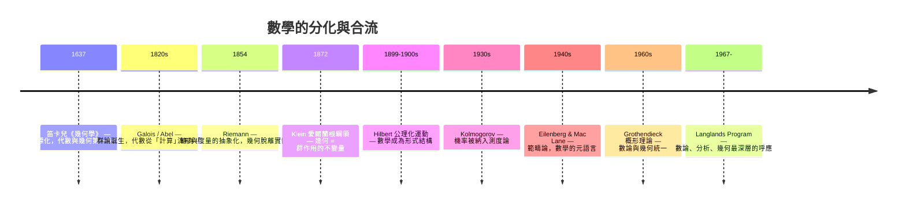

# 0.1 數學的分與合

## 從碎片的知識點到結構的網格

大多數人的數學教育是「線性」且「碎片化」的：先學算術，再學代數，然後是幾何、三角、微積分、機率……每一科像一個獨立的抽屜。但數學的真實樣貌並非一排抽屜，而是一張**互相映照的網格**。

一個經典的例子：方程式 $x^2+1=0$ 在實數中無解——這是「代數」的事實。若引入 $\mathrm{i}$，複數平面上的單位圓、指數函數 $e^{\mathrm{i}\theta}$、傅立葉分析、訊號處理全部被串連起來——「代數」的缺口迫使「分析」與「幾何」擴張，最後又反過來滋養工程。這就是分與合的辯證：**每個領域的內部危機，往往成為另一個領域的養分。**

## 歷史上的幾次「合流」

## 「危機驅動統一」的模式

歷史反覆出現同一個模式：

1. **內部危機**：某領域出現無法在自己的框架內解決的問題。
2. **引入新語言**：借用另一領域的語言重新表述。
3. **發現對偶**：兩個領域之間存在系統性的對應。
4. **綱領誕生**：對應被提升為普適綱領，反過來重組整個數學地圖。

例如：

- 三次、四次方程可解，五次方程為何不可解？（代數危機）→ 引入「置換的結構」→ 群論誕生（Galois, 1832）。
- 歐氏第五公設能否由其他公設推出？（幾何危機）→ 非歐幾何誕生（1830s）→ 迫使幾何「公理化」，最終由 Klein 用群論統一（1872）。
- 「任意實數子集的面積」如何定義？（分析危機）→ 測度論誕生（Lebesgue, 1902）→ 機率公理化（Kolmogorov, 1933）。

## 本書的主張

**數學不是一群定理的集合，而是一座結構的建築。** 代數、幾何、分析、機率統計是四大柱石，但它們之間不斷地互相搬運地基：代數把幾何變成方程，幾何把代數變成形狀，分析把兩者變成極限與連續，機率把分析變成不確定性的幾何。本書將帶讀者繞行這座建築的外觀，再逐一打開幾扇最關鍵的門——三大統一綱領。

## 練習與思考

1. 舉一個你在學習經驗中「某領域的技巧解決了另一領域問題」的例子。
2. 為什麼「危機」往往比「成功」更能推動數學的統一？
