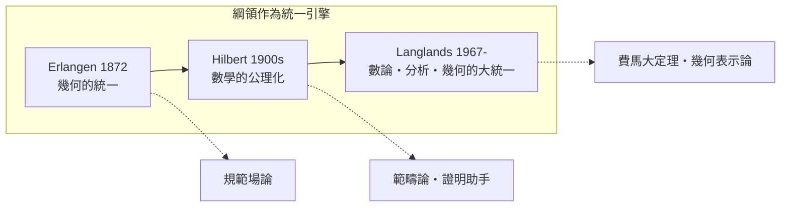

# 0.2 本書的視角：結構、對偶與綱領

## 三個關鍵詞

### 1. 結構（Structure）

數學物件之所以有意義，不在於它「是什麼」，而在於它**遵守什麼規則**。「整數」不只是 0, 1, 2, …，而是 $(\mathbb{Z}, +, \times)$ 滿足的運算律；「空間」不只是點的集合，而是點之間允許的變換（Klein）或允許的函數（Grothendieck）。這種「以關係定義物件」的態度，是現代數學與古典數學的分水嶺，也是本書第一篇的骨幹。

### 2. 對偶（Duality）

當兩個看似不同的領域之間存在**保持結構的一一對應**時，我們稱之為對偶。對偶的威力在於：難的問題可以搬到另一邊變成簡單的問題。

| 對偶 | 兩端 |
|---|---|
| 笛卡兒對偶 | 幾何曲線 $\leftrightarrow$ 代數方程 |
| Gelfand 對偶 | 緊緻 Hausdorff 空間 $\leftrightarrow$ 交換 $C^*$-代數 |
| Pontryagin 對偶 | 交換群 $\leftrightarrow$ 其特徵標群 |
| Poincaré 對偶 | 流形的 $k$ 維同調 $\leftrightarrow$ $(n-k)$ 維上同調 |
| Langlands 對偶 | Galois 表示 $\leftrightarrow$ 自守形式 |

### 3. 綱領（Program）

綱領是**大尺度的研究方向**：它宣告「這一大片數學應該可以如此統一」，然後花費數十年甚至百年由社群共同完成。

## 閱讀方法

每一節我們都會回答三個問題：

1. **前因**：這個概念是為了解決什麼問題而誕生？
2. **構造**：它精確地說了什麼（含定義與公式）？
3. **後果**：它驅動了哪些後續理論與應用？

## 練習與思考

1. 「對偶」與「同構」有何差別？（提示：對偶常是**反變**的，或兩端不是同一類物件。）
2. 挑一個你熟悉的領域（如線性代數），列出它與幾何的三個對偶現象。
