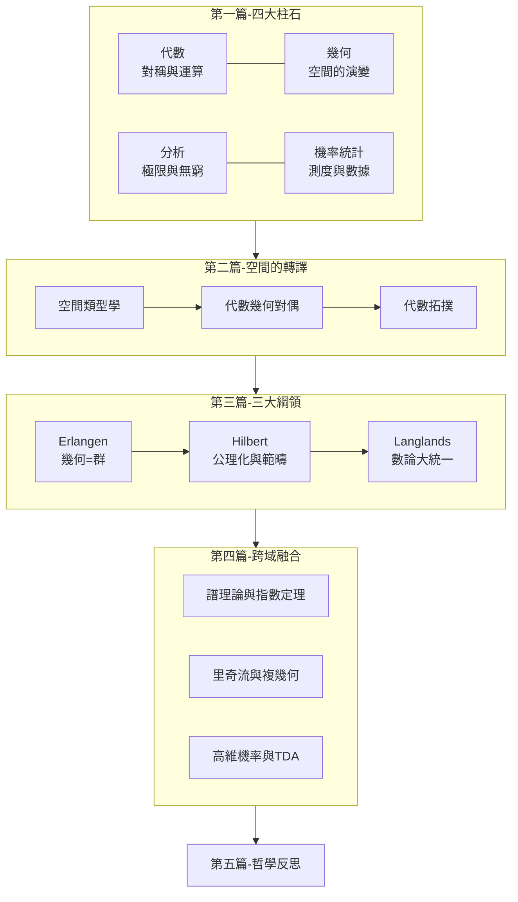

# 0.3 閱讀地圖：數學地貌全景導覽

## 全景圖

## 依讀者背景的建議路徑

| 讀者 | 建議路徑 |
|---|---|
| 大學低年級 | 1, 2, 3, 5 → 8 → 9.3–9.4 |
| 主修理工、重視應用 | 3, 4, 5, 11, 12, 13 |
| 對數學基礎與哲學有興趣 | 9, 14 → 6, 7 → 10 |
| 完整閱讀 | 依章節順序 |

## 符號約定

- $\mathbb{N}, \mathbb{Z}, \mathbb{Q}, \mathbb{R}, \mathbb{C}$：自然數、整數、有理數、實數、複數。
- $G, R, K, V, X, M$：群、環、體、向量空間、拓撲空間、流形。
- 記號 $\hookrightarrow$（嵌入）、$\twoheadrightarrow$（滿射）、$\cong$（同構）、$\simeq$（同倫等價）。
- 範疇論箭頭：$f: X \to Y$ 為態射；$F: \mathcal{C} \to \mathcal{D}$ 為函子。

## 每章結構

每節依「前因 → 構造 → 後果」展開，並以 mermaid 圖呈現理論的驅動關係。數學物件之間的「誰驅動誰」，是本書最想讓讀者帶走的東西。

## 練習與思考

1. 在上面的全景圖中，找出你目前最熟悉與最陌生的節點。
2. 為什麼「第二篇」要先談對偶、再談綱領？（提示：綱領是對偶的大規模化。）
