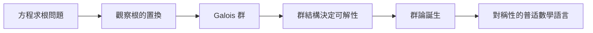

# 1.1 從方程求根到群論：對稱性的數學語言（1832）

## 前因：一個困擾數學家三百年的問題

16 世紀，義大利代數學家解開了三次與四次方程（Cardano、Ferrari）。此後近三百年，數學家嘗試尋找五次方程的根式解，全部失敗。Abel（1824）證明五次一般方程**沒有**根式解，但「為什麼」仍是謎。

Galois（1832，死於決鬥前夜）給出了決定性的洞察：

> 方程能否根式求解，取決於其**根之間的置換結構**——而不是係數或次数本身。

## 構造：群的概念

**定義（群）。** 集合 $G$ 配備二元運算 $\cdot: G\times G \to G$ ，滿足：

1. 結合律： $(a\cdot b)\cdot c = a\cdot(b\cdot c)$ ；
2. 單位元：存在 $e$ 使 $e\cdot a = a\cdot e = a$ ；
3. 反元素：每個 $a$ 有 $a^{-1}$ 使 $a\cdot a^{-1}=e$ 。

Galois 給每個多項式 $f$ 配上一個群：**根的置換群**（後稱 Galois 群 $G_f$ ）。例如 $x^2-2$ 的兩根 $\pm\sqrt2$ 可互換， $G_f \cong \mathbb{Z}/2$ 。

**核心定理（Galois）。** $f$ 可根式求解 $\iff$ $G_f$ 具有「可解群」的鏈狀結構。

$$\{e\} \triangleleft G_1 \triangleleft G_2 \triangleleft \cdots \triangleleft G_n = G_f,\quad G_i/G_{i-1}\ \text{皆為交換群}$$

五次一般方程的 Galois 群是 $S_5$ ，其中含有單純群 $A_5$ （不可再分解），因此不可解。

## 後果：群成為「對稱」的代名詞

- **幾何**：Klein 的愛爾蘭根綱領（1872）用群定義幾何（第 8 章）。
- **物理**：守恆律 $\leftrightarrow$ 對稱群（Noether, 1918）；粒子物理的分類就是群表示論。
- **數論**：Galois 群 $\mathrm{Gal}(\overline{\mathbb{Q}}/\mathbb{Q})$ 成為朗蘭茲綱領的一端（第 10 章）。
- **密碼學**：有限體上的群運算支撐 RSA 與橢圓曲線密碼。

一個為了「解方程」而生的工具，最終成為整座數學建築的樑柱——這是本書第一個「危機驅動統一」的範例。

## 練習與思考

1. 驗證 $\{1, -1, \mathrm{i}, -\mathrm{i}\}$ 在乘法下構成群，並找出它同構於哪個熟悉的群。
2. 為什麼 Galois 理論把「計算問題」轉化成「結構問題」後就變得可解？
