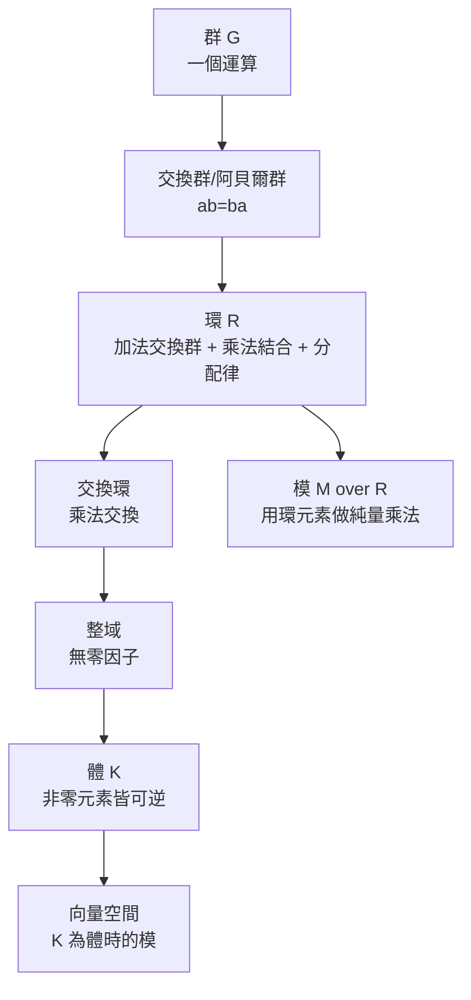

# 1.2 環、體與模：代數結構階梯

## 前因：一個群不夠用

群只有一個運算，但數學與物理需要同時處理「加法」與「乘法」：多項式的加乘、矩陣的加乘、整數的加乘。19 世紀末至 20 世紀初，Noether 學派將這些共同公理抽出，形成**環**與**體**的概念；再進一步問「能不能用環的元素當係數做線性代數」——答案是**模**。

## 構造：結構階梯

**定義（環）。** $(R, +, \times)$ ： $(R,+)$ 為交換群、 $\times$ 結合、分配律 $a(b+c)=ab+ac$ 成立。若 $\times$ 交換則為交換環。

**定義（體）。** 非零元素在乘法下構成交換群的交換環。例： $\mathbb{Q}, \mathbb{R}, \mathbb{C}, \mathbb{F}_p = \mathbb{Z}/p\mathbb{Z}$ 。

**定義（模）。** 交換群 $(M,+)$ 配備環作用 $R \times M \to M$ ，滿足 $r(m+n)=rm+rn$ 、 $(r+s)m = rm+sm$ 、 $(rs)m = r(sm)$ 、 $1m = m$ 。當 $R=K$ 為體，即得線性代數中的向量空間。

## 為什麼要「降級」到模？

向量空間的定理（所有基同基數、維數分類）高度依賴「係數是體」。把係數換成一般的環（如 $\mathbb{Z}$ 或多項式環 $k[x]$ ），分類會變得豐富而困難——而這正是**有用的困難**：

- **結構定理**：主理想整域上的有限生成模 $\cong \bigoplus_i R/(d_i)$ 。取 $R=\mathbb{Z}$ 得有限交換群分類；取 $R=k[x]$ 得線性代數的 Jordan 標準形。**一個定理，兩個大領域**——這是抽象化的紅利。
- **同調代數**：模之間的映射不夠好時，用「正合列」與導函子補救，誕生了 $Ext$ 、 $Tor$ ，成為代數拓撲（第 7 章）與代數幾何（第 6 章）的工作語言。

## 後果

1. **代數幾何**：交換環是「空間的函數環」——Grothendieck 概形理論的起點（6.3）。
2. **數論**： $\mathbb{Z}$ 的擴張（代數整數環）是 Fermat 大定理攻擊路線的基礎。
3. **表示論**：「群在向量空間上的作用」= 群代數上的模，把群分類化約為模分類。
4. **物理**：算子代數（第 6.2、6.4 節）與量子力學的可觀察量結構。

## 練習與思考

1. 證明 $\mathbb{Z}[\mathrm{i}] = \{a+b\mathrm{i} : a,b\in\mathbb{Z}\}$ 是交換環但不是體。
2. 用模的結構定理解釋：為什麼 Jordan 標準形與有限交換群分類是「同一個定理」。
