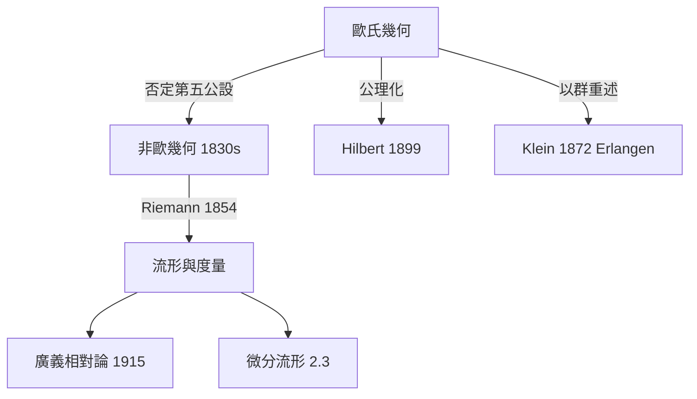

# 2.1 歐幾里得空間與古典幾何的極限

## 前因：兩千年的典範

Euclid《幾何原本》（約 BC 300）以五條公設建立幾何。第五公設（平行公設）：

> 過直線外一點，恰有一直線與之平行。

它的敘述不如其他公設「自明」，兩千年來無數數學家企圖由其他公設證明它，全部失敗。

## 構造：非歐幾何的誕生

Lobachevsky 與 Bolyai（1820s–1830s）獨立地「否定第五公設」：

| 幾何 | 平行公設 | 三角內角和 | 曲率 $K$ |
|---|---|---|---|
| 橢圓（球面）幾何 | 無平行線 | $> \pi$ | $K>0$ |
| 歐氏幾何 | 恰一條 | $= \pi$ | $K=0$ |
| 雙曲幾何 | 無窮多條 | $< \pi$ | $K<0$ |

三種幾何在各自公理系統內**同樣一致**——歐氏幾何不再是「唯一真理」，只是眾多可能空間之一。Gauss 甚至實測三座山頭的三角形內角和，企圖判斷物理空間的曲率。

**Riemann（1854）的躍進。** 演講《論幾何學基礎的假設》提出：空間 = 一個流形 $M$ 配上一個度量

$$ds^2 = \sum_{i,j} g_{ij}(x)\, dx^i dx^j$$

曲率由 $g$ 的導數決定。幾何從此脫離「物理直觀」，成為**可自由設定的數學結構**——這直接孕育了 1915 年的廣義相對論（重力 = 時空曲率）。

## 極限所在

歐氏幾何與其度量框架非常成功，但有以下限制，每一條都成為後續革命的驅動力：

1. **依賴度量**：有些性質（連通、有洞、連續形變）與距離無關 → 需要拓撲學（2.2）。
2. **整體 vs 局部**： $ds^2$ 是局部的，全局結構（如球面的整體形狀）需要新工具 → 流形理論（2.3）。
3. **直觀 vs 公理**：何謂「點、線、介於」？需要徹底的公理化 → Hilbert《幾何基礎》（9.1）。
4. **剛性 vs 對稱**：不同幾何之間的關係是什麼？→ Klein 的群論統一（第 8 章）。

## 後果

「空間」從名詞變成**變數**。此後數學家談論的空間包括：拓撲空間、向量空間、函數空間、模空間（參數空間）、概形、無窮維空間——每次擴張都讓原本不相干領域的問題擁有共同的家。

## 練習與思考

1. 在單位球面上取三點構成三角形，驗證內角和大於 $\pi$ 。
2. 為什麼「內部一致性」的證明（透過模型，如雙曲幾何在圓盤上的模型）比「直觀接受」更重要？
