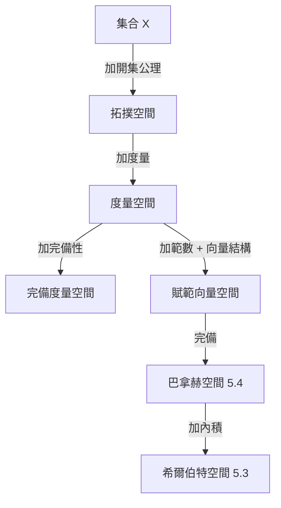

# 2.2 拓撲空間：流去形狀，保留連續

## 前因：不要距離的幾何

分析學的許多關鍵概念——極限、連續、收斂——表面依賴「距離」，但 19 世紀末數學家發現：**真正用到的只是「鄰近」的概念**。Cantor 研究點集、Fréchet 引入度量空間（1906）、Hausdorff 公理化拓撲空間（1914），最終完成「距離 vs. 開集」的剝離：

> 拓撲 = 只保留「哪些集合算開的」這一層資訊。

## 構造

**定義（拓撲空間）。** 集合 $X$ 配備子集族 $\mathcal{T} \subseteq 2^X$（其元素稱開集），滿足：

1. $\emptyset, X \in \mathcal{T}$；
2. 任意並集仍在 $\mathcal{T}$；
3. 有限交集仍在 $\mathcal{T}$。

**定義（連續）。** $f: X \to Y$ 連續 $\iff$ 每個開集的原像是開的。

註意：**沒有任何距離或極限出現在定義中**。連續性被還原成純粹的集合論條件。

**同胚（homeomorphism）。** 雙連續映射。拓撲學研究在同胚下不變的性質。著名的口訣：拓撲學家分不清咖啡杯與甜甜圈——因為两者同胚（都有「一個洞」）。

## 拓撲不變量的例子

- **連通性**：空間能否一刀不剪地分成兩塊開集。
- **緊緻性**：任何開覆蓋皆有有限子覆蓋——「有界且封閉」在拓撲中的推廣，是存在性定理（極值、不動點）的引擎。
- **基本群** $\pi_1$（7.1）：數洞的代數工具。

## 度量空間：中間層

**定義（度量空間）。** $(X, d)$，$d: X\times X\to \mathbb{R}_{\ge 0}$ 滿足正定性、對稱性、三角不等式。

度量空間以 $d(x,y) < \epsilon$ 定義開球，生成拓撲，因此是拓撲空間的特例。但**拓撲可由多個不同度量誘導**：$\mathbb{R}^2$ 的歐氏度量與 $d_\infty(x,y)=\max(|x_1-y_1|,|x_2-y_2|)$ 給出**同一個拓撲**——這說明拓撲抓到了比「某個特定距離」更本質的東西。

## 後果

1. **泛函分析**（第 5 章）：無窮維函數空間需要「弱於距離」的收斂概念（弱收斂、逐點收斂），只有拓撲語言能統一描述。
2. **代數拓撲**（第 7 章）：連續映射的分類導出同倫、同調。
3. **代數幾何**（6.3）：Zariski 拓撲——由「多項式的零點」定義的奇特拓撲，讓幾何完全代數化。
4. **網路與資料**（13.2）：TDA 直接把資料集合配上拓撲。

## 練習與思考

1. 證明 $\mathbb{R}$ 中開區間的任意并仍是開集，但可數個閉區間的并不一定閉。
2. 為什麼緊緻性常被稱為「有限性的代用品」？
