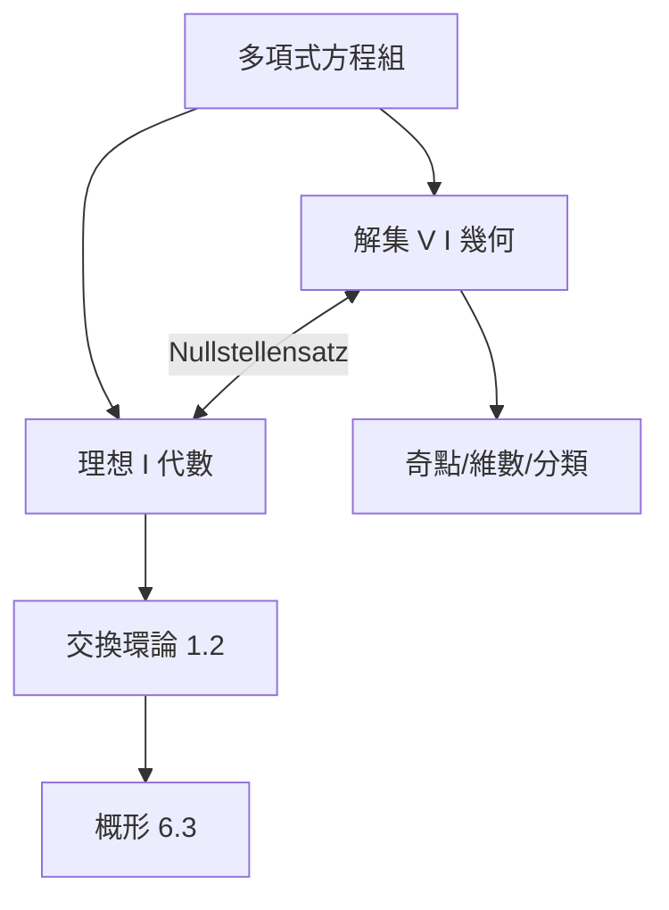

# 2.4 代數多樣體：方程組解集的幾何形狀

## 前因：當幾何完全變成方程式

笛卡兒把曲線寫成方程（6.1），但傳統解析幾何只處理直線、圓錐曲線等低次物件。19 世紀起，數學家開始系統性地研究**任意多項式方程組的解集**：

$$V(f_1, \ldots, f_m) = \{x \in K^n : f_1(x) = \cdots = f_m(x) = 0\}$$

這個解集稱為**代數多樣體（algebraic variety）**。它同時是幾何（形狀）與代數（多項式理想）——對偶性的大展覽場。

## 構造：兩個世界一面鏡子

多項式方程組 $f_1 = \cdots = f_m = 0$ 的一切推論構成**理想** $I = (f_1, \ldots, f_m) \subset k[x_1, \ldots, x_n]$。基本對應：

$$\text{幾何：} V(I) = \{x : f(x) = 0\ \forall f \in I\} \qquad \text{代數：} I(V) = \{f : f|_V = 0\}$$

**Hilbert 零點定理（Nullstellensatz, 1893）。** 在代數封閉體上，$I(V(J)) = \sqrt{J}$。

- 幾何命題「$V$ 非空」$\iff$ 代數命題「$1 \notin I$」（弱形式）。
- 點的集合 $\leftrightarrow$ 極大理想。

| 幾何概念 | 代數概念 |
|---|---|
| 點 | 極大理想 |
| 子多樣體 | 理想（素理想） |
| 維數 | 理想的 Krull 維數 |
| 映射（正則函數） | 環同態 |
| 積 $X \times Y$ | 張量積 $A \otimes B$ |

**經典範例：橢圓曲線。** $y^2 = x^3 + ax + b$（判別式非零）。它既是一條光滑曲線（幾何）、也是一個群（加法公式，來自弦切法）、也是數論物件（有理點、模形式）——費馬大定理的戰場（10.2）。

## 後果

1. **幾何問題代數化**：相交、維數、奇點由環的性質判定——交換代數成為幾何的文法。
2. **數論幾何化**：Diophantus 方程 $=$ 尋找多樣體的有理點/整點；Fermat 大定理 $y^2z = x^3 - z^5$（同質化後）是橢圓曲線的特例。
3. **Grothendieck 概形**（6.3）：把「解集」的概念推廣到「由任意環構造的空間」，數論與幾何終於共用一種空間。
4. **物理**：弦論的 Calabi–Yau 空間是代數多樣體（12.2）。

## 練習與思考

1. 求 $V(x^2 + y^2 - 1) \subset \mathbb{R}^2$ 與 $V(x^2+y^2-1) \subset \mathbb{C}^2$ 的差別；哪個視角下它是「球面」？
2. 為什麼需要代數封閉體（如 $\mathbb{C}$）才能讓幾何與代數完全對應？
