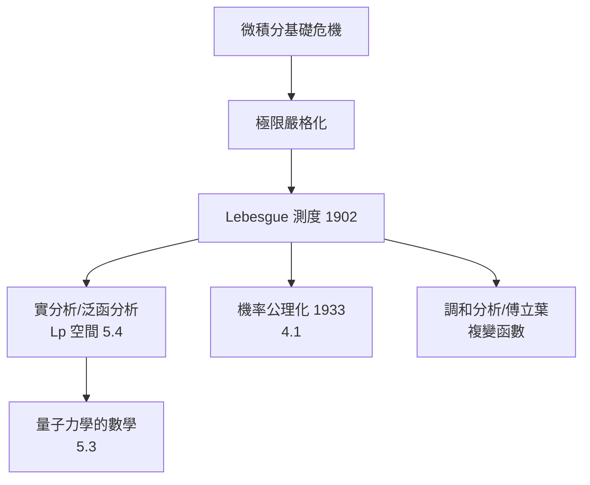

# 3.1 實分析與測度論：微積分的嚴格化

## 前因：微積分的信任危機

Newton 與 Leibniz（1660s–1680s）的微積分威力驚人，但基礎含糊：「無窮小量」是零還是非零？Berkeley 主教 1734 年譏之為「消失量的幽靈」。19 世紀的連續怪物（處處連續處處不可微的 Weierstrass 函數，1872；有界但 Riemann 不可積的函數）逼出了嚴格化工程：

1. 極限的 $\epsilon$-$\delta$ 定義（Cauchy、Weierstrass）
2. 實數的構造（Dedekind 分割、Cauchy 序列）
3. **面積/積分的徹底重做**（Lebesgue, 1902）

## 構造：測度論

**問題**：如何對「任意」實數子集定義長度？Lebesgue 的答案——外測度與可測性：

**定義（Lebesgue 外測度）。** $m^*(E) = \inf \left\{ \sum_n \ell(I_n) : E \subseteq \bigcup_n I_n,\ I_n \text{ 為開區間} \right\}$

**定義（測度空間）。** $(X, \mathcal{F}, \mu)$：$\mathcal{F}$ 是 $\sigma$-代數（對可數并與補集封閉），$\mu: \mathcal{F} \to [0, \infty]$ 滿足可數可加性：對互斥的 $E_n$，

$$\mu\left(\bigcup_n E_n\right) = \sum_n \mu(E_n)$$

**Lebesgue 積分**：先對簡單函數 $\sum a_i \mathbf{1}_{E_i}$ 定義 $\int = \sum a_i \mu(E_i)$，再取極限。與 Riemann 積分的差別：Riemann「垂直切」，Lebesgue「水平切」——先分函數值域，再量每層的測度。

**收斂定理**（Riemann 積分夢寐以求而不可得的）：

- **單調收斂**：$f_n \uparrow f \Rightarrow \int f_n \uparrow \int f$
- **支配收斂**：$|f_n| \le g$ 可積、$f_n \to f$ a.e. $\Rightarrow \int f_n \to \int f$

**關鍵對偶（4.1 的伏筆）**：機率論把「樣本空間」當成 $(\Omega, \mathcal{F}, P)$——機率就是總測度為 1 的測度。隨機變數 = 可測函數，期望 = 積分。**1933 年 Kolmogorov 用這一招讓機率成為分析的分支。**

## 後果

- **$L^p$ 空間**：$\|f\|_p = (\int |f|^p)^{1/p}$，完備賦範空間，泛函分析的模型（5.2–5.4）。
- **調和分析**：傅立葉級數收斂問題在 $L^2$ 中獲得完美解答（Parseval）。
- **遍歷理論與動態系統**（3.3）：保測變換。

## 練習與思考

1. 證明可數集的 Lebesgue 測度為零；由此說明「幾乎處處」概念的意義。
2. 為什麼支配收斂定理讓「極限與積分交換」從賭博變成定理？
