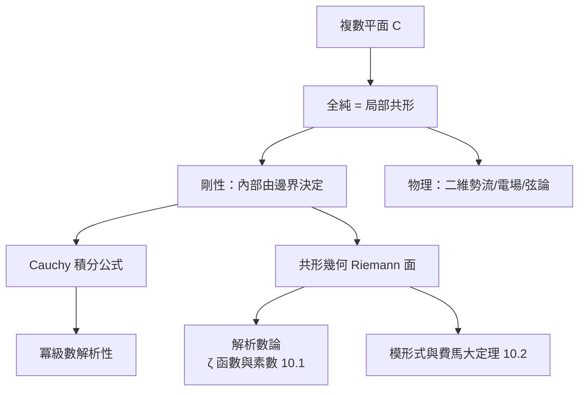

# 3.2 複分析：剛性與幾何構造的完美結合

## 前因： $\sqrt{-1}$ 從工具升格為空間

複數最初只是解方程的代數工具（Cardano, 1545；Euler 命名 $\mathrm{i}$ ）。Argand、Gauss 將其幾何化為平面 $\mathbb{C} \cong \mathbb{R}^2$ 。Cauchy（1825）、Riemann（1851）、Weierstrass 三條路線把「複變數函數」建立成一套**剛性極強**的理論——剛性正是它與實分析的深刻差異。

## 構造：可微的奇蹟

**定義（全純）。** $f: U \subseteq \mathbb{C} \to \mathbb{C}$ 可微，即極限

$$f'(z_0) = \lim_{h\to 0} \frac{f(z_0+h)-f(z_0)}{h} \quad (h \in \mathbb{C})$$

存在。注意 $h$ 可從**任何複數方向**趨近 0——這一個條件等價於 Cauchy–Riemann 方程組：

$$u_x = v_y, \qquad u_y = -v_x$$

**剛性定理階梯**（每一條在實分析中都沒有對應物）：

1. **Cauchy 積分定理**：全純函數在單連通域上任意閉迴路積分為 0。
2. **Cauchy 積分公式**： $f(z_0) = \dfrac{1}{2\pi \mathrm{i}} \oint \dfrac{f(z)}{z - z_0}\, dz$ ——內部值由邊界完全決定。
3. **解析性**：全純函數自動無窮可微，且等於自己的 Taylor 級數。
4. **唯一性**： $f$ 在有累積點的集合上為零 $\Rightarrow$ $f \equiv 0$ 。
5. **Liouville 定理**：有界整函數必為常數。
6. **極大模原理**：最大值只發生在邊界上。

**Riemann 映射定理（1851）**：任何單連通真子域 $\cong$ 單位圓盤——複分析同時是**共形幾何學**。

## 與其他領域的交會

- **數論**：Riemann ζ 函數 $\zeta(s) = \sum n^{-s}$ 用複分析研究素數分佈；素數定理（1896）由複分析證明。
- **解析延拓與 Riemann 面**： $\sqrt{z}$ 、 $\log z$ 的多值性用黎曼面解決——「函數的天然定義域是曲面」。
- **傅立葉分析**：複指數 $e^{\mathrm{i}\omega t}$ 是特徵函數，捲積定理本質上是 Cauchy 積分的世界。

## 後果

複分析的剛性使它成為「跨域翻譯器」：代數幾何把曲線推廣到任意體（含有限體），其中「微分」概念直接來自複分析；朗蘭茲綱領中的自守形式（10.1）就是上半天活在複分析、下半天活在數論的函數。

## 練習與思考

1. 用 Cauchy–Riemann 方程驗證 $e^z$ 全純、 $f(z) = \bar z$ 不全純。
2. 為什麼「有界整函數必為常數」體現了複分析的剛性？實分析中對應的敘述為何為假？
