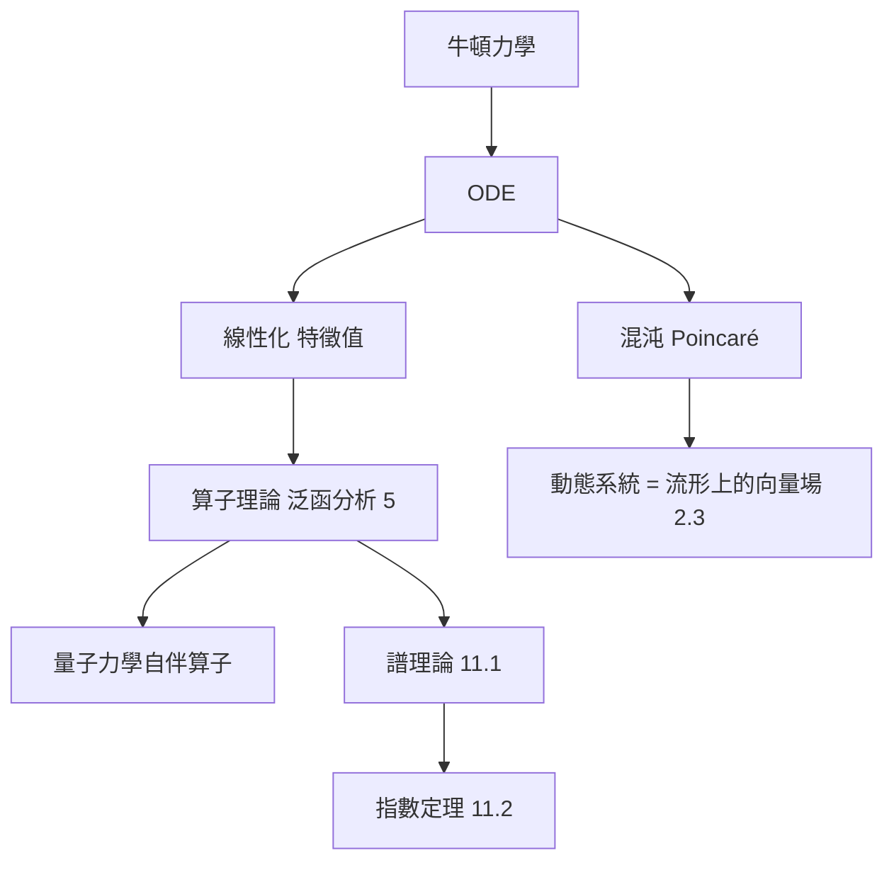

# 3.3 算子與微分方程：動態系統的語言

## 前因：從求方程的解到研究「解的空間」

牛頓寫下 $\ddot x = f(x)$ 的瞬間，數學迎來新任務：**由變化律預測未來**。19–20 世紀的兩次觀念躍進：

1. **線性化**：複雜系統在平衡點附近近似線性系統 $\dot x = Ax$ ，於是矩陣（代數）成為動力學的文法。
2. **算子觀點**：把微分方程寫成抽象方程 $Lu = f$ ，其中 $L$ 是函數空間之間的**算子**——微積分升格為線性代數的無窮維版本。

## 構造

**線性系統** $\dot x = Ax$ 的解為 $x(t) = e^{tA} x(0)$ 。行為由 $A$ 的特徵值決定：

| 特徵值 | 行為 |
|---|---|
| $\mathrm{Re}\,\lambda < 0$ | 收斂（穩定） |
| $\mathrm{Re}\,\lambda > 0$ | 發散（不穩定） |
| 純虛數 | 週期振盪 |
| 虛軸上有重根 | 共振 |

**譜問題**：解 $u'' + \lambda u = 0$ （配合邊界條件）只有特定 $\lambda$ 可行——**邊界條件把連續問題離散化**，特徵值譜就此登場（11.1），傅立葉級數 $=$ 用特徵函數展開。

**抽象化**： $L: D(L) \subseteq H \to H$ （希爾伯特空間上的無界算子）。自伴算子 $L = L^*$ 的譜為實數、有正交特徵展開（譜定理，5.3）。Schrödinger 方程

$$\mathrm{i}\hbar \frac{\partial \psi}{\partial t} = \hat H \psi$$

中能量算符 $\hat H$ 是自伴的——**量子力學的可觀測量就是自伴算子**（1925–1932，von Neumann 完成數學基礎）。

**非線性世界**：Poincaré（1890s，三體問題）證明：解多半不可寫成公式，改研究**解空間的幾何**——相流、極限環、混沌。動態系統 = 流形上的向量場（2.3）+ 微分方程（本節）。

## 後果

1. **泛函分析**（第 5 章）為了處理微分算子而生：Banach、Hilbert 空間是它的舞台。
2. **譜幾何**（11.1）：「能否從特徵值聽出鼓的形狀」。
3. **指數定理**（11.2）：解析指標 $=$ 拓撲不變量。
4. **里奇流**（12.1）：把「幾何」本身當成動態系統。
5. **數值分析與控制理論**：特徵值演算法、穩定性判準（Lyapunov）是工程日常。

## 練習與思考

1. 解 $\dot x = \begin{pmatrix}0 & 1 \\ -1 & 0\end{pmatrix} x$ ，說明解為何是旋轉。
2. 為什麼邊界條件會產生離散譜？與吉他弦的音高有何關係？
