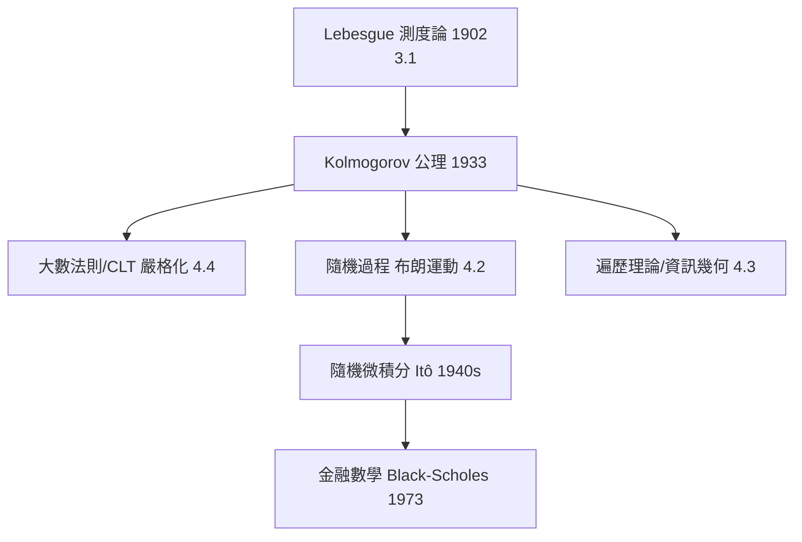

# 4.1 柯爾莫哥洛夫公理體系：機率即測度（1933）

## 前因：機率論的三百年尷尬

自 Pascal 與 Fermat（1654，賭徒問題通信）以來，機率論累積了強大的計算技巧，卻始終沒有穩固基礎：機率到底是主觀信念、長期頻率，還是別的什麼？「大數法則何時成立」、「隨機變數的收斂是哪種收斂」等基本問題爭論不休。核心障礙：**無窮次實驗**（如無窮多次丟銅板）需要嚴格的極限理論，而 20 世紀初的機率論沒有。

## 構造：一步跨入測度論

Kolmogorov《機率論基礎》（1933）宣告：

> 機率論 = 測度論 + 一條額外公理。

**定義（機率空間）。** $(\Omega, \mathcal{F}, P)$，其中：

1. $\mathcal{F}$ 為 $\Omega$ 上的 $\sigma$-代數；
2. $P: \mathcal{F} \to [0,1]$ 可數可加；
3. $P(\Omega) = 1$。

**翻譯表**（本書最重要的一張表）：

| 機率概念 | 測度論概念 |
|---|---|
| 樣本空間 $\Omega$ | 集合 $X$ |
| 事件 | 可測集 |
| 機率 $P$ | 測度 $\mu$（總量 1） |
| 隨機變數 $X$ | 可測函數 |
| 期望 $\mathbb{E}[X]$ | 積分 $\int X\, dP$ |
| 獨立 | $\sigma$-代數的獨立性 |
| 收斂 a.s. / in $L^p$ / in 機率 | 各種測度論收斂 |

**大數法則**因此變成測度論定理：$\mathbb{E}|X|<\infty$ 時，樣本均值 $\frac1n\sum X_i \to \mu$ **幾乎必然**（強法則）——「長期頻率」不再是哲學立場而是定理。

**隨機過程**：一族隨機變數 $\{X_t\}_{t\in T}$ = 可測函數的參數族；布朗運動由 Kolmogorov 相容性定理（K-extension）構造——「連續時間隨機性」首次獲得嚴格存在性（4.2）。

## 後果

1. **隨機過程與馬可夫鏈**：動態系統（3.3）的機率版本。
2. **隨機微積分**：Itô 積分（1944）在「不可微的路徑」上做積分，支撐 Black–Scholes 定價。
3. **遍歷理論**：Birkhoff 遍歷定理（1931）連接統計力學與動態系統。
4. **本書觀點**：機率不再是應用數學的附屬品——它是**分析 + 幾何 + 代數**的交匯處（4.3、13 章）。

## 練習與思考

1. 把「丟公平銅板無窮多次」建成機率空間：$\Omega = \{0,1\}^{\mathbb{N}}$，說明事件「前 $n$ 次皆正面」如何生成 $\sigma$-代數。
2. 為什麼「$\sigma$-代數」而非「所有子集」？考慮不可測集與 $P(\Omega)=1$ 的分配。
