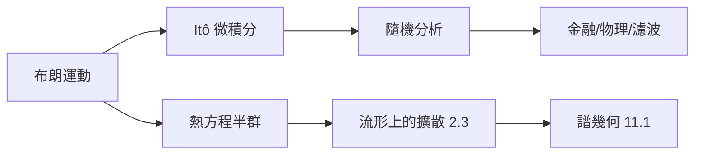

# 4.2 隨機過程與幾何：布朗運動、流形上的隨機漫步

## 前因：花粉的舞步

Brown（1827）觀察懸浮花粉的無規運動；Einstein（1905）由分子碰撞推導其統計律；Wiener（1923）在數學上構造出「處處連續、處處不可微」的隨機路徑——**布朗運動** $B_t$。它是隨機過程的「直線」，如同 $\mathbb{R}$ 之於幾何。

## 構造：隨機過程作為「機率化的函數空間」

**定義（布朗運動）。** 隨機過程 $\{B_t\}_{t\ge 0}$：

1. $B_0 = 0$；
2. 平穩獨立增量：$B_t - B_s \sim N(0, t-s)$；
3. 路徑 $t \mapsto B_t$ 幾乎必然連續。

兩種對偶的觀點（預示 5.2 的「函數即點」）：

- **時間軸觀點**：$t \mapsto B_t(\omega)$ 是 $C[0,\infty)$ 空間中的一條路徑；
- **空間軸觀點**：$\omega \mapsto (B_{t_1}, \ldots, B_{t_n})$ 給出高斯分佈——**布朗運動的機率測度（Wiener 測度）就是路徑空間上的高斯測度**。

**隨機微積分**：$B_t$ 不可微，古典微積分失效。Itô（1944）定義

$$\int_0^T f(B_t)\, dB_t, \qquad d\langle B\rangle_t = dt$$

得到 Itô 公式 $df(B_t) = f'(B_t)\,dB_t + \tfrac12 f''(B_t)\,dt$——多出的二階項正是「隨機性的曲率」。

**馬可夫過程與偏微分方程的對偶**（Feynman–Kac）：

$$\mathbb{E}[f(B_T)] = (e^{T\Delta/2} f)(0)$$

**期望 = 熱傳導半群**——機率（本節）與偏微分方程（3.3）是同一枚硬幣。

## 隨機過程遇上幾何

- **流形上的擴散**：在黎曼流形 $(M, g)$ 上，Laplace–Beltrami 算子 $\Delta_g$ 的半群生成**布朗運動在 $M$ 上行走**；小時間極限下路徑只「看到」度量的局部（不依賴座標）——熱方程、譜（11.1）與隨機漫步三合一。
- **幾何布朗運動**：$dS_t = \mu S_t\, dt + \sigma S_t\, dB_t$，Black–Scholes 定價的核心。
- **隨機微分方程的解 = 流上的擴散**：聯絡（8.4）決定平行輸運，隨機平行輸運給出 holonomy 的機率版本。

## 後果

1. **金融數學**：Black–Scholes（1973）= 幾何布朗運動 + Itô + 對沖論證。
2. **隨機幾何分析（Malliavin calculus）**：把「路徑空間」當無窮維流形做微積分，反過來證明 Hörmander 定理（次橢圓性）。
3. **量子場論**：Feynman 路徑積分的嚴格化嘗試依賴 Wiener 測度（歐化後）。
4. **TDA 與機器學習**（13 章）：資料上的隨機遊走定義了擴散距離與譜嵌入。

## 練習與思考

1. 用 Itô 公式計算 $f(B_t) = B_t^2$ 的微分，驗證 $\mathbb{E}[B_t^2] = t$。
2. 為什麼流形上的布朗運動「不需要座標」就良定義？這與 2.3 的切空間有何關係？
