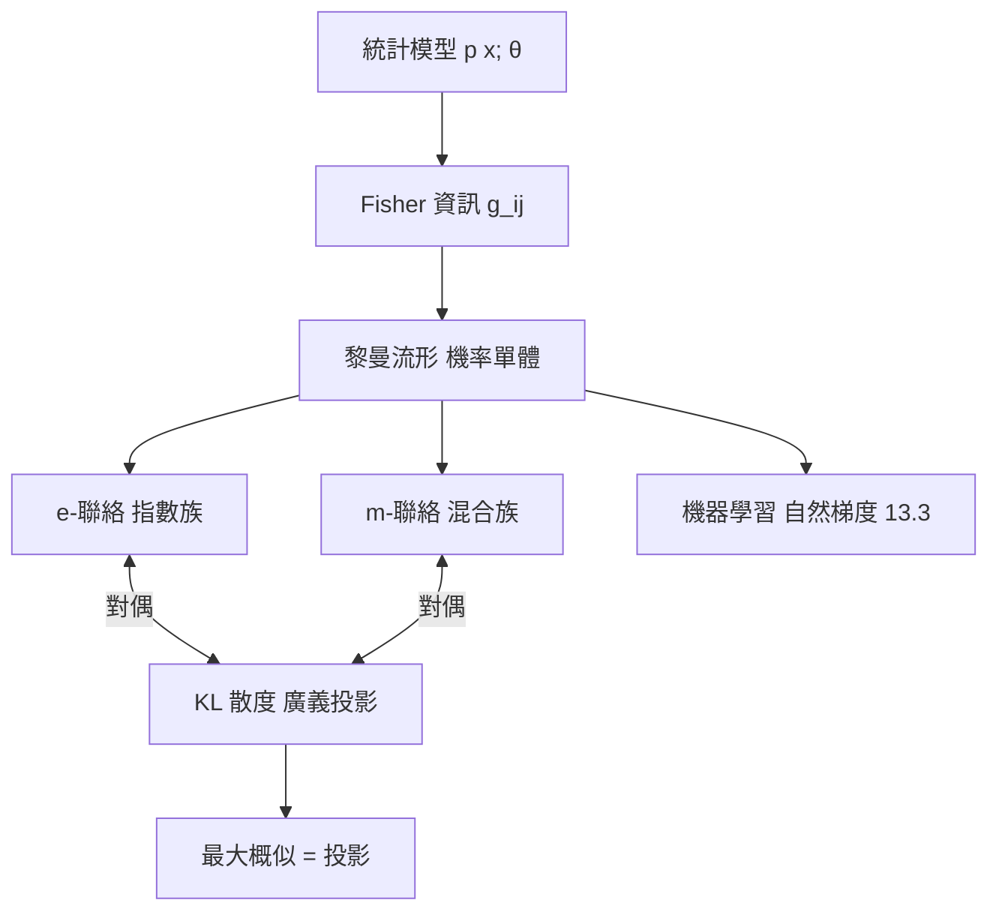

# 4.3 資訊幾何：機率分佈所構成的黎曼流形

## 前因：當「分佈的集合」需要距離

統計學的根本操作是比較兩個機率分佈：這組數據更接近哪個模型？兩個模型差多少？機率分佈全體 $\{p_\theta\}$ （參數 $\theta \in \Theta$ ）本身可以視為一個空間——但「兩個分佈差多遠」需要度量。Cramér（1946）、Rao（1945）指出 Fisher 資訊就是度量張量；Chentsov（1972）、Amari（1980s）建立完整理論：**資訊幾何**。

## 構造

**Fisher 資訊度量**：統計模型 $\{p(x;\theta)\}_{\theta\in\Theta}$ 上定義

$$g_{ij}(\theta) = \mathbb{E}_\theta\!\left[\frac{\partial \log p}{\partial \theta_i}\frac{\partial \log p}{\partial \theta_j}\right] = \int \frac{1}{p}\frac{\partial p}{\partial \theta_i}\frac{\partial p}{\partial \theta_j}\, dx$$

**定理（Rao–Chentsov）**： $g_{ij}$ 是唯一（在充分統計量等價變換下不變的意義上）自然的黎曼度量——測量誤差大處曲率「平緩」，資訊豐富處「陡峭」。

**兩個對偶仿射聯絡**（Amari 的核心貢獻）：機率單體上有兩種自然座標

- $m$ -座標：機率值本身 $p_i$ （混合座標）
- $e$ -座標：對數機率 $\log p_i$ （指數座標）

兩者誘導兩個平直聯絡 $\nabla^{(m)}$ 、 $\nabla^{(e)}$ ，在 Fisher 度量下互為對偶： $X g(Y,Z) = g(\nabla_X Y, Z) + g(Y, \nabla_X^{(e)} Z)$ 。**KL 散度** $D(p\|q) = \int p \log \frac{p}{q}$ 扮演「非對稱距離」，廣義畢氏定理 $D(p\|q) + D(q\|r) = D(p\|r) + \text{投影項}$ 在 $\nabla^{(e)}$ -測地線與 $\nabla^{(m)}$ -測地線之間成立——最大概似估計正是 $e$ -測地流形上的 $m$ -投影。

## 後果

1. **統計推論的幾何化**：效率（Cramér–Rao 下界） $=$ 測地線與切空間的關係。
2. **機器學習**（13.3）：自然梯度下降 $\tilde\nabla f = g^{-1}\nabla f$ 在機率單體上座標不變，改善了神經網路與強化學習的優化。
3. **資訊論**：KL 散度、熵成為幾何量；率失管理論有了測地線解釋。
4. **本書觀點**：資訊幾何是「機率統計（4.1）+ 黎曼幾何（2.3）」的直接合成，證明統計也有自己的微分幾何。

## 練習與思考

1. 對 Bernoulli 模型 $p(x;\theta) = \theta^x(1-\theta)^{1-x}$ 計算 Fisher 資訊 $g(\theta) = \frac{1}{\theta(1-\theta)}$ 。
2. 為什麼需要「兩個」對偶聯絡而不是一個黎曼聯絡？（提示：KL 散度不對稱。）
