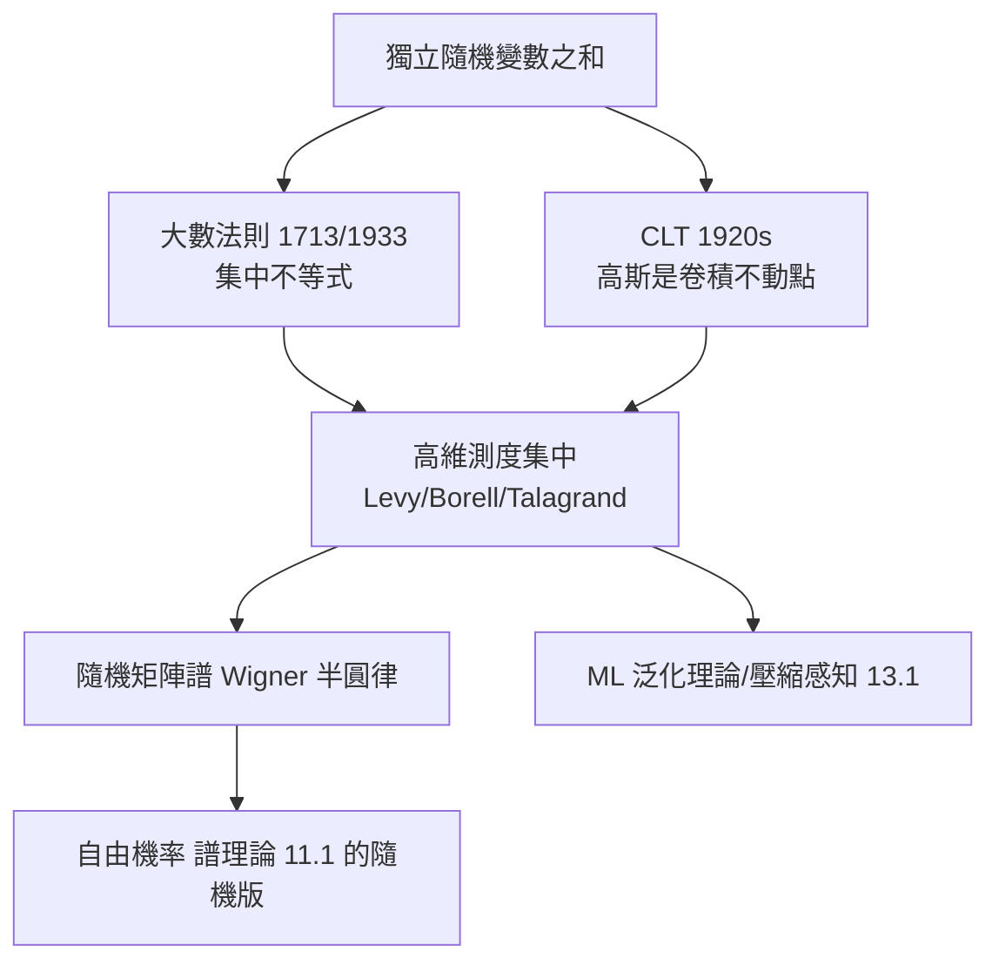

# 4.4 大數法則與中心極限定理：高維空間的幾何集中現象

## 前因：兩個古典定理的幾何秘密

- **大數法則**（Bernoulli, 1713；Kolmogorov, 1933）：大量獨立隨機量的平均值趨近期望——「平均消解偶然」。
- **中心極限定理**（Laplace、Gauss；Lindeberg–Lévy, 1920s）：和的波動趨近高斯

$$\frac{S_n - n\mu}{\sigma\sqrt n} \xrightarrow{d} N(0,1)$$

表面上這是「計算技巧」，但 20 世紀末的洞察是：**它們本質上是高維幾何的定理**。

## 構造：高維空間的反直觀幾何

考慮 $n$ 維單位球 $B^n$ 與球面 $S^{n-1}$（$n \to \infty$）：

1. **體積集中在赤道**：$B^n$ 的體積幾乎全在一個赤道帶 $|x_1| \le c/\sqrt n$ 內。
2. **體積集中在表面**：$B^n$ 的體積幾乎全在薄殼 $1-\epsilon \le |x| \le 1$。
3. **兩個隨機點幾乎正交**：均勻取自 $S^{n-1}$ 的 $x, y$，$\langle x, y\rangle \approx 0$（這正是高維資料的「維度災難」與「距離集中」現象的根源）。

**集中不等式**（Hoeffding, 1963；Talagrand, 1990s）：獨立有界變數的和偏離期望的機率呈指數衰減：

$$P(|S_n - \mathbb{E}S_n| \ge t) \le 2e^{-2t^2/\sum c_i^2}$$

**這就是大數法則的定量版本**——「平均會好」不是經驗，而是高維測度集中於少數區域的幾何事實。CLT 的證明（特徵函數法）也可解讀為「卷積的迭代把任何分佈推向唯一的不動點（高斯）」——一種動態系統的吸引子現象（3.3）。

## 後果

1. **統計推論**：信賴區間、假設檢定全部以 CLT 為地基。
2. **壓縮感知**（Candès–Tao, 2006）：高維隨機投影幾乎保持距離——稀疏訊號能用極少測量還原。
3. **機器學習理論**（13.1、13.3）：泛化界、隨機初始化的譜、Johnson–Lindenstrauss 降維引理。
4. **隨機幾何與組合**：隨機圖、滲流、Stein 方法。

## 練習與思考

1. 蒙地卡羅驗證：均匀取 $S^{n-1}$ 上兩點，畫出內積分佈隨 $n$ 增大趨近 $N(0, 1/n)$。
2. 為什麼高維中「所有方向的距離都差不多」會讓 k-NN 等演算法失效？
