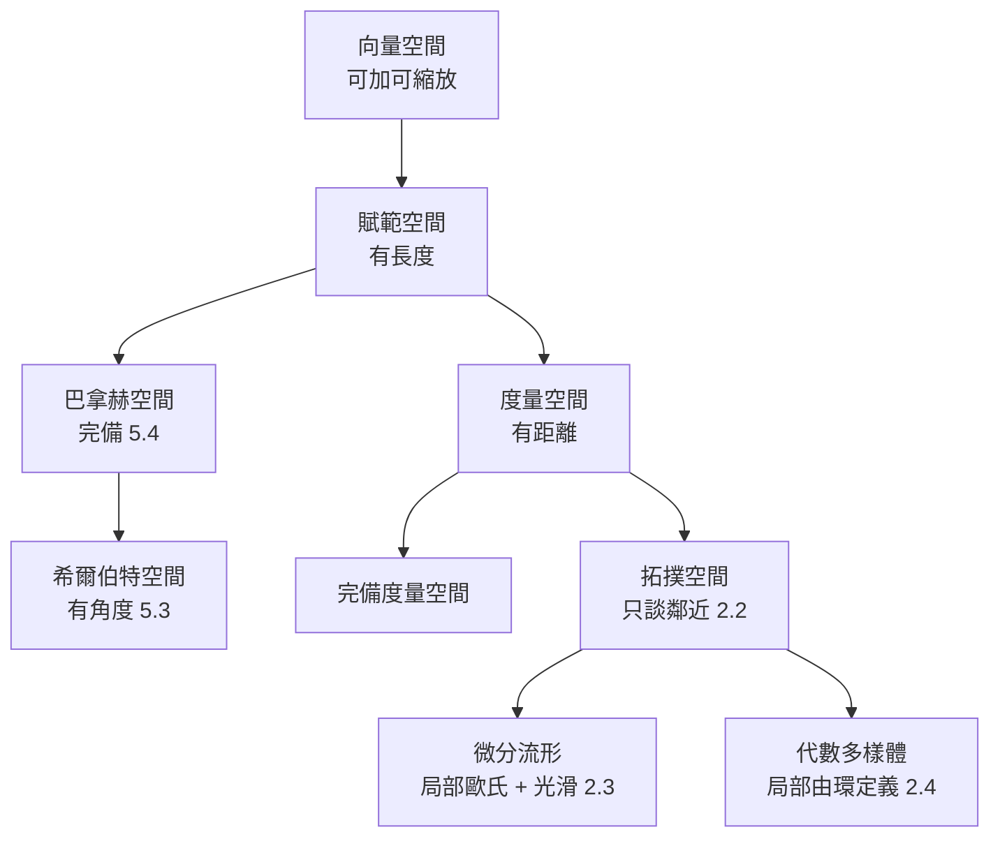

# 5.1 空間分級圖譜：向量空間、拓撲空間、度量空間與流形

## 前因：20 世紀的「空間大爆炸」

Bourbaki 的時代口號：「數學是研究**結構**的科學」。20 世紀上半葉，數學家系統性地把各種「空間」按公理分級，形成一張地圖。這張地圖是本書第二篇的骨架：**每一級空間都是為了回答某類具體問題而發明的。**

## 構造：由細到粗的圖譜

| 結構 | 公理核心 | 能做什麼 | 典型例子 |
|---|---|---|---|
| 向量空間 | 線性組合 | 解線性方程、特徵值 | $\mathbb{R}^n$ 、多項式 |
| 賦範空間 | $\|x\|$ | 談長度、極限 | $C[a,b]$ 配 sup 範數 |
| 巴拿赫空間 | 完備 | 收斂的極限仍在空間內 | $L^p$ |
| 希爾伯特空間 | 內積 | 正交投影、傅立葉 | $L^2$ 、 $\ell^2$ |
| 度量空間 | $d(x,y)$ | 談收斂、完備、緊 | 函數空間 |
| 拓撲空間 | 開集 | 談連續、連通、緊 | Zariski 拓撲 |
| 流形 | 局部歐氏 | 微積分、曲率 | 球面、時空 |

**三個方向的反向閱讀**（由粗到細）：

1. 拓撲 + 相容的線性結構 = 拓撲向量空間（泛函分析的實際舞台）。
2. 拓撲 + 局部歐氏 + 光滑相容 = 流形。
3. 拓撲 + 由函數環生成 = 概形（6.3）。

**關鍵原則：結構疊加時公理必須相容**。例如賦範空間要求 $d(x,y) = \|x-y\|$ 與線性結構相容（ $\|ax\| = |a|\|x\|$ ）；巴拿赫空間 $=$ 賦範 + 完備，而完備性是**分析性質**（Cauchy 序列收斂）——「用代數公理 + 分析公理同時定義空間」正是分析與代數交融的第一現場（5.4 將詳述）。

## 後果

1. 每一級都有**對偶理論**：向量空間的對偶空間、巴拿赫空間的連續對偶、希爾伯特空間的自對偶（Riesz 表示）。
2. **分類定理**逐級失效：有限維向量空間只有一種（ $K^n$ ），無窮維則千姿百態——維度是「分類的邊界」。
3. 這張圖譜直接組織了第 5 章其餘三節與第 6 章（空間 ↔ 代數的對偶）。

## 練習與思考

1. 驗證 $C[0,1]$ 配 sup 範數完備、配 $L^1$ 範數不完備。
2. 為什麼「完備」在無窮維中變成昂貴的要求？舉一個不完備化後喪失的定理。
