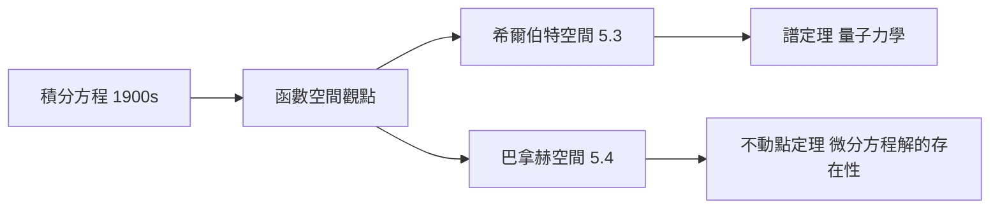

# 5.2 無窮維空間的誕生：函數作為空間中的「點」

## 前因：一個革命性的倒轉

19 世紀的數學把「函數」當作輸入輸出的規則。但 Volterra、Fredholm（1890s–1900s）研究積分方程時發現：把**函數當成一個點**、把**積分/微分當成這個空間中的變換**，整個問題瞬間變成線性代數：

$$\int_a^b K(x,y) u(y)\, dy = f(x) \quad \leadsto \quad Ku = f$$

Hilbert（1904–1910）與 Schmidt、Riesz、Fischer 沿此路開創了無窮維線性代數——泛函分析。

## 構造

**空間：** $C[0,1]$（連續函數）、$L^2[0,1]$（平方可積）、$\ell^2$（平方可和數列）。範數：

$$\|f\|_{L^2} = \left(\int_0^1 |f|^2\right)^{1/2}, \qquad \|f\|_\infty = \max |f|$$

**點 = 函數**帶來的立即效果：

- 「解方程」= 在函數空間中找一個點；
- 「解的穩定性」= 映射的連續性；
- 「逐次逼近」= 距離空間中的收斂（Banach 不動點，5.4）；
- 「級數展開」= 用一組基（特徵函數）表達一個點——**傅立葉級數就是 $L^2$ 中的正交座標系**。

**例子（Green 函數）**：$-u'' = f$，$u(0)=u(1)=0$ 的解是

$$u(x) = \int_0^1 G(x,y) f(y)\, dy$$

微分方程 = 用積分算子 $G$ 在函數空間中求逆——**微分與積分在無窮維空間中互為逆算子**。

## 後果

1. **量子力學**（1925–1932）：波函數 $\psi \in L^2$ 是希爾伯特空間的點；可觀測量是算子——物理直接採用了無窮維幾何。
2. **偏微分方程**：弱解、Sobolev 空間——「解」不必處處可微，只需在函數空間中收斂。
3. **最佳化與機器學習**（13.3）：神經網路的參數空間、再生核希爾伯特空間（RKHS）。
4. **本書觀點**：這是「分析 → 幾何」的搬運：極限理論的問題被重新表述為幾何（距離、正交、投影）問題。

## 練習與思考

1. 驗證 $\{\sqrt2 \sin(n\pi x)\}$ 是 $L^2[0,1]$ 的正交基（至少檢查 $n=1,2$）。
2. 「函數是點」顛覆了什麼傳統階層？它如何讓傅立葉級數與矩陣對角化成為同一件事？
