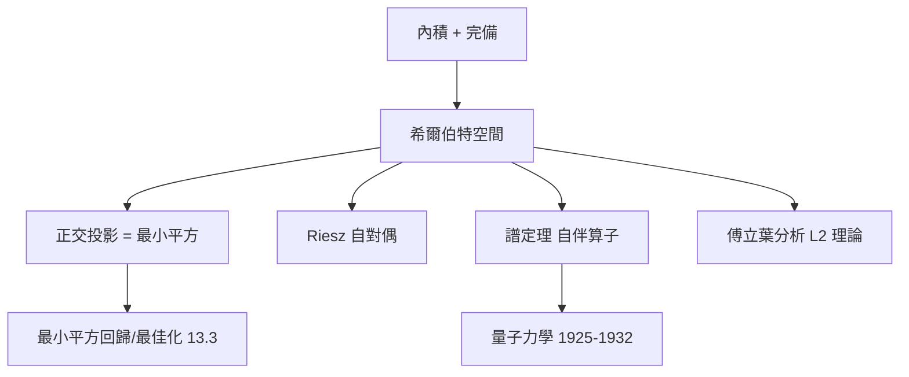

# 5.3 希爾伯特空間：內積、角度與正交幾何

## 前因：給無窮維空間裝上歐氏幾何

Hilbert 研究積分方程時使用的 $\ell^2$ 空間，在 von Neumann（1927–1932）手中公理化為**希爾伯特空間**——保留了內積，也就保留了角度與正交。這是無窮維空間中與歐氏幾何最接近、性質最好的一層。

## 構造

**定義。** 內積空間 $(H, \langle\cdot,\cdot\rangle)$：線性、對稱、正定；若誘導的 $\|x\| = \sqrt{\langle x,x\rangle}$ 使 $H$ 完備，則 $H$ 為希爾伯特空間。例：$\mathbb{C}^n$、$\ell^2$、$L^2[0,1]$。

**三大支柱**：

1. **Cauchy–Schwarz**：$|\langle x, y\rangle| \le \|x\|\|y\|$（角度的基礎）。
2. **正交投影**：對閉凸子集 $C$，任意 $x$ 有唯一最近點 $\mathrm{proj}_C(x)$——最佳化的幾何本質。
3. **Riesz 表示定理**：每個連續線性泛函 $f \in H^*$ 皆為 $\langle \cdot, v\rangle$——**$H$ 自對偶**。這是希爾伯特空間獨有的奢侈（一般巴拿赫空間 $V^{**} \ne V$）。

**正交基與譜定理**：可分 $H$ 有可數正交基 $\{e_n\}$（Parseval：$\|x\|^2 = \sum |\langle x, e_n\rangle|^2$）。自伴算子的譜定理：

$$A = \int \lambda \, dE_\lambda$$

連續譜用投影值測度 $E_\lambda$ 表達——**矩陣對角化的完全推廣**。量子力學中：狀態 = 希爾伯特空間的單位向量、可觀測量 = 自伴算子、測量值 = 譜中的實數、機率 = $|\langle\psi, e_\lambda\rangle|^2$。

**傅立葉分析 = 幾何**：$\{\mathrm{e}^{\mathrm{i}n x}\}$ 是 $L^2$ 的正交基；傅立葉變換把訊號分解為正交分量——捲積定理、Plancherel 定理都是內積恒等式。

## 後果

1. **量子力學的數學基礎**（von Neumann 1932）：物理與幾何在無窮維合流。
2. **控制與濾波**：Kalman 濾波 = 希爾伯特空間中的投影。
3. **機器學習**：RKHS 使「核方法」成為幾何（13.3）。
4. **譜理論**（11.1）與**指數定理**（11.2）的舞台。

## 練習與思考

1. 證明希爾伯特空間中，$x$ 到閉子空間 $M$ 的投影是 $M$ 中唯一與 $x - \mathrm{proj}$ 正交的向量。
2. 為什麼 $C[0,1]$ 配 sup 範數**不是**希爾伯特空間？（提示：平行四邊形恆等式。）
