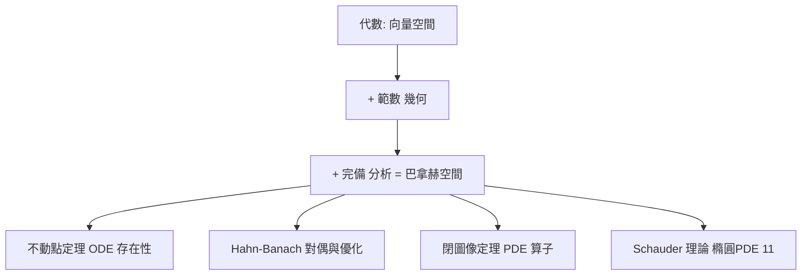

# 5.4 巴拿赫空間：以完備賦範定義的分析舞台

## 前因：比希爾伯特更寬的舞台

許多自然空間沒有內積： $C[0,1]$ 配 sup 範數、 $L^p$ （ $p\ne 2$ ）。它們仍需要「長度」與「完備」才能談極限與收斂。Banach（1920 論文，1932《線性算子理論》）公理化：

**定義。** 賦範空間 $(V, \|\cdot\|)$ ：範數滿足 $\|ax\| = |a|\|x\|$ 、 $\|x+y\| \le \|x\| + \|y\|$ ；若完備（Cauchy 序列皆收斂），則 $V$ 為**巴拿赫空間**。

**結構解讀（本節主旨）**：巴拿赫空間的定義 = **向量空間（代數公理）+ 範數三角不等式（幾何/距離公理）+ 完備（分析公理）**——一個空間同時掛著代數、幾何、分析三塊牌照，是三柱石交匯的具體地點。

## 構造：四大基本定理

1. **Hahn–Banach 延拓**：線性泛函可保範延拓——對偶空間夠大，分離點與超平面（凸分析、對偶規劃的基礎）。
2. **開映射定理**：巴拿赫空間之間的滿連續線性算子是開映射。
3. **閉圖像定理**：算子連續 $\iff$ 圖像閉——驗證微分算子連續性的標準工具。
4. **Banach 不動點定理**：壓縮映射有唯一不動點，且迭代收斂——**存在性證明的機器**：Picard 迭代證 ODE 解存在唯一、牛頓法收斂、隱函數定理。

**對偶理論**： $(C[0,1])^*$ = 測度（Riesz–Markov）； $(L^p)^* = L^q$ （ $1/p + 1/q = 1$ ）。但 $\ell^1$ 、 $\ell^\infty$ 出現病態（ $c_0^{**} \ne c_0$ ，非自反），無窮維的「形狀」遠比有限維詭譎——Banach 空間理論本身成為一門深奧學問（超冪、可補子空間問題等）。

**與希爾伯特的關係**：希爾伯特空間 = 有內積的巴拿赫空間（平行四邊形恆等式 $\|x+y\|^2 + \|x-y\|^2 = 2\|x\|^2 + 2\|y\|^2$ 刻劃「範數來自內積」）。巴拿赫更廣，希爾伯特更好算——理論上取捨的典範。

## 後果

1. **微分方程**：線性/非線性 PDE 的存在唯一性大規模用不動點與對偶論證（Schauder、Lax–Milgram）。
2. **凸優化**：Lagrange 對偶、 LP/半正定規劃——Hahn–Banach 的工程化身。
3. **譜理論與指數定理**（11 章）：Fredholm 算子理論在巴拿赫空間成形。
4. **經濟學**：一般均衡存在性（Arrow–Debreu）用不動點定理。

## 練習與思考

1. 證明 $\ell^\infty$ 的單位球不是緊的（找一個無收斂子列的序列）；這說明有限維的什麼定理在無窮維失效？
2. 指出巴拿赫空間定義中哪一條是代數的、哪一條是幾何的、哪一條是分析的。
