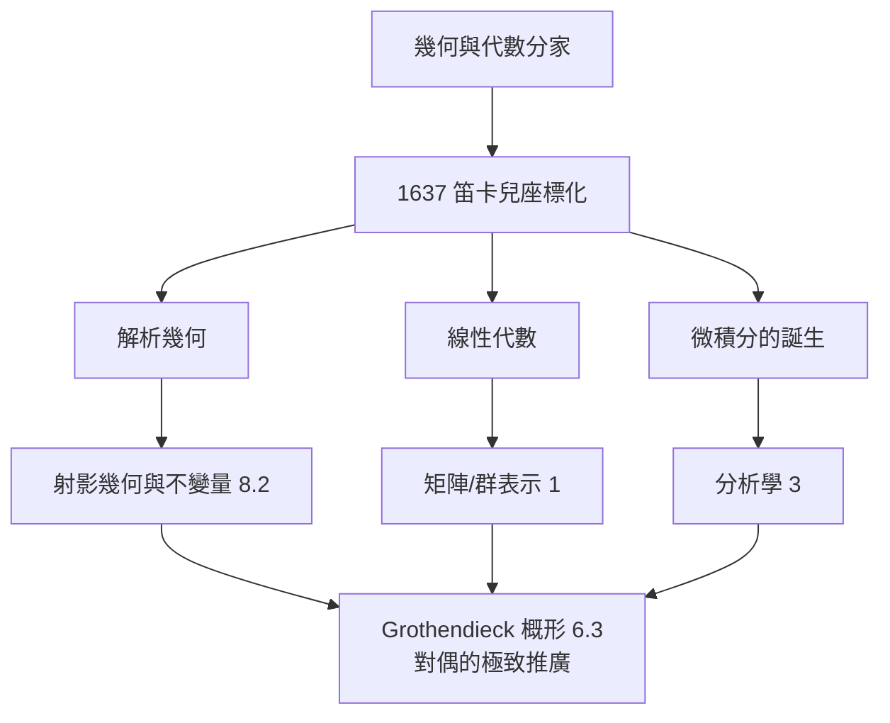

# 6.1 笛卡兒的遺產：坐標化作為代數與幾何的第一次交會

## 前因：兩千年分家的合流

Euclid 的幾何靠圖形與公設，代數（巴比倫、Diophantus）靠文字演算，兩者自希臘時代分家。1637 年 Descartes《幾何學》（附於《方法論》）與同時代 Fermat 的工作，讓**每一對數 $(x, y)$ 對應平面上的一點、每一條曲線對應一個方程**：

$$x^2 + y^2 = r^2 \quad \leftrightarrow \quad \text{圓}$$

## 構造：翻譯字典

| 幾何 | 代數 |
|---|---|
| 點 | 數組 $(x,y)$ |
| 曲線/曲面 | 方程 $F(x,y) = 0$ |
| 兩曲線相交 | 方程組聯立求解 |
| 平行/垂直 | 斜率相等/乘積 $-1$ |
| 距離 | $\sqrt{(x_1-x_2)^2 + (y_1-y_2)^2}$ |
| 變換 | 座標轉換公式（矩陣） |

深層意義不只是「方便計算」：

1. **同構成為明確概念**：幾何問題與代數問題一一對應，任何一方的新工具立即雙向輸出。
2. **維度自由化**：$n$ 維幾何（純思辨的 $\mathbb{R}^n$）成為合法物件——純量組有 $n$ 個即可。
3. **線性代數的誕生**：直線與平面 $\leftrightarrow$ 線性方程組，消去法 = 行列式 = 矩陣。

**微積分的馬上應用**：切線斜率 = 導數——Descartes 的座標化是 Newton/Leibniz 微積分的前提；沒有座標，「曲率的變化率」無從談起。

## 後果

1. **射影幾何**（17–19 世紀）：換座標到極致（齊次座標、無窮遠點），催生不變量理論 → Erlangen 綱領（第 8 章）。
2. **Gelfand 對偶**（6.2）：把「空間 = 函數環」倒轉——笛卡兒字典的完備化。
3. **張量與廣義相對論**：座標變換下的不變量 = 幾何量（2.1、2.3）。
4. **本書觀點**：笛卡兒的真正遺產是「**對偶精神**」——每個領域都可以問：「我對應的另一邊是什麼？」

## 練習與思考

1. 用座標法證明：圓 $x^2+y^2=r^2$ 上過點 $(x_0, y_0)$ 的切線方程為 $x x_0 + y y_0 = r^2$。
2. 「座標」是選擇，「幾何性質」是不變量——用此原則解釋為什麼向量不依賴基底。
