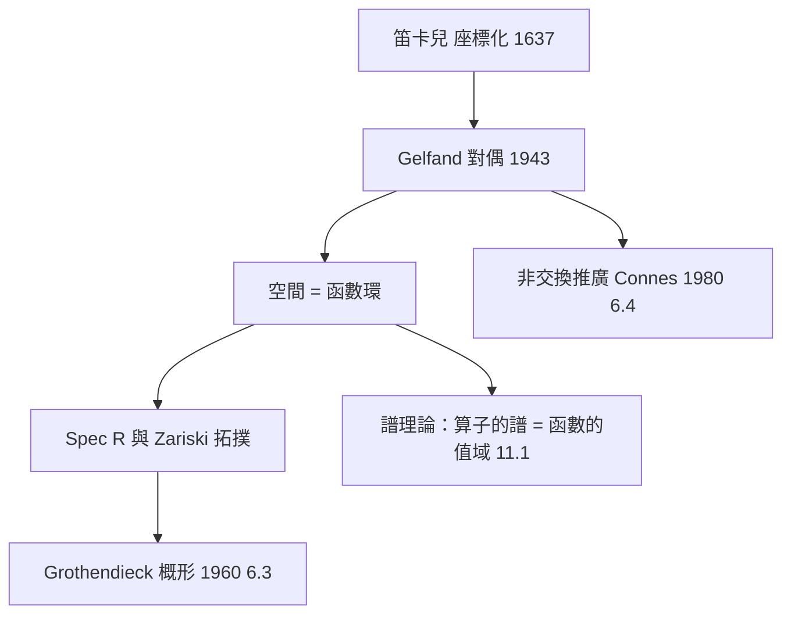

# 6.2 Gelfand 對偶：幾何空間與交換代數環的完美對應（1943）

## 前因：把笛卡兒字典倒過來讀

笛卡兒說：空間 $X$ 上的點配座標，就成了數。Gelfand 問反方向的問題：

> 如果我們只知道 $X$ 上所有「好函數」構成的環 $A = C(X)$ ，能還原出 $X$ 嗎？

答案：**能，而且精確到同胚**。空間完全編碼在它的函數環裡——「點」可以被重新定義為「代數上的極大理想」。

## 構造

**Gelfand–Kolmogorov 定理（1939）/ Gelfand–Naimark 定理（1943）。**

- 緊 Hausdorff 空間 $X$ $\leftrightarrow$ 交換 $C^*$ -代數 $C(X)$ （連續函數環，配 $\|f\|_\infty$ 與對合 $f \mapsto \bar f$ ）。
- **點 = 極大理想**： $p \in X \mapsto M_p = \{f : f(p) = 0\}$ ，且所有極大理想恰是這些。
- **連續映射** $X \to Y$ $\leftrightarrow$ **環同態（反方向）** $C(Y) \to C(X)$ 。

$$X \xrightarrow{\ \varphi\ } Y \qquad \Longleftrightarrow \qquad C(Y) \xrightarrow{\ \varphi^*\ } C(X)$$

**箭頭方向相反**——這是「反變對偶」：把幾何範疇 $\mathbf{Top}$ 反變嵌入代數範疇。Gelfand 變換 $f \mapsto \hat f$ 把交換代數的元素變成「極大理想空間上的函數」。

**交換環的更普遍版本（代數幾何）**：任意交換環 $R$ ，其素譜 $\mathrm{Spec}\, R$ （素理想全體，配 Zariski 拓撲）扮演「空間」的角色——這是 Grothendieck 概形（6.3）的第一塊磚。

## 交換性是關鍵、也是邊界

$C(X)$ 是交換代數，故此對偶只看見「交換的世界」。兩個後果：

1. **非交換的空白**：矩陣代數 $M_n(\mathbb{C})$ 對應哪個空間？——「沒有點的空間」，催生非交換幾何（6.4）。
2. **量子力學的暗示**：可觀測量代數天生非交換（ $[\hat x, \hat p] = \mathrm{i}\hbar$ ）——量子世界正是「非交換空間」。

## 後果

1. **泛函分析與調和分析**：交換 $C^*$ -代數分類完備，作為「試金石」校正非交換理論。
2. **代數幾何**（6.3）：素理想取代極大理想（容納非代數封閉體與冪零元），幾何完全代數化。
3. **諾特交換環論**：Krull 維數、局部化獲得幾何意義（局部化 = 開集上取函數）。
4. **本書觀點**：Gelfand 對偶是本書「對偶」概念的核心範例——**兩個範疇反變等價**，問題可以在最順手的一邊解決（拓撲問題 → 代數問題，或反之）。

## 練習與思考

1. 對 $X = \{a, b\}$ ，寫出 $C(X) \cong \mathbb{R}^2$ ，找出兩個極大理想，驗證它們對應兩個點。
2. 為什麼連續映射誘導的環同態「方向相反」？這與範疇論中的反變函子（9.4）有何關係？
