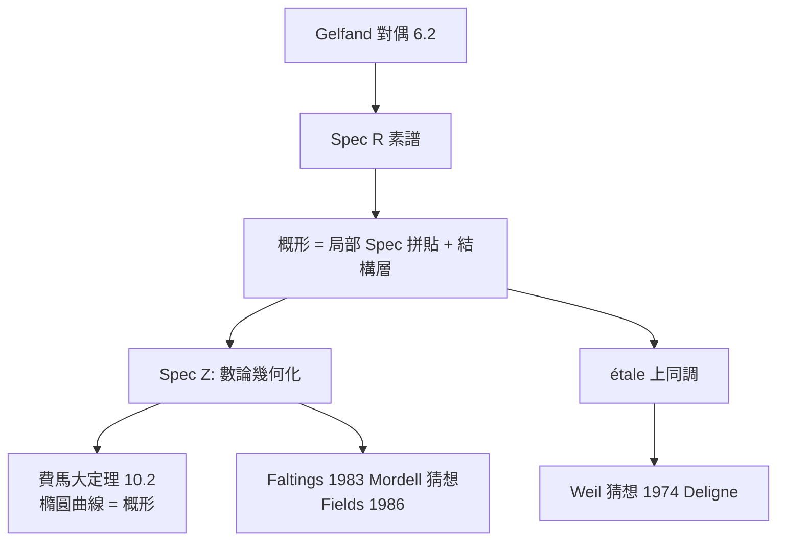

# 6.3 Grothendieck 概形：將數論與幾何統一（1960）

## 前因：數論渴望幾何的工具

20 世紀中葉，數論面臨尷尬：Diophantus 方程（如 Fermat 方程 $x^n + y^n = z^n$ ）被公認是「幾何」問題——曲線上的有理點——但**整數解的世界沒有連續性、沒有距離**： $\mathbb{Z}$ 上無法談論微積分。Weil（1949）提出著名的 Weil 猜想：數數函數（zeta 函數）應該像拓撲空間一樣滿足 Lefschetz 不動點公式、Poincaré 對偶——**彷彿有限體上的方程解集真的是一個拓撲空間**。

Grothendieck（1957–1970）回應：重新發明「空間」的概念。

## 構造

**核心觀念**：空間不由「點」定義，而由**函數環**定義（Gelfand 對偶 6.2 的極致化）。

**定義（仿射概形）。** 交換環 $R$ 對應空間 $\mathrm{Spec}\, R$ ：

- 點集：素理想 $\mathfrak{p} \subset R$ ；
- 拓撲：Zariski 拓撲，閉集 $V(\mathfrak{a}) = \{\mathfrak{p} : \mathfrak{a} \subseteq \mathfrak{p}\}$ ；
- **結構層** $\mathcal{O}$ ：每個開集配上「其上的函數環」，開集縮小時函數環局部化。

概形 = 這種局部 $\mathrm{Spec}\, R$ 拼貼起來的空間。允許**冪零元**（ $\mathfrak{p} \ni x, x^2=0$ ）——「無窮小厚度的點」，這正是微分幾何中切向量的代數化身。

**關鍵收穫**：

1. $\mathrm{Spec}\, \mathbb{Z}$ 是一個「一維空間」！素數成為「點」， $\mathbb{Z}$ 上也能做幾何。
2. 有限體 $\mathbb{F}_q$ 上的方程組 = 概形上的點數問題——數數變成幾何。
3. **étale 上同調**（Grothendieck–Deligne, 1960s–70s）：在概形上重建「拓撲上同調」，證明 Weil 猜想（Deligne 1974 獲證最後一環）——**用幾何證明了 Riemann 假設的有限體類比**。

## 後果

1. **數論幾何成為主流**：Mordell 猜想（Faltings 1983）、Weil 猜想、Fermat 大定理（Wiles 1995）全部在概形語言中證明。
2. **上同調方法的統一**：層論（1946, Leray）+ 概形 → derived 範疇、譜理論化的同倫論——「同調代數」成為通用文法（7.2、9.4）。
3. **物理**：模空間、層理論進入弦論與規範場論（10.3、10.4）。
4. **本書觀點**：概形理論是「代數與幾何對偶」的第三次躍進：第一次座標化（6.1）、第二次函數環還原空間（6.2）、**第三次連空間的定義本身都改成代數的**。

## 練習與思考

1. 求 $\mathrm{Spec}\, \mathbb{Z}$ 的閉點與一般點；解釋為什麼它是「一維」的。
2. 冪零元在幾何上代表什麼？用 $\mathrm{Spec}\, \mathbb{R}[\epsilon]/(\epsilon^2)$ 說明「切方向」如何出現。
