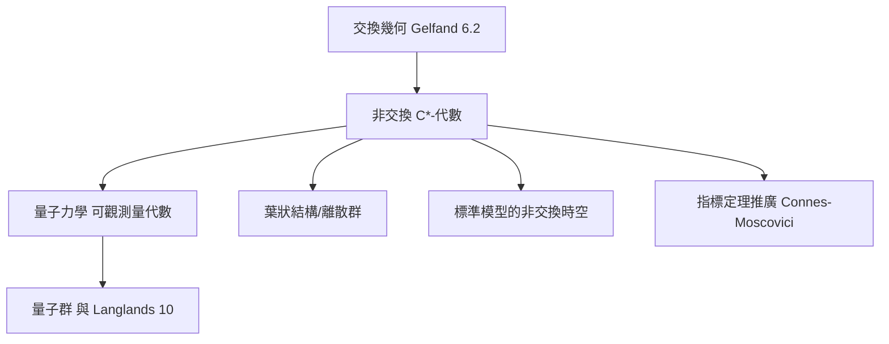

# 6.4 非交換幾何：當代數不交換時的空間概念（1980）

## 前因：交換性是一堵牆

Gelfand 對偶（6.2）把空間變成函數環，但只對**交換**代數有效。三個自然現象打破牆：

1. **矩陣**：$M_n(\mathbb{C})$ 非交換，卻是最「良性」的代數；
2. **量子力學**：可觀測量代數 $\{[\hat x, \hat p] = \mathrm{i}\hbar\}$ 非交換；
3. **葉狀結構與不連續空間**：有些「空間」的函數環天然非交換（如 $\mathrm{IR}_n$——$n$ 維葉狀結構的葉空間，常常是病態的拓撲空間）。

Connes（1980s）的主張：

> **把 $C^*$-代數本身當作空間。** 交換時它還原為古典空間（Gelfand）；非交換時，它是「沒有點的空間」。

## 構造：用代數翻譯幾何詞彙

| 幾何概念 | 代數化身 |
|---|---|
| 空間 $X$ | $C^*$-代數 $A$ |
| 點 | 不可約表示 |
| 函數 | $a \in A$ |
| 向量叢 | 有限投射模 |
| 微分形式 | 徵分（$\Omega^1$，由導數 $\delta: A \to \Omega^1$ 生成） |
| 積分 | 迹（trace）$\tau$ |
| 維數、曲率、示性類 | 週期循環上同調 |

**標準例子**：非交換環面 $A_\theta$——由 $uv = \mathrm{e}^{2\pi \mathrm{i}\theta} vu$ 生成的代數。交換時（$\theta = 0$）是尋常環面；$\theta$ 無理時，它對應「葉的斜率無理的 Kronecker 葉狀結構之葉空間」——那個葉空間在古典拓撲下是病態的（每個葉稠密），非交換幾何卻給它完整的幾何：度量、曲率、示性類、指標定理全數可用。

**指標定理的非交換版（Connes–Moscovici）**：Fredholm 指標 $=$ 週期循環上同調的配對——11.2 的直接推廣。

## 後果

1. **數學物理**：非交換幾何重寫粒子物理標準模型的幾何（Connes–Lott）；分數量子霍爾效應的數學模型。
2. **數論**：Bost–Connes 系統、非交換的 Spec $\mathbb{Z}$ 企圖——數論的非交換化。
3. **表示論與幾何 Langlands**（10.3）：D-模與非交換代數的工具互通。
4. **本書觀點**：這是對偶概念的哲學極限測試——**當對偶的兩端不再等價時，選擇更代數的那一端當作定義**。「空間」一詞至此徹底解放。

## 練習與思考

1. 驗證 $M_2(\mathbb{C})$ 不可交換；它有幾個不可約表示？對應幾個「點」？
2. 為什麼無理 $\theta$ 的非交換環面可以「比古典空間更光滑」？聯想 4.2 中稠密葉狀結構。
