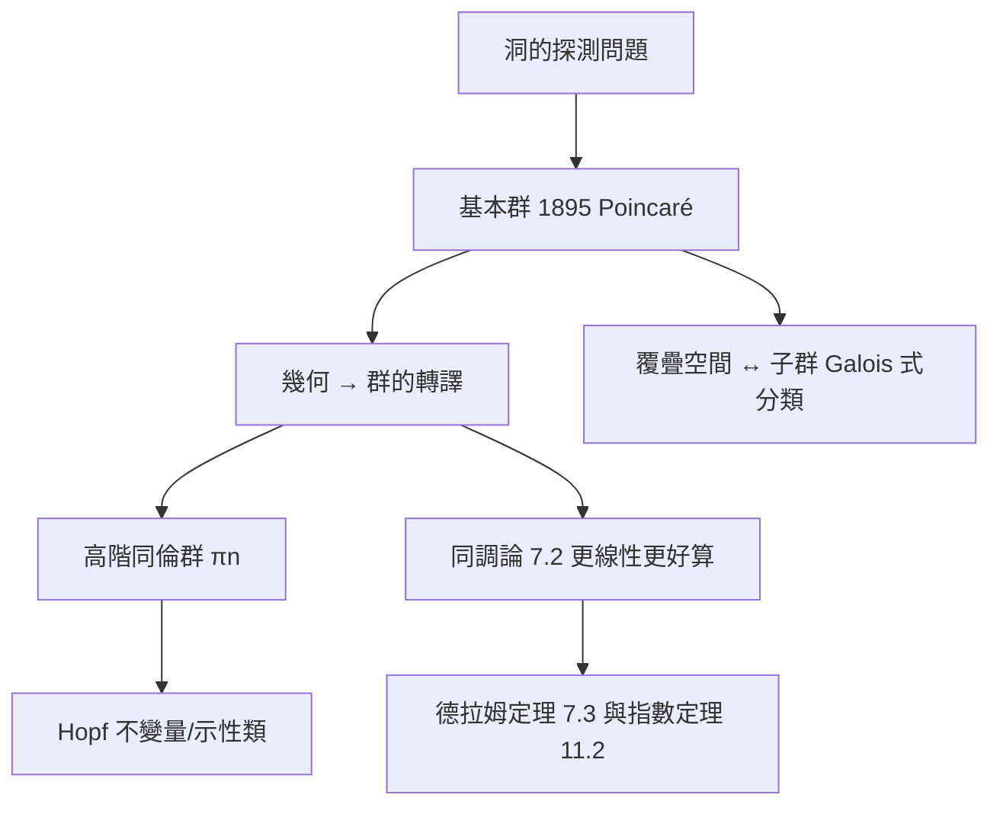

# 7.1 同倫群與基本群：用圈繞流形來量測「洞」（1895）

## 前因：怎麼區分「有洞的」空間？

咖啡杯與甜甜圈同胚（2.2），但環面與球面不同胚——差在哪？直觀答案：**洞的數量與類型**。問題是「洞」不是空間裡的點，必須發明探測器。Poincaré《位置分析》（1895）提供第一個：**圈（loop）**。

## 構造

**基本群 $\pi_1$。** $X$ 中取基點 $x_0$，考慮從 $x_0$ 出發又回到 $x_0$ 的連續路徑（圈）；兩個圈若可連續形變（同倫）則視為相同；運算為「接龍」：

$$\pi_1(X, x_0) = \{\text{圈}\}/\text{同倫}, \qquad [\alpha]\cdot[\beta] = [\alpha * \beta]$$

**例子**：

| 空間 | $\pi_1$ | 解讀 |
|---|---|---|
| $\mathbb{R}^n$ | $0$ | 無洞，圈可全部收縮 |
| $S^2$ | $0$ | 球面無一維洞 |
| $S^1$ | $\mathbb{Z}$ | 一個洞；繞 $k$ 圈 $\mapsto k$ |
| 環面 $T^2$ | $\mathbb{Z} \times \mathbb{Z}$ | 兩個獨立方向繞圈 |
| $\mathbb{RP}^2$ | $\mathbb{Z}/2$ | 「繞兩圈才算收縮」 |

**關鍵思想：幾何問題 → 群問題**。$S^1$ 的 $\pi_1 \cong \mathbb{Z}$ 說明：繞圈次數（捲繞數）自動形成一個群——**代數結構是幾何現象的影子**。

**高階同倫群**：$\pi_n(X) = $ 把 $n$ 維球面 $S^n$ 映入 $X$ 的同倫類。Cech、Whitney、Hurewicz（1930s）建立。驚人的事實：$\pi_3(S^2) \cong \mathbb{Z} \ne 0$（Hopf 映射）——高維球面之間藏著完全不直觀的「糾纏」。

**Poincaré 猜想（1904）**：單連通閉 3-流形 $\cong S^3$？——本節工具引出的百年難題，2003 年由 Perelman 以幾何方法（12.1）解決。

**覆疊空間與 Galois 對應**：$\pi_1(X)$ 作用於覆疊空間，連通覆疊的分類 $= \pi_1$ 的子群——**拓撲的「Galois 理論」**，這將在 Langlands 綱領（10.1）中與數論的 Galois 群遙相呼應。

## 後果

1. **代數拓撲**成為學科：同倫、同調、上同調互相配合。
2. **微分幾何**：單連通 + 常曲率 → 空間形式分類；Ricci 流（12.1）依賴 $\pi_1$ 的行為。
3. **物理**：規範場論的瞬子 = $\pi_3$ 的非平凡元素；拓撲缺陷（磁單極、宇宙弦）由同倫群分類。
4. **資料科學**（13.2）：TDA 直接計算資料的 $\pi_1$ 類比（持久同調）。

## 練習與思考

1. 證明 $\pi_1(S^1) \cong \mathbb{Z}$ 的關鍵步驟：用角度函數提升路徑。
2. 為什麼基本群是群而「同倫類的集合」不必是？（若路徑不要求閉合會如何？）
