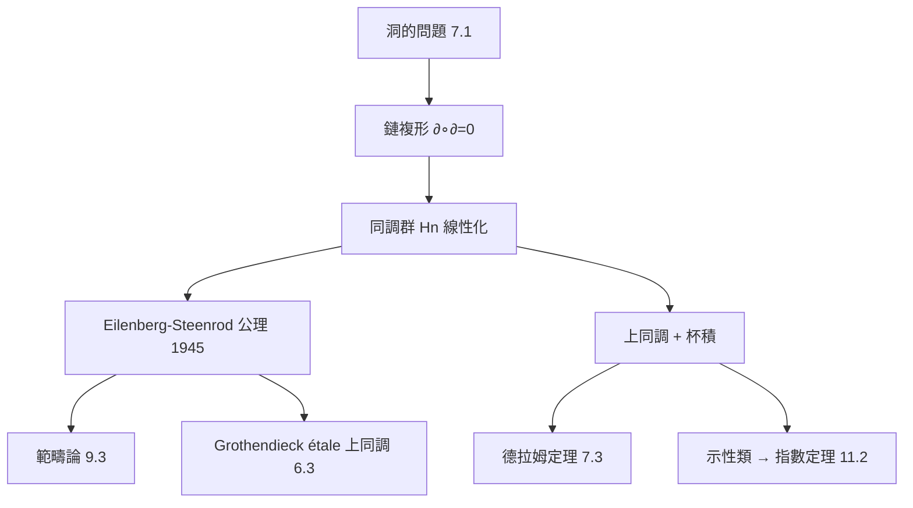

# 7.2 同調論與不變量：將空間轉譯為線性代數

## 前因：$\pi_1$ 不夠線性

基本群是非交換的、難計算的。拓撲學家想要**更機械化**的探測器：把空間變成（阿貝爾）群序列，像矩陣的秩一樣可以計算。Noether（1925）指出關鍵：**邊界的邊界為零**——複形上「有向單形鏈 + 邊界算子」自動給出同調群。

## 構造

**鏈複形與同調**：對單純複形 $K$，設 $C_n$ 為 $n$ 維有向單形生成的自由阿貝爾群，邊界算子 $\partial_n: C_n \to C_{n-1}$（如 $\partial[a,b,c] = [b,c] - [a,c] + [a,b]$）。滿足

$$\partial_{n-1} \circ \partial_n = 0$$

於是定義

$$H_n(X) = \frac{\ker \partial_n \ (\text{閉鏈，圈})}{\mathrm{im}\ \partial_{n+1}\ (\text{邊界，可縮圈})}$$

$H_n$ 是阿貝爾群——**「$n$ 維洞」的線性代數影子**：

| 空間 | $H_0$ | $H_1$ | $H_2$ |
|---|---|---|---|
| 點 | $\mathbb{Z}$ | 0 | 0 |
| $S^1$ | $\mathbb{Z}$ | $\mathbb{Z}$ | 0 |
| $S^2$ | $\mathbb{Z}$ | 0 | $\mathbb{Z}$ |
| 環面 $T^2$ | $\mathbb{Z}$ | $\mathbb{Z}^2$ | $\mathbb{Z}$ |

**公理化（Eilenberg–Steenrod, 1945）**：同調論 = 滿足同倫不變性、長正合列、切除等公理的函子。公理化統一了單純同調、奇異同調、胞腔同調——並且預告了**範疇論**（9.3）：同調論本質上是「鏈複形範疇上的函子」。

**上同調**：$H^n(X; R) = \mathrm{Hom}(H_n, R)$ 再加**杯積** $\smile$——上同調不只計數，還有**環結構**（乘法），編碼更深的幾何。示性類（Stiefel–Whitney、Chern）是流形上叢的上同調類，連接幾何曲率（11.2 的 Gauss–Bonnet 推廣）。

## 後果

1. **計算革命**：同調可由電腦計算——直接催生 TDA（13.2）。
2. **同調代數**：把「$\partial^2 = 0$ 抽出來」，得到導函子 $Ext$、$Tor$，成為代數幾何與表示論的文法。
3. **Weil 猜想與概形**（6.3）：同調方法移植到數論。
4. **物理**：de Rham 上同調、Chern 類進入規範場論；拓撲量子場論（10.4）。

## 練習與思考

1. 計算 $\partial\partial[a,b,c] = 0$，說明幾何意義（面積邊界的邊界是空）。
2. 為什麼上同調的杯積讓它比同調「資訊更多」？考慮 $H^*(T^2)$ 的環結構。
