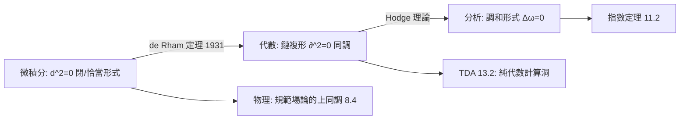

# 7.3 德拉姆定理：微分形式（微積分）與拓撲洞（代數）的完美統一

## 前因：兩個世界的同構預感

同一個「洞」，有兩種計法：

- **代數**：奇異同調 $H_n(X)$（7.2）——數鏈與邊界。
- **微積分**：de Rham 上同調——微分形式與外微分 $d$，$d^2 = 0$（2.3）。

de Rham（1931）證明：**在光滑流形上，兩者同構**。

$$H^n_{\mathrm{dR}}(M) = \frac{\ker d: \Omega^n \to \Omega^{n+1}\ (\text{閉形式})}{\mathrm{im}\ d: \Omega^{n-1} \to \Omega^n\ (\text{恰當形式})} \;\cong\; H^n(M; \mathbb{R})$$

## 構造

**配角們**：

- **Poincaré 引理**：$\mathbb{R}^n$ 上閉形式皆恰當（局部無洞）。
- **Stokes 定理**：$\int_M d\omega = \int_{\partial M} \omega$——微積分基本定理的高維形式；也是「$\partial\partial = 0 \iff d^2 = 0$」的幾何對偶。
- **積分作為配對**：閉形式 $\omega$ 作用在 $n$ 維閉鏈 $C$ 上 $\int_C \omega$；若 $\omega$ 恰當則為零。**「恰當形式沿閉鏈積分為零」正是同構的機制。**

**經典例：圓上的 $d\theta$。** $\omega = d\theta$ 在 $S^1$ 上閉但不恰當（$\theta$ 不是 $S^1$ 上的整體函數），$[\omega] \ne 0$ 生成 $H^1_{\mathrm{dR}}(S^1) \cong \mathbb{R}$——「繞圈的積分」就是 7.1 的捲繞數！

**Hodge 理論（1930s）**：配上黎曼度量，調和形式（$\Delta\omega = 0$）與 de Rham 上同調類一一對應：

$$\mathcal{H}^n(M) \cong H^n_{\mathrm{dR}}(M) \cong H^n(M; \mathbb{R})$$

**分析（熱方程/橢圓算子）直接計算出拓撲**——這是指數定理（11.2）的前奏。Hodge 結構更成為代數幾何（6.3）與 Langlands（10.3）的核心工具。

## 後果

1. **微積分能數洞**：曲率積分（Gauss–Bonnet：$\int_M K\,dA = 2\pi\chi(M)$）＝ Euler 示性數＝同調的交錯和——三個領域在同一個等式會師。
2. **規範場論**：電磁場強度是閉 2-形式、磁荷由上同調分類（8.4）。
3. **複幾何**（12.2）：Kähler 流形上三種上同調理論（de Rham、Dolbeault、奇異）交織。
4. **本書觀點**：de Rham 定理是「對偶」的教科書範例——**不同領域對同一個不變量的兩種計算被證明相等**，這類定理（Weil 猜想、指標定理、Langlands）構成數學統一的主旋律。

## 練習與思考

1. 在 $\mathbb{R}^2 \setminus \{0\}$ 上驗證 $\omega = \frac{-y\,dx + x\,dy}{x^2+y^2}$ 閉但不恰當，並計算沿單位圓的積分。
2. Gauss–Bonnet 如何同時體現「微積分（曲率）」與「拓撲（Euler 數）」？
