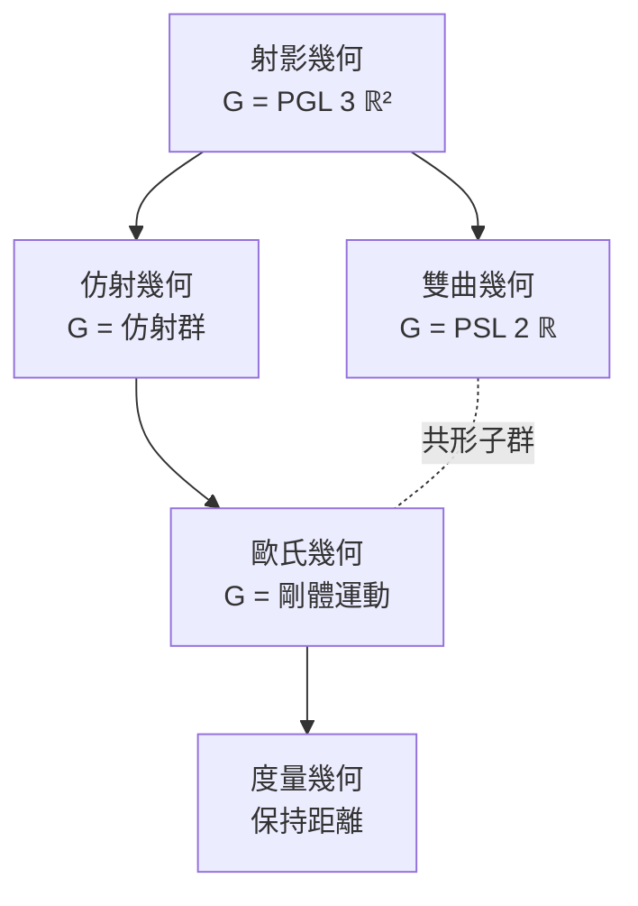

# 8.1 克萊因的革命性洞見：幾何學即群作用的不變量（1872）

## 前因：幾何學的大混亂

19 世紀的幾何學爆炸了：歐氏幾何、射影幾何、仿射幾何、雙曲幾何、橢圓幾何、反演幾何……彼此關係不明，似乎都是「幾何」卻語言各異。23 歲的 Felix Klein 在愛爾蘭根大學就職演說（1872）中提出統一方案：

> **一種幾何 = 一個空間 + 一個作用在其上的群；該幾何研究的，是群作用下保持不變的性質。**

## 構造

**定義（Kleiner 幾何）。** 集合 $X$ 配上變換群 $G \le \mathrm{Sym}(X)$ 。「 $G$ -幾何」的定理只談 $G$ -不變量。

**例：平面幾何的族譜**（群的包含決定幾何的粗細）：

| 幾何 | 群 $G$ | 不變量 |
|---|---|---|
| 歐氏 | $\mathbb{R}^2 \rtimes SO(2)$ | 距離、角度、面積 |
| 仿射 | $\mathrm{GL}_2 \rtimes \mathbb{R}^2$ | 平行、共線、面積比 |
| 射影 | $\mathrm{PGL}_3$ | 共線、交比 |
| 雙曲 | $\mathrm{PSL}_2\mathbb{R}$ （上半平面模型） | 雙曲距離、角度 |

**邏輯**：群越小 → 不變量越多 → 幾何越「細」；群越大 → 幾何越「粗」。射影幾何最粗（只保共線與交比），因此是其他幾何的公共母體。

**雙曲幾何的統一（2.1 的回響）**：雙曲幾何 = 上半平面 $\mathbb{H}$ 配 $\mathrm{PSL}_2\mathbb{R}$ 作用——**與歐氏幾何同屬一個框架，只是換了群**。非歐幾何的「哲學威脅」就此消解：它們都是群論家族的成員。

## 後果

1. **幾何 = 對稱**：這條公理滲透整個 20 世紀數學。
2. **表示論登場**：「研究群 $G$ 」=「研究 $G$ 在各種空間上的作用」，群表示論（1.3 的模觀點）成為核心。
3. **物理**：Noether 定理（1918）：連續對稱 $\leftrightarrow$ 守恆律；規範場論（8.4）是 Erlangen 精神的動力學版本。
4. **均勻幾何**：Thurston 八大幾何（1982，3-流形分類）= 尋找「足夠好的」傳遞群作用——里奇流（12.1）證明了幾何化猜想。
5. **離散幾何**：拓撲群的離散子群（晶格）連接數論——模形式（10.1）正是 $\mathrm{SL}_2\mathbb{Z}$ 作用下的不變函數。

## 練習與思考

1. 證明「平行性」是仿射不變量但不是射影不變量。
2. 為什麼「不變量」的觀點能消解非歐幾何的爭議？
