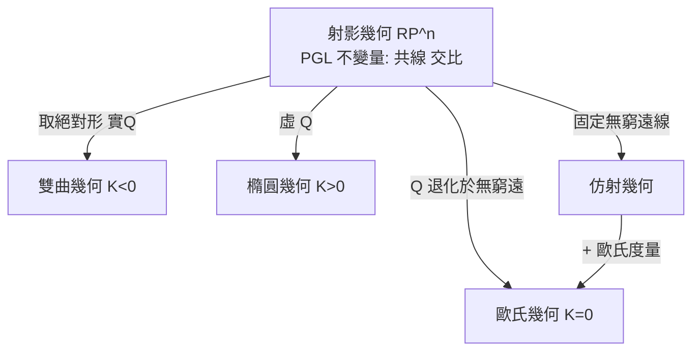

# 8.2 歐氏、仿射、射影與雙曲幾何的統一

## 前因：四種幾何，一個家族

8.1 的綱領如何具體統一各家幾何？關鍵是**射影幾何作為母體**：在射影平面 $\mathbb{RP}^2$ 上，透過「選擇一條直線當無窮遠線」與「選擇一個二次曲線當絕對形」，可以一一產生其他幾何。

## 構造：由母體分化

**齊次座標**：點 $(x:y:z)$ （僅比例有意義）。無窮遠線 $z = 0$ 。令 $z = 1$ 回到仿射平面；平行線相交於無窮遠點——「平行」不再是例外而是射影現象。

**絕對形法（Cayley–Klein, 1871–73）**：在 $\mathbb{RP}^n$ 中選一個二次曲面 $Q$ （絕對形），定義：

$$\text{距離} \propto \log \frac{\text{交比}}{} \quad \text{（兩點連線與 } Q \text{ 的交點決定交比）}$$

| 絕對形 $Q$ | 幾何 | 模型 |
|---|---|---|
| 實橢球 | 雙曲幾何 | Klein 圓盤模型（曲率 $K<0$ ） |
| 虛（無實點） | 橢圓幾何 | 球面（ $K>0$ ） |
| 退化（觸於無窮遠） | 歐氏幾何 | 極限 $K \to 0$ |

**三種幾何成為同一個射影世界的三種「度量選擇」**——曲率只是絕對形的相對位置。

**交比**：射影幾何的基本不變量。四點 $A,B,C,D$ 共線，交比

$$(A,B;C,D) = \frac{CA/CB}{DA/DB}$$

在任何射影變換下不變——它是「射影世界裡唯一的距離」。

**與度量的和解（Riemann 路線）**：Klein 用「群作用」統一，Riemann 用「度量張量」統一（2.1）。兩者在齊性空間重合： $X = G/H$ （ $H$ 為迷向群）， $G$ -不變度量自動存在（如 $\mathbb{H} = \mathrm{PSL}_2\mathbb{R}/\mathrm{SO}(2)$ ）。**Klein 管剛性對稱，Riemann 管彎曲變形**——20 世紀兩者合流於 Lie 群與齊性空間（8.3）。

## 後果

1. **雙曲幾何獲得嚴格模型**（Beltrami、Klein、Poincaré），非歐爭議終結。
2. **不變量理論**：Cayley「Projective metrics」、Hilbert 有限基定理（1888）——不變量研究催生抽象代數（1.3）。
3. **調和分析**： $\mathrm{SL}_2\mathbb{R}$ 在 $\mathbb{H}$ 上作用 → 自守形式（10.1）= 群作用下的不變/特徵函數。
4. **計算機視覺**：相機成像本質是射影變換，交比用於標定。

## 練習與思考

1. 驗證共線四點 $(0,1), (1,1), (2,1), (3,1)$ 的交比在變換 $x \mapsto \frac{ax+b}{cx+d}$ 下不變。
2. Klein 模型中雙曲直線是圓的弦——為什麼角度會失真而共線不變？
