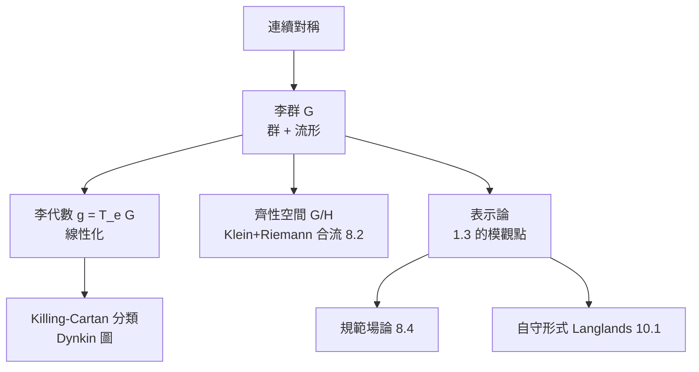

# 8.3 李群與李代數：連續對稱性與微分幾何的橋樑

## 前因：無窮多個對稱怎麼處理？

旋轉 $\mathrm{SO}(3)$、平移、Lorentz 變換、規範變換——這些對稱是**連續的**（由實參數族構成）。有限群論（1.1）處理離散對稱，連續對稱需要新數學。Lie（1870s–90s）研究微分方程的變換群，創立**李群**理論；Killing、Cartan 完成分類。

## 構造

**定義（李群）。** 兼具兩種結構的集合 $G$：

- 群（代數，1.1）；
- 光滑流形（幾何，2.3）；

且乘法與求逆是光滑映射。

**定義（李代數）。** $\mathfrak{g} = T_eG$（單位元的切空間），配換位子

$$[X, Y] = \left.\frac{\partial^2}{\partial s\,\partial t}\right|_{0} (e^{sX}e^{tY}e^{-sX}e^{-tY})$$

滿足反對稱與 Jacobi 恆等式 $[X,[Y,Z]] + [Y,[Z,X]] + [Z,[X,Y]] = 0$。

**李氏三大定理**：群結構 $\leftrightarrow$ 代數結構，且（連通單連通時）**一一對應**：

$$G \quad \longleftrightarrow \quad \mathfrak{g}$$

「非線性的群」被「線性的代數」完全編碼——**對稱性的微積分**。指數映射 $\exp: \mathfrak{g} \to G$ 是兩者之橋（3.3 的 $e^{tA}$ 正是矩陣李群的例子）。

**分類（Killing–Cartan, 1890s）**：半單李代數由 Dynkin 圖完全分類——$A_n, B_n, C_n, D_n, E_6, E_7, E_8, F_4, G_2$。**「所有連續對稱性」是一個有限、可列舉的宇宙**，這是數學最偉大的分類定理之一。

| 李群 | 李代數 | 物理意義 |
|---|---|---|
| $\mathrm{SO}(3)$ | $\mathfrak{so}(3)$ | 旋轉、角動量 |
| $\mathrm{SU}(2)$ | $\mathfrak{su}(2)$ | 自旋、弱作用 |
| $\mathrm{SL}_2\mathbb{R}$ | $\mathfrak{sl}_2\mathbb{R}$ | 雙曲幾何、模形式 |
| $\mathrm{SU}(3)$ | $\mathfrak{su}(3)$ | 量子色動力學 |
| $E_8$ | $\mathfrak{e}_8$ | 最大例外群；異質弦 |

## 後果

1. **表示論成為數學中樞**：Lie 群表示分類了基本粒子（Gell-Mann 八重法）；也表示了自守形式（10.1）。
2. **微分幾何**：主叢、聯絡、和樂——李群作用的幾何化（8.4）。
3. **齊性空間與對稱空間**：Cartan 對稱空間分類連接調和分析、數論（對稱空間的算術子群 → 模形式）。
4. **例外群 $E_8$ 與物理**：異質弦的規範群 $E_8 \times E_8$。

## 練習與思考

1. 驗證 $\mathfrak{so}(3)$ = 反對稱矩陣全體，並計算 $[E_x, E_y] = E_z$（聯想角動量對易關係）。
2. 為什麼「線性化」對連續群有效而對有限群無意義？（有限群的單位元切空間是 0。）
