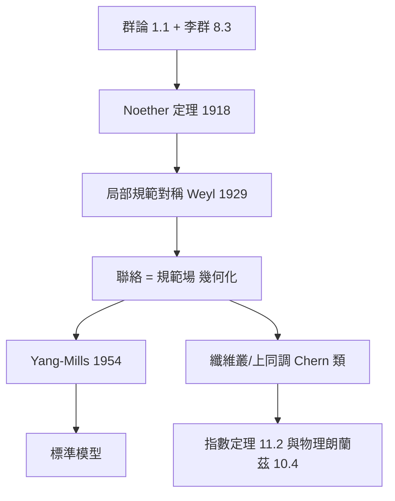

# 8.4 規範場論作為 Erlangen 綱領的物理實現

## 前因：對稱從「性質」升格為「定律的來源」

Noether（1918）：每個連續對稱對應一條守恆律（時間平移 → 能量、空間平移 → 動量、旋轉 → 角動量）。這只是第一步。Weyl（1918–1929）、Yang–Mills（1954）把觀念再翻一層：

> **力的本身，就是局部對稱性的要求。**

## 構造：從整體對稱到局部對稱

**整體對稱**：波函數相位 $e^{\mathrm{i}\theta}$ （常數 $\theta$ ）→ 電荷守恆（Noether）。

**局部對稱（規範對稱）**：允許 $\theta$ 隨時空點變化 $\theta(x)$ 。問題： $\partial$ 算子會破壞對稱（ $\partial(e^{\mathrm{i}\theta(x)}\psi) \ne e^{\mathrm{i}\theta}\partial\psi$ ）。**解法：引進修正後的導數**

$$D_\mu = \partial_\mu + \mathrm{i}e A_\mu(x)$$

$A_\mu$ 恰好就是**電磁場**！規範不變性不是電磁的性質，而是它的**原因**。

**幾何化身**： $A_\mu$ = 主叢上的**聯絡**（connection）——「在不同點的相位座標系之間做平行輸運」的規則（2.3 + 8.3 的合成）；場強

$$F_{\mu\nu} = [D_\mu, D_\nu] = \partial_\mu A_\nu - \partial_\nu A_\mu + [A_\mu, A_\nu]$$

= 聯絡的**曲率**。Maxwell 方程 = 曲率的 Bianchi 恆等式 + 運動方程。

**Yang–Mills（1954）**：把 $\mathrm{U}(1)$ 換成非交換李群（ $\mathrm{SU}(2)$ 、 $\mathrm{SU}(3)$ ），聯絡與曲率公式原封不動：

- $\mathrm{SU}(3)$ 規範場 = 強作用（膠子）；
- $\mathrm{SU}(2)\times\mathrm{U}(1)$ = 弱電統一（Glashow–Weinberg–Salam）；
- 標準模型 = 產生群 $\mathrm{U}(1)\times\mathrm{SU}(2)\times\mathrm{SU}(3)$ 的幾何。

**上同調與磁荷**：場強 $F$ 是閉形式（ $dF = 0$ ，Bianchi），但可能不恰當——Dirac 磁單極的磁荷 $= \int F \in 2\pi\mathbb{Z}$ 是 $H^2$ 的整數類（Chern 類，7.2）——**拓撲學進入物理**。

## 後果

1. **標準模型**：物理三大力中的兩支由規範原理導出；粒子 = 聯絡的量子。
2. **幾何與物理的雙向驅動**：Donaldson 理論（4-流形，Yang–Mills 方程的解空間）、鏡像對稱（12.2）皆源自物理。
3. **數學內部**：規範理論使「叢、聯絡、示性類」成為微分幾何的核心而非邊角。
4. **本書觀點**：Erlangen 說「幾何 = 對稱下的不變量」；規範場論說「**相互作用 = 對稱的強制力**」。同一思想從描述性的（幾何的分類）變成生成性的（力的起源）。

## 練習與思考

1. 驗證 $D_\mu$ 在變換 $\psi \mapsto e^{\mathrm{i}e\theta(x)}\psi$ 、 $A_\mu \mapsto A_\mu - \partial_\mu \theta$ 下不變。
2. 為什麼 Dirac 磁荷必須是整數？（提示：波函數在圍繞磁單極的圈上必須單值 → Chern 類的整數性。）
