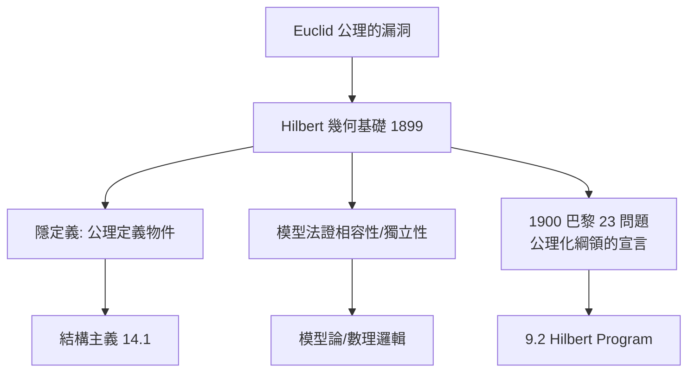

# 9.1 幾何學公理化：幾何的邏輯底座（1899）

## 前因：Euclid 的裂縫

Euclid《幾何原本》號稱公理化典範，但漏洞極多：它暗中依賴圖形直觀——「兩圓相交則有交點」、「介於」的概念、順序關係都未定義也未公理化。2.1 的非歐革命後，「什麼才算嚴格的幾何基礎」成為迫切問題。Hilbert《幾何基礎》（1899）給出答案，並在 1900 年巴黎演講中把公理化精神推向整個數學。

## 構造：徹底的公理化

Hilbert 的幾何體系：**六個原始詞**（點、線、面、屬於、介於、全等）+ **20 條公理**，分五組：

| 公理組 | 內容 | Euclid 所缺 |
|---|---|---|
| 關聯 | 點線面的歸屬 | 部分補足 |
| 順序 | 「介於」的性質 | **完全缺失** |
| 全等 | 線段與角的全等 | 未嚴格化 |
| 平行 | 第五公設 | 明確隔離（可替換！） |
| 連續 | Archimedes + 完備性 | **完全缺失** |

**方法論革命**：

1. **隱定義（implicit definition）**：公理不「描述」點線面，而是**定義**它們——「點、線、面必須處處以『桌子、椅子、啤酒杯』代換也成立」。物件的本質 = 滿足公理的**結構位置**（1.3、14.1 的結構主義源頭）。
2. **公理的獨立性與相容性用模型證明**：為每條公理造「去掉它仍相容」的模型——模型論的雛形。
3. **平行公理被隔離**：第 I–IV 組公理 + 絕對幾何，第五組可選歐氏或雙曲——非歐幾何從此有了邏輯上的平等地位。

## 後果

1. **公理化方法蔓延全數學**：實數（Hilbert 1900）、機率（Kolmogorov 1933, 4.1）、拓撲（2.2）、向量空間——現代教科書的「定義-公理-定理」格式由此定型。
2. **數理邏輯誕生**：公理系統成為可研究的數學物件 → 完備性、可判定性 → Hilbert Program（9.2）。
3. **結構主義哲學**：數學物件 = 結構中的位置（14.1）。
4. **範疇論的接棒**（9.3）：公理化「公理化」——把「結構 + 保持結構的映射」本身再公理化。

## 練習與思考

1. 舉一個滿足 Hilbert 關聯公理但不滿足順序公理的「幾何」（如射影平面的子結構）。
2. 為什麼「隱定義」比「直觀定義」更能容納非歐幾何？
