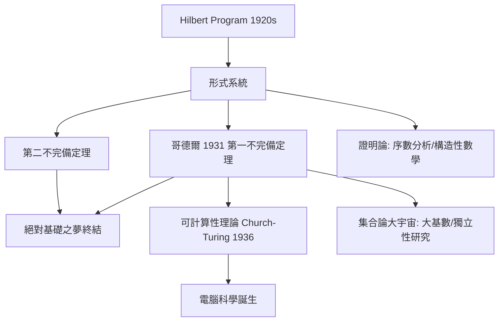

# 9.2 形式主義與哥德爾不完備定理：數學統一的邊界與深意（1931）

## 前因：Hilbert Program 的宏願

邏輯主義（Frege、Russell）、直覺主義（Brouwer）、形式主義三派論戰中，Hilbert 提出最雄心勃勃的方案（1920s）：

> 把全部數學形式化為公理系統，然後在**有限的、組合的**（metal 層面）方法內證明：
> 1. **相容性**：推不出 $0=1$ ；
> 2. **完備性**：任何命題或其否定可證；
> 3. **可判定性**（Entscheidungsproblem）：存在算法判定任何命題。

若成功，數學將獲得絕對安全的地基。形式系統 = 符號 + 公理 + 推理規則——數學變成「符號遊戲」，意義被抽離，正確性只看規則。

## 構造：哥德爾的兩記重錘

**哥德爾不完備定理（1931）**。對任何**相容、遞歸可公理化、且包含足夠算術**（如 PA）的形式系統 $T$ ：

- **第一不完備定理**：存在命題 $G$ 使得 $T$ 既不能證明 $G$ 也不能證明 $\neg G$ 。構造核心：Gödel 編碼——把符號、公式、證明都編成自然數，使「可證明性」變成算術命題； $G$ 說「 $G$ 不可證」——**說謊者悖論的算術化**。
- **第二不完備定理**： $T$ （若相容）無法證明自身的相容性 $\mathrm{Con}(T)$ 。

**後續打擊**：

- Church–Turing（1936）：可判定性問題無解（停機問題不可判定）——同時**發明了可計算性理論**（電腦科學的數學起點！）。
- Gentzen（1936）：用超窮歸納證明 PA 的相容性——但用了超出 PA 的方法；證明論改以「相對化」方式存活。

## 後果：邊界之後的富饒

1. **不完備 ≠ 混亂**：獨立性研究成為學問——連續統假設獨立於 ZFC（Gödel 1940, Cohen 1963，forcing）；大基數層級描繪「不可證」的地形。
2. **可計算性 → 電腦**：圖靈機、遞歸函數、λ 演算——不完備定理的技術工具成為資訊時代的數學基礎。
3. **證明論**：Gentzen 的相繼式演算反哺構造性數學與類型論。
4. **證明助手**（14.3）：Lean/Coq 把形式化夢想以工程方式復活——只是目標從「證明相容性」變成「證明定理」。
5. **本書觀點**：Hilbert Program 失敗的方式極有教益——**它證明了「數學不能被壓縮成單一形式系統」，但形式化本身成為新的數學分支**。統一以「邊界明確」的形式達成。

## 練習與思考

1. 解釋為何「 $G$ 說自己不可證」在相容假設下既不矛盾也不可證。
2. 為什麼第二不完備定理使「數學的絕對安全保證」在原理上不可能？
