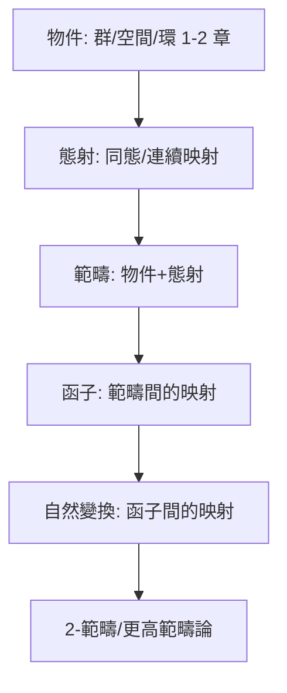

# 9.3 範疇論的誕生：高階結構的「數學之數學」（1945）

## 前因：公理化的公理化

1940 年代，代數拓撲學家發現自己不斷重複同一套操作：「對每個空間配一個群，對每個連續映射配一個群同態」。這個「配對」本身有規律，值得被數學化。Eilenberg 與 Mac Lane《群、擴張與同調的一般理論》（1945）發明範疇論來表述它——**最初只是工具，後來成為世界觀**。

## 構造

**定義（範疇）。** 物件類 $\mathrm{Ob}(\mathcal{C})$ + 態射集合 $\mathrm{Hom}(A,B)$ + 合成，滿足結合律與單位元。例： $\mathbf{Grp}$ （群與群同態）、 $\mathbf{Top}$ （空間與連續映射）、 $\mathbf{Vect}_K$ 、 $\mathbf{Set}$ 。

**定義（函子）。** $F: \mathcal{C} \to \mathcal{D}$ ：物件配物件、態射配態射，保持合成與單位元。共變/反變（如 $\mathrm{Hom}(-, B)$ 反變——6.2 的 Gelfand 對偶正是反變函子）。

**定義（自然變換）。** 函子之間的「一致變換」 $\eta: F \Rightarrow G$ ，對每個物件 $X$ 給態射 $\eta_X: F(X) \to G(X)$ ，滿足自然性方塊交換。

$$
\begin{CD}
F(X) @>\eta_X>> G(X)\\
@V F(f) VV @VV G(f) V\\
F(Y) @>\eta_Y>> G(Y)
\end{CD}
$$

**層級躍升**：

**幾個本書已出現概念的範疇論重述**：

| 概念 | 範疇論表述 |
|---|---|
| 同構（1.3） | 有雙側逆的態射 |
| 商結構 | 餘等化子 / 餘積 |
| 直積 | 範疇積（用普遍性質定義，不需元素！） |
| 6.2 Gelfand 對偶 | 反變等價 $\mathbf{CHaus}^{op} \simeq \mathbf{CC}^*\mathbf{Alg}$ |
| 7.2 同調 | 從拓撲到代數的函子序列 |
| 6.3 概形 | 範疇 $\mathbf{Sch}$ 與層、topos |

**Yoneda 引理**：物件由其「被所有物件看見的方式」（ $\mathrm{Hom}$ 函子）完全決定——**「是什麼」徹底讓位給「關係是什麼」**，1.3 與 14.1 結構主義的極致表達。

## 後果

1. **同調代數**：正合列、導函子、三角範疇——Grothendieck 學派的工作語言（6.3、7.2）。
2. **topos 理論**（Lawvere–Tierney, 1970s）：把「集合論宇宙」本身相對化；概形的 étale topos 證 Weil 猜想。
3. **邏輯與電腦**：Curry–Howard 對應——「證明即程式」，直達證明助手（14.3）。
4. **本書觀點**：範疇論是 Hilbert 公理化精神的完成與超越：公理化物件（9.1）→ 公理化**物件之間的關係**（範疇）→ 公理化**關係之間的關係**（函子與自然變換）。數學的「數學之數學」。

## 練習與思考

1. 證明範疇中「有左逆又有右逆的態射」其兩逆相等。
2. 用 Yoneda 引理解釋：「群由它到所有群的同態決定」這句話的精確意義。
