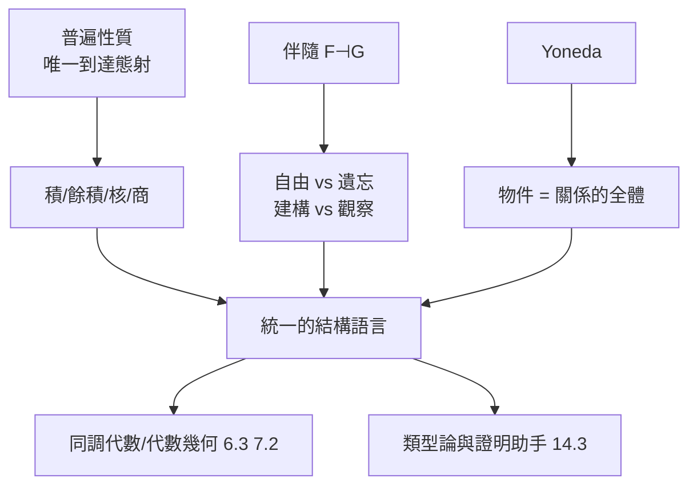

# 9.4 態射、函子與自然變換：超越公理化的結構語言

## 前因：從「研究物件」到「研究映射」

9.3 已給出定義；本節展示這套語言如何**實際驅動數學**——三個核心思想：普遍性質、伴隨函子、極限/餘極限。它們共同的哲學：**用「與萬物的關係」定義物件，而不用內部構造。**

## 構造

### 1. 普遍性質（universal property）

**積的定義**：$P = A \times B$ 是「存在投影 $p: P \to A$、$q: P \to B$，且對任何 $X$ 及映射 $f: X \to A$、$g: X \to B$，存在唯一 $h: X \to P$ 使 $p h = f$、$q h = g$」的物件。

$$
\begin{CD}
@. X\\
@. @V\exists! h VV\\
A @<p<< P @>q>> B
\end{CD}
$$

注意：**不提元素、不提構造**。同一公式在 $\mathbf{Set}$、$\mathbf{Top}$、$\mathbf{Grp}$、$\mathbf{Sch}$（6.3 的 $A \otimes B$！）各自給出正確的「積」——**一個證明，全領域免費**。

### 2. 伴隨函子（adjoint functor）

$F \dashv G$（$F: \mathcal{C} \to \mathcal{D}$，$G: \mathcal{D} \to \mathcal{C}$）：

$$\mathrm{Hom}_{\mathcal{D}}(F(X), Y) \cong \mathrm{Hom}_{\mathcal{C}}(X, G(Y)) \quad \text{自然地成立}$$

| 伴隨對 | 意義 |
|---|---|
| 自由 $\dashv$ 遺忘 | 自由群/自由模是「最通用的」 |
| 張量積 $\dashv$ Hom | $A \otimes - \dashv \mathrm{Hom}(A, -)$（模論 1.2） |
| sheafification $\dashv$ inclusion | 層化（6.3） |
| 極限 $\dashv$ 常函子 | 範疇論版本的 top/bottom |

伴隨是數學中最常見的「互補對」：**建構（$F$）與觀察（$G$）的對偶**。

### 3. 極限與餘極限

積、核（kernel）、等化子都是極限的特例；餘積、餘核（cokernel）、商是餘極限的特例。7.2 同調的核/商語言（$H = \ker/\mathrm{im}$）在阿貝爾範疇中完全範疇化。

### 4. 可表性與對偶

**Yoneda**：$X \mapsto \mathrm{Hom}(-, X)$ 是全忠實嵌入。「物件 = 它的可表函子」——6.2 Gelfand 對偶、6.3 概形（空間由其點上的函數決定）、14.1 結構主義的數學定理化。

## 後果

1. **數學寫作的重構**：Grothendieck 的 EGA/SGA 全以範疇語言寫成；現代數學論文的預設語法。
2. **導出範疇**：同倫、上同調、D-模（10.3）統一在三角範疇/穩定 $\infty$-範疇中。
3. **電腦科學**：Haskell 的單子、代數效應、類型系統——範疇論是程式語言理論的數學。
4. **本書觀點**：態射-函子-自然變換提供了「跨領域搬運定理」的自動化機制——這是第三篇綱領（尤其 Langlands）在方法論上的基礎設施。

## 練習與思考

1. 用普遍性質證明：積若存在則在同構意義下唯一。
2. 解釋「自由群函子 $\dashv$ 遺忘函子」如何體現「最通用、最不特別」的直觀。
