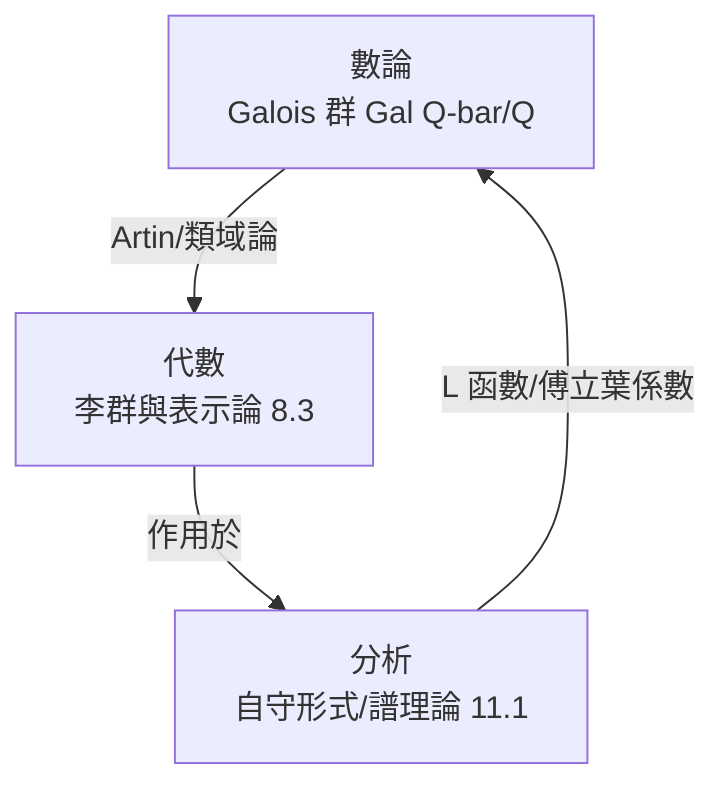

# 10.1 伽羅瓦群與自守形式：數論、代數與分析的三角關係

## 前因：朗蘭茲的問題

Langlands（1967）寫給 Weil 的信中提出一個大膽的問題：**數論中兩個最神秘的物件——Galois 群的表示與自守形式——之間，是否存在系統性的對應？**

三角的三個頂點：

## 構造

### 1. Galois 群（代數端，1.1 的延伸）

$\Gamma = \mathrm{Gal}(\overline{\mathbb{Q}}/\mathbb{Q})$ ：所有 $\mathbb{Q}$ 的代數對稱。它是「素數的編碼器」：Frobenius 元素 $\mathrm{Frob}_p$ 記錄多項式 $\bmod\ p$ 的分解方式。**研究素數 = 研究這個群的表示**：

$$\rho: \Gamma \to \mathrm{GL}_n(\overline{\mathbb{Q}}_\ell) \quad (\ell\text{-進表示})$$

### 2. 自守形式（分析端）

**模形式**：上半平面 $\mathbb{H}$ 上的函數 $f$ ，滿足

$$f(\gamma z) = (cz+d)^k f(z), \quad \gamma = \begin{pmatrix}a&b\\c&d\end{pmatrix} \in \mathrm{SL}_2\mathbb{Z}$$

即 $\mathrm{SL}_2\mathbb{R}$ （8.3）在 $\mathbb{H}$ （8.2）上作用下的**協變函數**，加上全純（3.2）與增長條件。它有 Fourier 展開 $f = \sum a_n q^n$ ——**分析的物件，卻編碼數論資訊**： $a_p$ 記錄曲線 $\bmod\ p$ 的點數（10.2）。

**自守形式** = 模形式的一般化：把 $\mathrm{SL}_2$ 換成任意（adèlic）李群 $G$ ，函數生活在其齊性空間上，李群表示論（8.3）成為自然框架。

### 3. L-函數（翻譯機）

兩端各自產生一個 Dirichlet 級數：

$$L(s, \rho) = \prod_p \frac{1}{\det(1 - \rho(\mathrm{Frob}_p) p^{-s})} \qquad L(s, \pi) = \sum_n \frac{a_n}{n^s}$$

**Langlands 對應（預言）**：

$$\{\text{$n$ 維 Galois 表示 } \rho\} \;\longleftrightarrow\; \{\text{$\mathrm{GL}_n$ 自守表示 } \pi\}, \qquad L(s, \rho) = L(s, \pi)$$

**已知特例**：

- $n=1$ ：類域論（Artin, 1927）——一維表示 $\leftrightarrow$ Hecke 特徵。**已證**。
- $n=2$ ：部分（Wiles 等，10.2）。
- 一般 $n$ ：開放，是當代數學最大的計畫。

## 後果

1. **費馬大定理**（10.2）是此綱領的第一個世紀級收穫。
2. **Fermat–Wiles 之後的方法論**：R = T 定理（Galois 變形環 $\mathcal{R}$ = Hecke 代數 $\mathbb{T}$ ，Taylor–Wiles 方法）。
3. **幾何化**（10.3）與**物理化**（10.4）。
4. **本書觀點**：Langlands 是三大對偶的總集——Galois（代數） $\leftrightarrow$ 自守（分析） $\leftrightarrow$ 幾何（模空間），如 6.2 所說「問題可以在最順手的一邊解決」，只是這次是在**整個數學**的尺度上。

## 練習與思考

1. 計算 $\mathbb{Q}(\sqrt2)$ 的 Galois 群，並說明 $\mathrm{Frob}_p$ （ $p$ 奇）由 $\left(\frac{2}{p}\right)$ 決定。
2. 為什麼「函數滿足對稱條件 $\gamma z \mapsto (cz+d)^k$ 」能編碼素數資訊？
