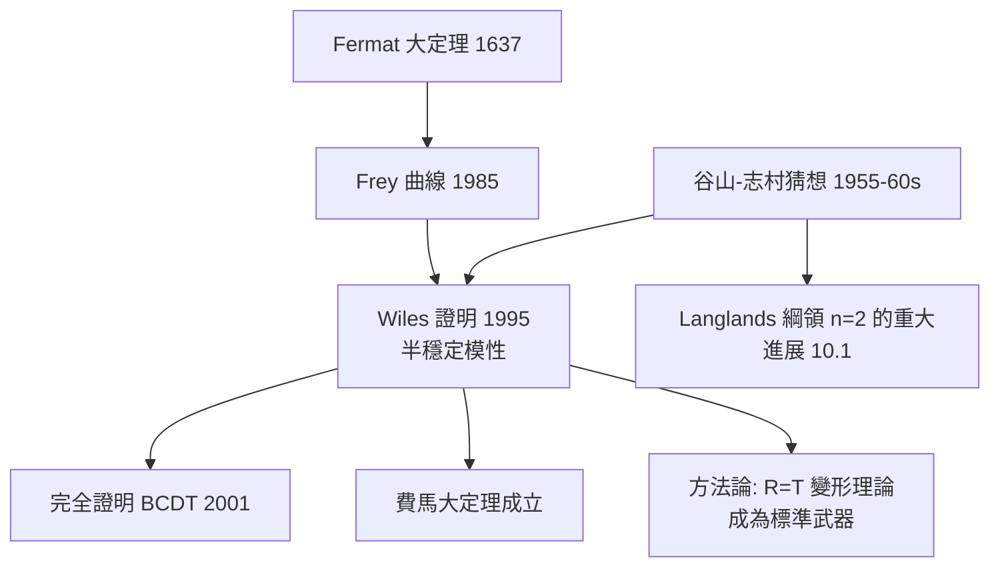

# 10.2 谷山–志村猜想與費馬大定理：橢圓曲線與模形式的奇蹟對應（1995）

## 前因：三條線索匯流

1. **Fermat（1637）**：書頁邊上宣稱 $x^n + y^n = z^n$ （ $n \ge 3$ ）無正整數解；三百多年來僅個別指數被攻克。
2. **橢圓曲線**（2.4）： $y^2 = x^3 + ax + b$ ——同時是曲線、群、概形（6.3）。
3. **谷山–志村–Weil 猜想（1955–60s）**：每一條有理橢圓曲線都是**模的**——即由一個模形式（10.1）「生成」。

**Bridge（Frey, 1985）**：若 Fermat 方程有解 $(a, b, c, n)$ ，構造半穩定橢圓曲線

$$E_{a,b}: y^2 = x(x - a^n)(x + b^n)$$

這條曲線的點數統計過於詭異，**不可能是模形式生成**。於是：

$$\text{谷山–志村} \implies \text{Frey 曲線不存在} \implies \text{Fermat 成立}$$

## 構造：Wiles 的證明骨架（1995）

Wiles（與 Taylor 補洞）證明了谷山–志村猜想的半穩定情形：

1. **模性 = Galois 表示來自模形式**：橢圓曲線 $E$ 對每個素數 $\ell$ 給出 $\ell$ -進表示

$$\rho_{E, \ell}: \Gamma = \mathrm{Gal}(\overline{\mathbb{Q}}/\mathbb{Q}) \to \mathrm{GL}_2(\mathbb{Z}_\ell)$$

作用在 $\ell$ -冪撓點 $E[\ell^\infty]$ 上。**模性 = 這個表示（自某一層起）同構於某模形式的表示。**

2. **變形理論（Mazur）**：把所有「模 $\ell$ 化簡後等於 $\bar\rho$ 的表示」收進一個**變形環** $\mathcal{R}$ 。
3. **R = T 定理（Taylor–Wiles 方法）**：證明變形環 $\mathcal{R}$ 等於 Hecke 代數 $\mathbb{T}$ ——「幾何/算術的一邊」與「模形式的一邊」恆等，於是提升唯一、表示自動模化。
4. **3-5 切換**：一個技術奇招——在 $\ell = 3$ 與 $\ell = 5$ 之間切換，補上第一版證明的漏洞（與 Taylor 合作，1994 秋）。

## 後果

1. **Fermat 大定理**：358 年懸案終結——**由「分析↔數論」的對應間接證明**，本身不涉及任何 Fermat 方程的計算。
2. **模性定理完全版**（Breuil–Conrad–Diamond–Taylor, 2001）。
3. **方法論革命**：Taylor–Wiles 的「補丁法」與 $R=\mathbb{T}$ 成為表示論的標準技術，繁殖出上百個定理（Sato–Tate、Serre 猜想等）。
4. **本書觀點**：這是本書三主軸的交匯示範——**結構**（橢圓曲線的群律與概形）、**對偶**（曲線 $\leftrightarrow$ 模形式）、**綱領**（Langlands 的第一次世紀級兌現）。

## 練習與思考

1. 驗證 $y^2 = x^3 - x$ 上的點 $(0,0)$ 、 $(\pm 1, 0)$ 在弦切群律下的關係。
2. 為什麼「反證 + 構造矛盾物件 + 用大綱領否證其存在」這種證明結構是朗蘭茲時代的典型？
