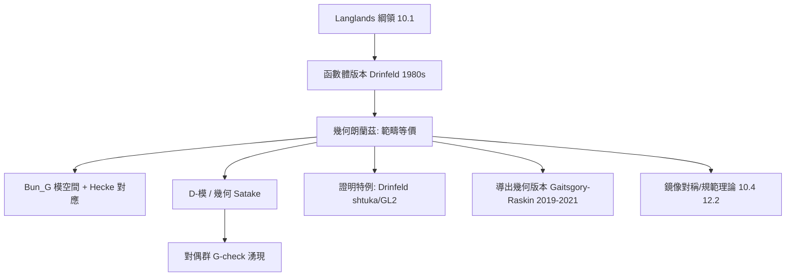

# 10.3 幾何朗蘭茲綱領：引進代數幾何與代數拓撲

## 前因：把數論換成曲線

Langlands 綱領（10.1）談的是「數」的對應。1980 年代，Drinfeld 與 Laumon 提出把整個綱領搬到**函數體**上：把 $\mathbb{Q}$ 換成曲線 $X$ 的函數體 $\mathbb{F}_q(X)$ ——素數換成 $X$ 的閉點，Galois 群換成 fuchs 群的類比，「數數」變成「模空間的幾何」。這個版本可以**用代數幾何與代數拓撲的完整火力**來攻擊（6.3 的概形、7 的同調、9 的範疇論）。

## 構造

**幾何朗蘭茲對應**（ $X$ 為緊黎曼面或其代數幾何類比）：

$$\{\text{局部系 } E \text{（Galois 端）}\} \;\longleftrightarrow\; \{\text{Hecke 特徵層 } F \text{（自守端）}\}$$

兩端都是**範疇**而非集合——對應是**範疇等價**（這比數論版的「一一對應」更結構化，正是幾何版本的優勢）。

**關鍵舞台**：

1. **向量叢的模空間** $\mathrm{Bun}_G(X)$ （自守端）：曲線上主 $G$ -叢全體——「所有可能配置的空間」（moduli）。
2. **Hecke 修飾**：在一點 $x$ 處改變叢的結構，給出 Hecke 對應——自守端的「Hecke 算子」變成**對應空間之間的幾何對應**。
3. **D-模與幾何 Satake**：球面 Hecke 範疇 $\cong$ 李群 $G$ 的表示範疇（ $\mathrm{Rep}(\check G)$ ）——**Langlands 對偶群 $\check G$ 從幾何中自然湧現**（Lusztig、Ginzburg、Mirković–Vilonen）。
4. **譜分解**： $\mathrm{Bun}_G$ 上的 Hecke 特徵層沿「譜叢」的特徵標分解——譜理論（11.1）的範疇化。

## 後果

1. **函數體上的 Fields 獎**：Drinfeld（1990，shtuka 與 Langlands）、Laumon、Lafforgue（2002， $\mathrm{GL}_n$ 函數體朗蘭茲全證）、Vincent Lafforgue（幾何化技術反哺數論版）。
2. **幾何表示論**：Springer 理論、Kazhdan–Lusztig 猜想（用幾何解表示論）——朗蘭茲思想滲透表示論各處。
3. **導出代數幾何的成熟**：Gaitsgory–Raskin 等建立「譜分解的 $\infty$ -範疇證明」（2019–2021），整個領域的工具鏈（6-範疇、Formal geometry）來自範疇論傳統（9.3–9.4）。
4. **物理**：與 4d 規範理論的 S-對偶、鏡像對稱深度糾纏（10.4）。
5. **本書觀點**：幾何朗蘭茲展示「綱領的可移植性」——同一個對應幻想換一個宇宙（函數體）就變得可證；而證明它所發明的工具又回流到原版數論。**綱領不是靜態目標而是遷徙路線。**

## 練習與思考

1. 為什麼函數體版本的 Langlands「更容易」？（提示：可以取上同調、可用代數簇的幾何；數論版的 p-adic 分析更難。）
2. 「對應從集合升級為範疇等價」多獲得了什麼資訊？
