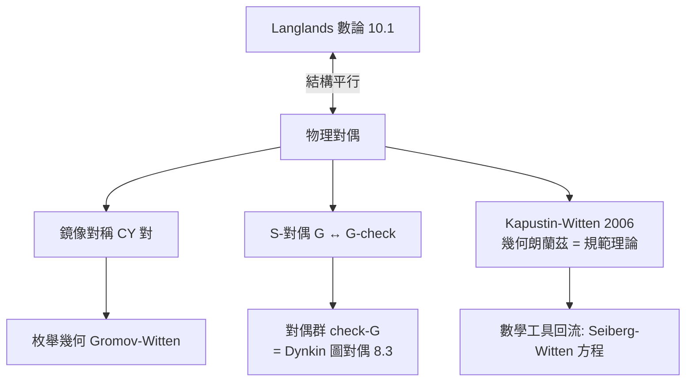

# 10.4 物理朗蘭茲綱領：量子場論與超弦理論中的對偶性

## 前因：物理學家也發現了同樣的對應

1990 年代，弦論與規範場論中出現一系列「對偶」：看起來完全不同的理論描述同一個物理。Witten 等人意識到：這些物理對偶與朗蘭茲綱領（10.1、10.3）**結構相同**——兩邊是同一枚硬幣。

## 構造：三層對應

### 1. 鏡像對稱（1990–）

Calabi–Yau 三重流形 $X$ 與 $\hat X$（12.2）成對：$X$ 上的 A-模型（辛幾何、計數有理曲線）$\leftrightarrow$ $\hat X$ 上的 B-模型（複幾何、變形理論）。數學後果：Candelas 等用物理計算出五次三重流形上有理曲線數目，震驚代數幾何界；Givental、Lian–Liu–Yau 嚴格證明（鏡像定理）。

### 2. 電磁對偶 / S-對偶（Montonen–Olive, 1977; Seiberg–Witten, 1994）

規範群 $G$ 的理論 $\leftrightarrow$ Langlands 對偶群 $\check G$（8.3 的 Dynkin 圖對偶！）的理論，耦合常數取倒數。Seiberg–Witten 用此解出 $\mathcal{N}=2$ 規範理論，瞬間革新 4-流形不變量（Donaldson 理論的替代品）。

### 3. 幾何朗蘭茲的物理化身（1990s–）

在 $\mathcal{N}=4$ 超對稱 Yang–Mills 中，**S-對偶作用在模空間 $\mathrm{Bun}_G$ 上時給出的正是幾何朗蘭茲對應**（Kapustin–Witten, 2006）：「Hecke 特徵層」= 規範理論中某個超對稱方程的解（vortex/fugacity 積分）。6.4 非交換幾何、8.4 規範場論、7 的上同調在此會師。

## 後果

1. **數學吸收物理預言**：鏡像對稱、Seiberg–Witten、GW 不變量已成為純數學的標準章節。
2. **Langlands 對偶群有了物理身分**：$\check G$ 是「磁變量下的規範群」——一個純代數發明獲得物理實現。
3. **未竟之業**：完整的「物理朗蘭茲」仍在建設中（表單與範疇化），是數學與物理的前沿交界。
4. **本書觀點**：第 8 章的規範原理（幾何 = 對稱）、第 10 章的朗蘭茲（數論 = 分析）、物理的對偶綱領——三者共享同一語法：**兩種描述之間的嚴格對應，且對應本身攜帶不變量**。這是「對偶」作為數學最深文法的證據。

## 練習與思考

1. 對 $\mathrm{SU}(n)$ 找出其 Langlands 對偶群（$\mathrm{PSU}(n)$ 的對偶關係），聯想 Dynkin 圖的鏡像。
2. 為什麼物理對偶能「預言」數學定理？聯想 14.2 的不可思議有效性。
