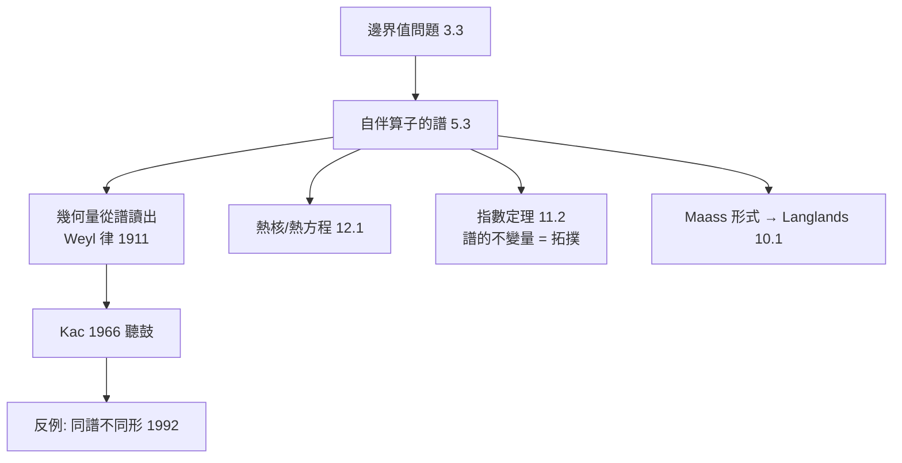

# 11.1 譜理論：算子的特徵值與幾何形狀——聽得出鼓的形狀嗎？

## 前因：從弦的振動到算子的譜

Pythagoras 時代已知：弦越短音越高。數學化後（3.3、5.3）：邊界值問題

$$-\Delta u = \lambda u, \quad u|_{\partial D} = 0$$

的特徵值 $\lambda_k$ 是（$\sqrt{\lambda_k}$ 正比於）固有頻率。把微分算子 $\Delta$ 當作希爾伯特空間上的自伴算子，其**譜** $\{\lambda_k\}$ 編碼整個振動行為。Weyl（1911）證明漸近律：

$$N(\Lambda) = \#\{k : \lambda_k \le \Lambda\} \sim \frac{\mathrm{vol}(D)}{4\pi}\Lambda \quad (n=2)$$

**面積可以從頻率「聽」出來**。Kac（1966）的名問：**Can one hear the shape of a drum?**——面積之外，周長（第二項）、洞數（熱核展開）也能聽出；但 Milnor（1964）、Gordon–Webber–Wolpert（1992）造出了**同譜不同形**的鼓——譜不能完全決定形狀。

## 構造

**譜資料**：特徵值 $\{\lambda_k\}$ + 特徵函數 $\{u_k\}$。可提取的幾何量：

| 譜資料 | 幾何資訊 |
|---|---|
| $N(\Lambda)$ 漸近 | 體積、邊界長度 |
| 熱核 $\mathrm{Tr}(e^{-t\Delta})$ 展開 | 體積、曲率積分、洞數 |
| $\zeta_\Delta(s) = \sum \lambda_k^{-s}$ | 同上 + 解析延拓 |
| 特徵函數的節線 | nodal domain 猜想（Yau）、節線長度 |

**譜幾何 = 「由譜研究幾何」的學科**，正逆兩問：

- 正問題：給定幾何 → 計算譜（有限方法：極小極大、有限元）。
- 逆問題：給定譜 → 還原幾何（部分可能：負曲率曲面的譜決定長度譜，波 trace 對稱性等）。

**與 Langlands 的聯繫**：緊曲面上 $\mathrm{SL}_2\mathbb{R}$ 的不變微分算子的譜 = **Maass 形式的特徵值**（10.1 的自守形式之一支）——譜理論是朗蘭茲「分析端」的技術核心。

## 後果

1. **指數定理**（11.2）：譜的不對稱性（正負特徵值計數差）= 拓撲不變量。
2. **量子混沌**：特徵函數的高頻行為（QUE 猜想）連接動態系統與數論。
3. **數論**：Selberg trace formula = 「非交換傅立葉分析」，譜與測地線長度的對偶。
4. **應用**：譜聚類、圖訊號處理、分子振動光譜——「譜即形狀指紋」的工程化。

## 練習與思考

1. 用分離變數求 $\Delta$ 在 $[0,\pi]$ 上的譜，驗證 $\lambda_k = k^2$。
2. 為什麼「同譜不同形」不推翻譜理論，反而深化它？（提示：譜是不變量而非完備不變量。）
