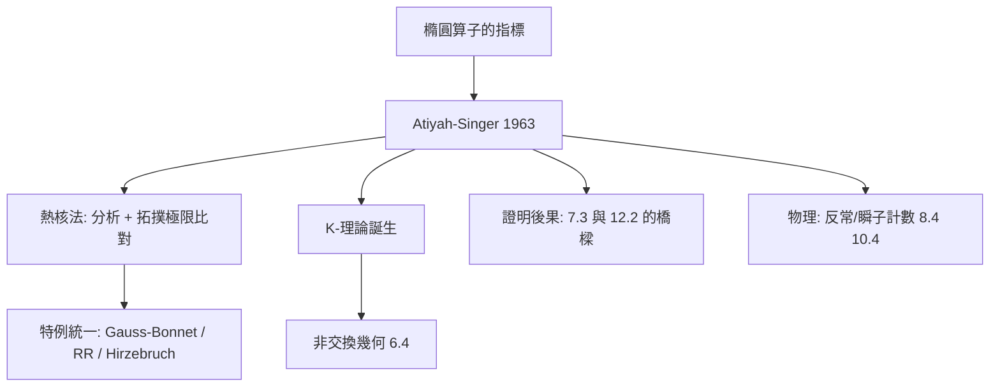

# 11.2 Atiyah–Singer 指數定理：微分方程解空間（分析）與流形拓撲（幾何/代數）的頂峰對接（1963）

## 前因：計數解的悖論

橢圓算子 $D$（如 $\bar\partial$、Dirac 算子、de Rham $d+d^*$）的解空間是有限維的。自然問題：**解的個數（維數）由什麼決定？** 直接計算需要知道 $D$ 的全部細節——但 Groenewold、Gel'fand、Seeley 等發現某些量與細節無關：

$$\mathrm{ind}(D) = \dim \ker D - \dim \ker D^*$$

**指標是不變量**。Atiyah 與 Singer（1963）證明它恰好等於一個純拓撲量：

$$\boxed{\ \mathrm{ind}(D) = \int_M \hat A(M)\, \mathrm{ch}(E)\ }$$

右端：$\hat A$ 類（Riemann 幾何）與 Chern 特徵（7.2 上同調）的積分——**完全不涉及任何分析**。

## 構造

**骨架理解**：

1. **熱方程證明法**（Atiyah–Bott–Patodi）：指標 $= \mathrm{Tr}(e^{-t D^* D}) - \mathrm{Tr}(e^{-t D D^*})$。當 $t \to 0$，分析上「局部熱核展開」給出曲率多項式；拓撲上 McKean–Singer 說明指標與 $t$ 無關。**兩邊極限比較，等式誕生**——這是 7.3 de Rham（調和形式）思想的全盛版。
2. **Gauss–Bonnet 是特例**：取 $D = d + d^*$，$\mathrm{ind}(D^{even}) = \chi(M)$（Euler 示性數）——微積分數洞（7.3）的最終解釋。
3. **Riemann–Roch–Hirzebruch 是特例**：代數幾何的 RR 定理（曲線上的除數與函數空間）被統一進來，並推廣到緊複流形（12.2 的 Kähler 幾何）。
4. **K-理論**：Atiyah 為了表述指標定理發展拓撲 K-理論（向量叢的廣義上同調）——後來成為非交換幾何（6.4）與算子代數的核心。

## 後果

1. **分析的拓撲化**：解的存在性與個數可以由環的積分預言——「不看方程算解數」。
2. **物理反哺數學**：規範理論的 chiral 反常 = 指標定理；瞬子計數（Donaldson、Uhlenbeck）以 Dirac 指標為工具。
3. **非交換推廣**（Connes–Moscovici）：指標定理在非交換空間仍成立（6.4）。
4. **本書觀點**：指標定理是本書「跨域統一」的頂峰範例——**分析（特徵值）、幾何（曲率）、代數（K-理論）、拓撲（示性類）在同一公式中互譯**。它證明：深層不變量必然有多重化身。

## 練習與思考

1. 對 $S^2$ 上的 $\bar\partial$，用 Riemann–Roch 檢查 $\mathrm{ind} = 1 - g = 1$。
2. 為什麼指標「與度量無關」卻「由分析定義」？這如何體現不變量思想？
