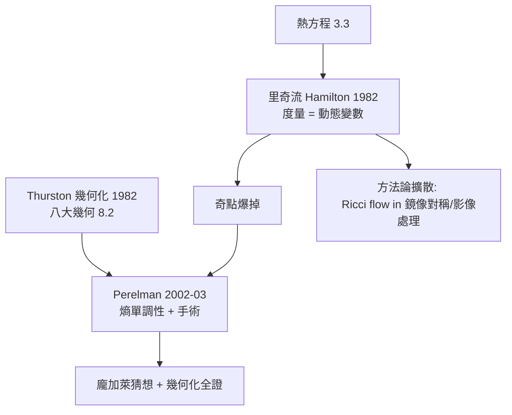

# 12.1 里奇流與熱方程：用微積分求解幾何拓撲問題——佩雷爾曼證明龐加萊猜想（2003）

## 前因：讓幾何「流」起來

Poincaré 猜想（1904，7.1）：單連通閉 3-流形必同胚於 $S^3$ 。百年之間，拓撲方法（Thurston 幾何化綱領, 1982）給出藍圖：每個閉 3-流形應可沿曲面分解成「八種幾何」的碎塊。**如何找到正確的幾何？**

Hamilton（1982）的靈感：把度量本身當作隨時間演化的變數，讓它滿足一個**熱方程型 PDE**：

$$\frac{\partial g}{\partial t} = -2\,\mathrm{Ric}(g)$$

**里奇流**。直觀：像熱擴散一樣，把曲率「抹平」，讓流形自己流向均勻幾何。

## 構造

**熱方程的類比**：熱方程 $\partial_t u = \Delta u$ 把溫度場平滑化（3.3）；里奇流把**度量**平滑化—— $\mathrm{Ric}$ 是「曲率的梯度下降」（12.2 的愛因斯坦–希爾伯特泛函的梯度流）。正如熱方程消滅溫度極值，里奇流消滅幾何不均。

**難題：奇點**。流會在某處爆掉（曲率 $\to \infty$ ）——但 Perelman（2002–03）的洞見：

1. **奇點分類**：爆掉處經適當縮放極限後是標準模型（球、柱、帽）——O. Huisken 等的單調量 + Perelman 的**熵** $W(g, f, \tau)$ 與**約化體積** $R(\tau)$ 單調性。
2. **手術（surgery）**：奇點處「剪掉頸部、補上球帽」，繼續流。
3. **終局**：若 $M$ 單連通且最終碎成 $S^3$ 與球帽，則 $M \cong S^3$ ；一般情形完成**Thurston 幾何化猜想**——3-流形全分類。

## 後果

1. **3-流形分類完成**——20 世紀拓撲學的最大夢想之一。
2. **幾何分析的標準化**：里奇流成為與極小曲面、調和映射並列的幾何 PDE 主力。
3. **跨域擴散**：Ricci flow 在鏡像對稱（12.2 的 RG-flow 類比）、電腦視覺（surface fairing）、網路幾何中出現。
4. **本書觀點**：這是「用微積分解拓撲」的世紀示範——**把靜態分類問題動態化**。拓撲問「形狀是什麼」，幾何 PDE 答「讓它自己流成標準形」。分析（熱方程）、幾何（曲率）、拓撲（分類）在同一方程中合流——與 11.2 指標定理遙相呼應。

## 練習與思考

1. 為什麼里奇流在一維（圓）上是平凡的、在二維（曲面）上收斂到常曲率、在三維才爆出奇點？
2. 「熵單調性」如何扮演「無法逆流的時間之箭」？（提示：熱方程不可逆。）
