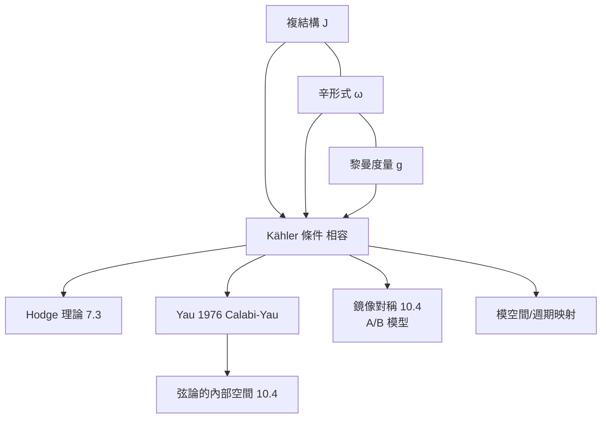

# 12.2 Kähler 流形與複幾何：分析、代數與古典幾何的三重交集

## 前因：三種結構必須相容嗎？

複流形（局部像 $\mathbb{C}^n$、全純變換）有：

- **複結構 $J$**：切空間上 $J^2 = -1$（代數/線性）；
- **辛形式 $\omega$**：閉非退化 2-形式（幾何/拓撲）；
- **黎曼度量 $g$**（分析/微積分）。

何時三者相容？答案是**Kähler 條件**（Kähler, 1933）：

$$g(X, Y) = \omega(X, JY), \qquad d\omega = 0, \qquad \nabla J = 0$$

三種結構互相決定、三套工具全部可用——這是本書「跨域」主題的幾何化身。

## 構造

**例**：複射影空間 $\mathbb{CP}^n$、環面 $(\mathbb{C}^*)^n$、以及最重要的 **Calabi–Yau 流形**：滿足 $\mathrm{Ric}(g) = 0$ 且 $c_1 = 0$ 的緊 Kähler 流形。

**Yau 定理（1976，Calabi 猜想）**：Kähler 類 $[\omega]$ 給定時，存在唯一 Ricci 平坦代表度量——**一個完全非線性 PDE（複 Monge–Ampère 方程）的存在唯一性定理**，以分析證幾何，是 12.1 里奇流思想的靜態先聲。Yau 由此獲 Fields 獎；Calabi–Yau 流形成為弦論的內部空間。

**Kähler 幾何的三重身分**：

| 工具 | 表現 |
|---|---|
| 分析 | $\bar\partial$ 算子、Hodge 理論、調和形式（7.3、11.2） |
| 代數 | 射影多樣體、線叢、Hodge 分解 $H^n_{\mathrm{dR}} \cong \bigoplus_{p+q=n} H^{p,q}$ |
| 拓撲 | Chern 類、Hodge 結構（6.3 的 étale 對應物） |

**Hodge 猜想**（Hodge 1950，千禧年問題之一）：代數閉鏈是否生成 $(p, p)$ 類？——Kähler 幾何直逼代數與拓撲的最深關係。

## 後果

1. **弦論的數學舞台**：額外六維 = Calabi–Yau 三重流形；其拓撲（Euler 數）決定粒子代數。
2. **鏡像對稱**（10.4）：Kähler 幾何與複幾何的對偶，產生枚舉幾何的物理預言。
3. **微分方程反哺幾何**：Yau 的 PDE 方法開創「幾何分析」學派（與 12.1 的里奇流同屬一脈）。
4. **本書觀點**：Kähler 流形是「分析 + 代數 + 幾何同時在場」的最純淨場域——三大柱石在這裡不是互相借用，而是**融為同一物件的三個側面**。

## 練習與思考

1. 對 $\mathbb{CP}^1$ 驗證 Fubini–Study 度量是 Kähler 的（$d\omega = 0$）。
2. 為什麼 Kähler 條件讓 Hodge 分解成立？聯想 7.3 的調和形式。
