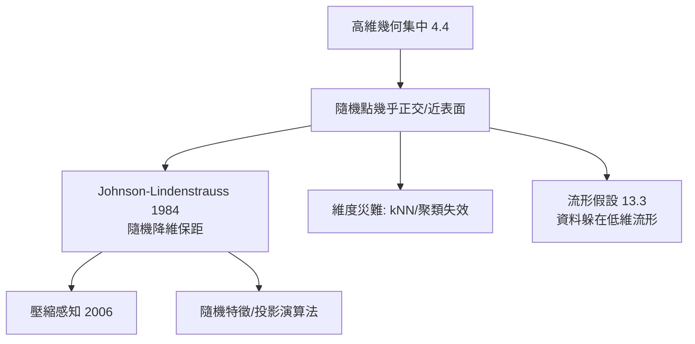

# 13.1 高維機率與幾何：高維球面的非直觀性質與數據降維

## 前因：直觀在高維失效

我們的三維直觀在高維全面失靈（4.4 的幾何集中），而現代資料恰恰是高維的（一張圖片 = 上萬維向量）。理解高維幾何因此成為資料科學的理論地基。

## 構造：反直觀清單與其數學

1. **體積移向表面**：內切球 $r<1-\epsilon$ 佔 $B^n$ 體積 $\to 0$。數據含義：隨機點幾乎都是「離群值」。
2. **赤道集中**：$|x_1| \le c/\sqrt n$ 以高機率成立——座標值都比直觀小。
3. **夾角集中於 $90°$**：任意兩向量幾乎正交。
4. **體積權重移向「腰」**：高維球的體積集中在 $r \approx \sqrt{2/3}$ 的環帶（非最外殼！），高維橘子幾乎全是皮。

**數學工具**：集中不等式（4.4）、Levy 引理（Lipschitz 函數在球面上集中於均值）。

**降維定理（Johnson–Lindenstrauss, 1984）**：$n$ 點集可隨機投影到

$$k = O(\epsilon^{-2}\log n)$$

維，而所有兩兩距離保持在 $(1\pm\epsilon)$——**距離結構可以用指數少的維度保存**。證明正是「隨機投影的集中」。

## 後果

1. **演算法層**：隨機投影（Random Projection）、LSH、隨機傅立葉特徵。
2. **理論層**：壓縮感知（Candès–Romberg–Tao, 2006）：稀疏訊號以 $O(k\log N)$ 個隨機測量完美重建——高維幾何 + 凸優化（5.4 的對偶）。
3. **統計層**：為什麼高維回歸容易過擬合、為什麼需要正則化——幾何直觀給出原因。
4. **本書觀點**：機率（4.4）與幾何（2.3）在「高維」交匯，直接供電給資料科學（13.2、13.3）——四大柱石中最年輕的大規模應用。

## 練習與思考

1. 蒙地卡羅驗證 $B^{10}$ 的體積集中在薄殼。
2. 用 JL 引理估計：一萬筆資料壓到多少維仍保 90% 距離精度？
